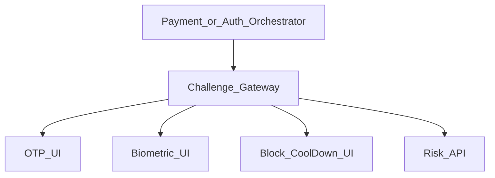
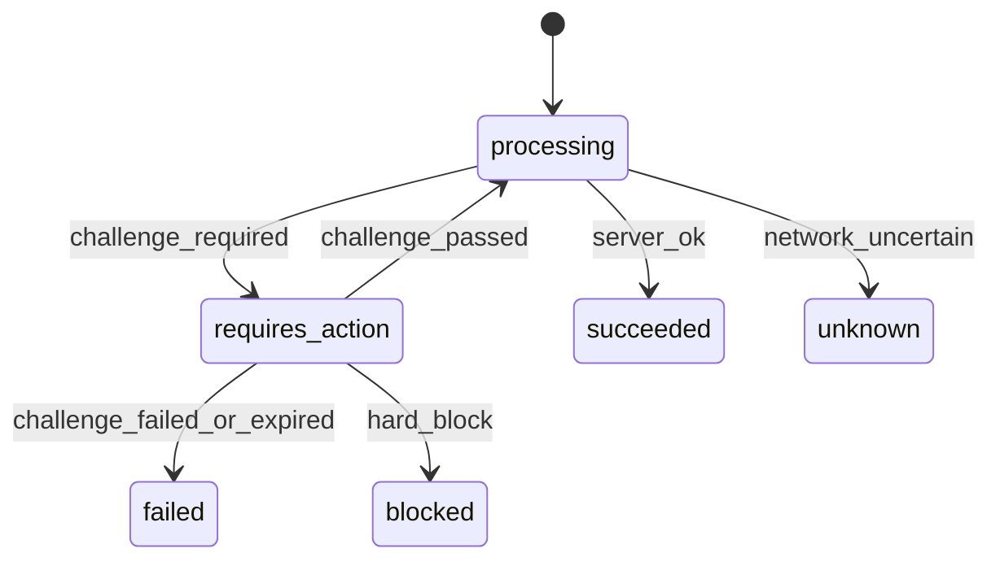

# 31 — Model Solution: Fraud Challenge / Step-up

## Timed outline (45–60 min)

| Min | Focus |
|-----|--------|
| 0–6 | MVP: challenge types mid-pay / login |
| 6–18 | Risk-driven UI; payment stays requires_action |
| 18–40 | OTP, biometric, cool-down, hard block flows |
| 40–55 | Bypass resistance, metrics, privacy |

## Clarify and scope

**Prompt:** “Design mobile step-up / fraud challenge UX for payments.”

**MVP:** when server returns `challenge_required`, present the right challenge; on pass continue payment/login; on fail/block show safe messaging; never locally bypass.

**Defer:** training the risk model, rule engine authoring UI, call-center override tools (mention opaque `challengeId`).

## NFRs

- Challenges are **server-authorized**; client is a renderer
- Payment remains non-terminal until server clears challenge
- No OTP/PIN in logs or crash reports
- Soft vs hard outcomes explicit in UX
- Works after process death (resume by `paymentId`/`challengeId`)

## Architecture



## Data model

```text
Challenge:
  challengeId, paymentId?, sessionId?,
  type (otp_sms|otp_email|otp_totp|biometric|pin|cool_down|block|device_bind),
  status (pending|passed|failed|expired|blocked),
  expiresAt, attemptsRemaining?,
  displayCopy?, allowAlternateRails?

PaymentAttempt.status includes requires_action while challenge pending
```

## When challenges appear

| Trigger | Example |
|---------|---------|
| Pay create | High amount, new device, new beneficiary |
| Login / bind | Impossible travel, emulator signals |
| Mid-rail | Issuer/PSP soft decline → step-up |
| Settings | Change VPA, add card, raise limits |

Client may send soft signals (device integrity, velocity hints) on create—**server decides** challenge.

## Flow



1. API returns `requires_action` + `challenge` payload.
2. Persist attempt + challenge ids locally.
3. Present UI for `type`.
4. Submit proof to `POST /challenges/{id}/verify` (or PSP path).
5. On pass, resume payment confirm/poll—**do not** mark paid locally.
6. On kill: cold start → load pending requires_action → re-fetch challenge state.

## Challenge types (client duties)

| Type | Client | Notes |
|------|--------|-------|
| OTP | Input + resend cooldown | Mask destination; rate-limit UI |
| Biometric | Local prompt then server verify session step-up token | Biometric ≠ payment truth |
| App PIN | Secure field; FLAG_SECURE | |
| Cool-down | Timer UI; cannot skip | Show reason at high level |
| Block | Terminal messaging + support | No pay button |
| Device bind | Deep link into Ch 28 | |

### Soft vs hard

- **Soft:** allow lower-risk rail (e.g., block wallet P2P but allow bill pay) if `allowAlternateRails`.
- **Hard:** stop money movement; only support path.

## Bypass resistance

| Anti-pattern | Fix |
|--------------|-----|
| Client skips if `isDebug` | Server ignores client flags for decision |
| Cache “already challenged today” | Server session/payment scoped |
| Deep link `challenge=passed` | Ignore; only API verify |
| Brute force OTP UI | Honor attemptsRemaining; lock UI |

## Failures

| Case | Behavior |
|------|----------|
| OTP expired | New challenge or resend; payment still pending |
| Biometric lockout | Fallback PIN/OTP if server allows |
| Network during verify | `unknown`; poll challenge + payment |
| User cancels | failed/cancelled; release UI lock |
| Push “approve login” | Approve is hint → verify API |

## Security & privacy

- Never log OTP codes, PINs, full challenge secrets.
- Accessibility: don’t speak OTP aloud in insecure contexts.
- Screenshot block on OTP/PIN.
- Fraud copy: avoid teaching attackers (“we blocked because emulator”).

## Android UI: Views (XML) and Compose

The challenge UI is mostly OTP, PIN and timers. Basis: [Ch 4 — Android UI toolkits](../part-2-building-blocks/04-client-architecture.md#android-ui-toolkits-views-xml-and-compose).

| Concern | Views (XML) | Compose |
|---------|-------------|---------|
| OTP boxes | One hidden `EditText` + drawn boxes, or N single-char `EditText`s with focus juggling (paste/backspace bugs) | One `BasicTextField` whose `decorationBox` draws N boxes |
| OTP autofill | `autofillHints="smsOTPCode"`; SMS Retriever / User Consent API fills the field | Same Play-services APIs feed ViewModel state; field just shows it |
| App PIN | `numberPassword` field + `FLAG_SECURE` | `KeyboardType.NumberPassword` + `PasswordVisualTransformation`; same window flag |
| Resend cooldown | `CountDownTimer` → text; cancel in `onDestroyView` | Remaining time from ViewModel (based on server `retryAfter`), not `LaunchedEffect` restarting on rotation |
| Biometric | `BiometricPrompt(fragment, …)` | Same API — needs a `FragmentActivity` host even in Compose |
| Announce result | `announceForAccessibility` / live region | `semantics { liveRegion = LiveRegionMode.Polite }` |

```kotlin
// One text field, drawn as N boxes: paste / autofill / SMS fill land in one place
@Composable
fun OtpField(code: String, length: Int = 6, onChange: (String) -> Unit) = BasicTextField(
    value = code,
    onValueChange = { v -> if (v.length <= length && v.all(Char::isDigit)) onChange(v) },
    keyboardOptions = KeyboardOptions(keyboardType = KeyboardType.NumberPassword),
    decorationBox = {
        Row(horizontalArrangement = Arrangement.spacedBy(8.dp)) {
            repeat(length) { i ->
                Box(Modifier.size(40.dp).border(1.dp, MaterialTheme.colorScheme.outline), Alignment.Center) {
                    Text(code.getOrNull(i)?.toString() ?: "")
                }
            }
        }
    },
)
```

The View equivalent is the same idea: a single `EditText` (or custom View with `onCreateInputConnection`) drawing boxes — not six `EditText`s.

**Mixed codebase:** the challenge is often launched from an older View checkout; host the Compose OTP screen in a `ComposeView` and keep `BiometricPrompt` on the `FragmentActivity` both share.

## Trade-offs

| Decision | Alternative | Why |
|----------|-------------|-----|
| Server-driven challenge type | Client picks MFA | Consistent risk policy |
| Payment stays requires_action | Parallel “provisional paid” | Money safety |
| Soft alternate rails | Always hard block | Conversion without silent risk accept |

## Metrics

challenge_issued by type, pass_rate, time_to_pass p95, cancel_rate, verify_unknown, bypass_attempt_signals, payment_terminal_after_challenge.

## Staff stretch

- Step-up orchestration across login + pay (same `riskSessionId`)
- Progressive trust after bind cool-off (Ch 37)
- Issuer ACS / 3DS as a challenge subtype via Ch 21
- Kill switch: force step-up globally via remote config

## Follow-ups

- Passkeys as challenge type ([Ch 42](42-passkeys-webauthn.md))
- Customer attestations for dispute (Ch 38)
- Agent assist: one-time unlock token

## See also

- [Ch 21](21-checkout-payment-sdk.md) · [Ch 28](28-secure-auth-device-binding.md) · [Ch 37 Cool-off](37-beneficiary-cool-off.md) · [Ch 23 Wallet](23-wallet-transfer.md)
