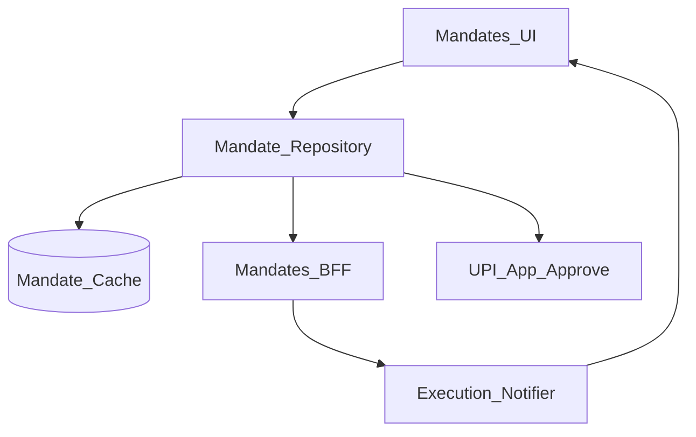
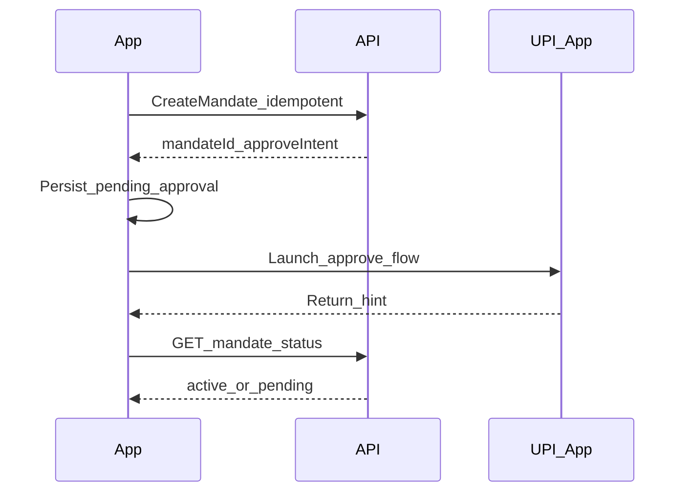

# 32 — Model Solution: UPI Autopay / Mandates

## Timed outline (45–60 min)

| Min | Focus |
|-----|--------|
| 0–6 | MVP: create mandate, pause, revoke, pre-debit |
| 6–18 | Consent UX; amount rules; issuer handoff |
| 18–40 | Execution day debit; failures; notifications |
| 40–55 | Modify mandate, security, metrics |

## Clarify and scope

**Prompt:** “Design UPI Autopay / e-mandate on mobile (subscriptions, rent, SIPs).”

**MVP:** create mandate (payee, max amount, frequency, start/end); user approves in UPI app; list active mandates; pause/revoke; show upcoming debit; handle execution success/fail.

**Defer:** NPCI mandate protocol deep dive, sponsor bank ops—client talks to BFF/PSP.

## NFRs

- Explicit consent; no hidden recurring charge UX
- Pre-debit visibility where required
- Execution is server/PSP-initiated; app reconciles
- Revoke must be durable and reflected offline-safe

## Architecture



## Data model

```text
Mandate:
  mandateId, payeeName, payeeVpaOrId,
  maxAmountMinor, amountRule (fixed|max),
  frequency (asPresentedByServer),
  status (draft|pending_approval|active|paused|revoked|expired|failed),
  nextDebitAt?, lastExecutionId?,
  clientMutationId?

MandateExecution:
  executionId, mandateId, amountMinor,
  status (scheduled|processing|succeeded|failed|unknown),
  utr?, scheduledFor
```

## Create + approve



- Prefer **server-built** approve intent/payload.
- Treat UPI return as hint; poll until `active|failed|expired`.
- Amount confirmation UI must show **max/fixed** clearly before launch.

## Lifecycle UX

| Action | Client |
|--------|--------|
| List | Server list + cache; badge pending approval |
| Pause/Resume | Idempotent API; optimistic UI OK if reconciled |
| Revoke | Confirm dialog; pending until server ack |
| Modify amount/frequency | Often new mandate or amend API—say product rule aloud |

## Execution day

1. Push / local notification: “Debit of ₹X to Payee on date” (pre-debit).
2. Deep link opens mandate detail + last execution status (fetch fresh).
3. Actual debit happens on rails **without** requiring app open.
4. App on foreground: refresh executions; merge into history (Ch 24).
5. Failure: show reason code + retry policy (issuer decline vs tech fail).

**Never** invent execution success from notification body alone.

## Offline

- View cached mandates OK.
- Create/approve requires connectivity (+ UPI app).
- Revoke: queue intent with clear “revoke requested” until ack.

## Failures

| Case | Behavior |
|------|----------|
| Kill mid-approve | Resume pending_approval → poll |
| Approve success hint / API pending | Keep pending |
| Insufficient balance on exec | failed execution; mandate may stay active |
| Payee revoked sponsor-side | status revoked on sync |
| Duplicate create | Same clientMutationId |

## Security & privacy

- Mandates list is sensitive financial relationship data.
- Step-up to create/revoke high-value mandates (Ch 31/28).
- FLAG_SECURE on approve summary if amounts shown with full VPA policy.

## Trade-offs

| Decision | Alternative | Why |
|----------|-------------|-----|
| Server-driven schedule copy | Client computes RRULE | Avoid timezone bugs |
| Pre-debit notification | Silent debit only | Trust + regulation shaped UX |
| Poll after approve | Trust intent extras | Money/mandate safety |

## Metrics

mandate_create → approved; time_to_active; revoke_success; execution_success_rate; predebit_open_rate; approve_abandon.

## Staff stretch

- Partial amount debit under max
- Shared family mandates / multi-approver (mention complexity)
- SIP top-up when execution fails (product)
- Kill switch pause-all via remote config

## Follow-ups

- Card mandates / subscriptions (tie Ch 29)
- UPI Lite interaction (Ch 33)
- Dispute failed Autopay (Ch 38)

## See also

- [Ch 22 UPI](22-upi-intent-collect.md) · [Ch 30 Bill pay](30-bill-pay.md) · [Ch 24 History](24-txn-history-pending-recovery.md)
