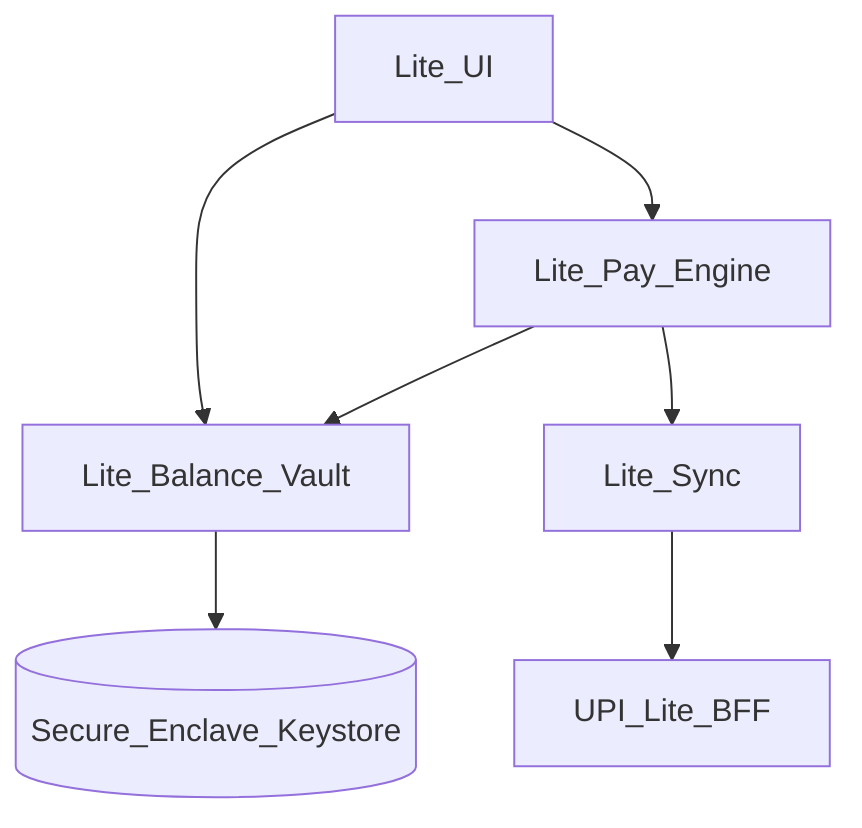
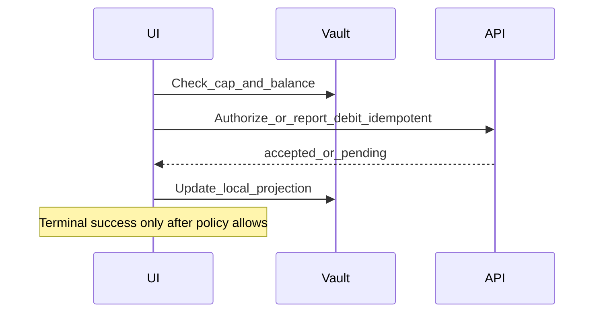

# 33 — Model Solution: UPI Lite / Low-value Offline-ish Balance

## Timed outline (45–60 min)

| Min | Focus |
|-----|--------|
| 0–6 | MVP: Lite onboarding, balance, pay, top-up |
| 6–18 | Device-bound balance; sync authority |
| 18–40 | Offline pay limits; conflict; disable Lite |
| 40–55 | Security, failures, metrics |

## Clarify and scope

**Prompt:** “Design UPI Lite (or similar low-value on-device balance) for mobile.”

**MVP:** enable Lite (device-bound); show Lite balance; pay small amounts with fewer round-trips; top-up / unwind to main UPI; disable Lite on logout/revoke.

**Defer:** exact NPCI Lite protocol bytes—model **contracts** and client safety.

**Interview framing:** Lite is **not** “free offline money.” It is a constrained, device-bound balance with strict caps and reconciliation.

## NFRs

- Hard caps (per-txn / total) enforced server-side; client mirrors for UX
- Device bind required; transfer Lite across phones = unwind + re-enable
- Offline/poor-network pay only within policy window
- Main ledger remains ultimate truth after sync

## Architecture



## Data model

```text
LiteProfile:
  enabled, deviceBindingId, caps (maxBalance, maxTxn),
  status (active|suspended|pending_sync|disabled)

LiteBalance:
  amountMinor, asOfLocal, serverGeneration?,
  pendingDebits[] // local intents not yet acked

LiteTxn:
  localId, liteTxnId?, amountMinor, payeeHint?,
  status (created|device_authorized|syncing|succeeded|failed|unknown),
  clientMutationId
```

Store balance material only in **hardware-backed** storage when available.

## Enable / top-up / unwind

1. Step-up + device bind (Ch 28/31).
2. `POST /lite/enable` → provision device keys / tokens (server).
3. Top-up: debit main UPI/wallet → credit Lite (server confirms before UX “Lite balance updated”).
4. Unwind: move Lite back to main; disable local vault.

## Pay flow (online-ish)



Say aloud: product may allow **device-authorized** spend with later sync—but UI must show `pending/syncing` until server generation catches up if policy says so. Prefer honesty over fake “Paid.”

## Offline / airplane constraints

| Policy knobs | Client behavior |
|--------------|-----------------|
| Max offline spend | Block when exceeded |
| Max offline count | Block |
| Max offline age | Force sync before further pay |
| Payee restrictions | Often limited set / QR only |

If sync overdue: freeze Lite pays; prompt connectivity.

## Sync & conflicts

- Server `generation` / version monotonic; client rejects older snapshots.
- Pending local debits replayed idempotently.
- Conflict (server balance lower): freeze + force unwind/support path—never invent funds.

## Disable / device change

- New phone: Lite on old device must be unwound/disabled remotely.
- Root/jailbreak soft signal → suspend Lite (high risk for on-device value).
- Logout → disable local vault.

## Failures

| Case | Behavior |
|------|----------|
| Kill mid-pay | Persist intent; on launch sync before showing success |
| Sync lag | Show pending; history unknown row (Ch 24) |
| Cap hit | Block with clear CTA to main UPI |
| Dual-device attempt | Server rejects; UX explain single-device |

## Security

- Hardware-backed keys; no Lite secrets in prefs plaintext.
- FLAG_SECURE on Lite pay confirm.
- Attestation soft gate for enable/top-up.
- Analytics never include raw balance + device ids together carelessly.

## Trade-offs

| Decision | Alternative | Why |
|----------|-------------|-----|
| Strict sync-before-success | Always optimistic Lite paid | Fewer support disputes |
| Single-device Lite | Multi-device shared | Security model simpler |
| Small caps | Large offline wallet | Risk containment |

## Metrics

lite_enable_rate, topup_success, pay_sync_pending_age p95, offline_block_rate, suspend_rate, unwind_success.

## Staff stretch

- Interaction with Autopay (usually main rail, not Lite)
- Merchant acceptance flags for Lite
- Migration when OS keystore invalidated after biometric change

## Follow-ups

- SoftPOS low-value offline (Ch 34) contrast
- Fraud velocity across Lite + main (Ch 31)

## See also

- [Ch 22](22-upi-intent-collect.md) · [Ch 23](23-wallet-transfer.md) · [Ch 28](28-secure-auth-device-binding.md) · [Ch 24](24-txn-history-pending-recovery.md)
