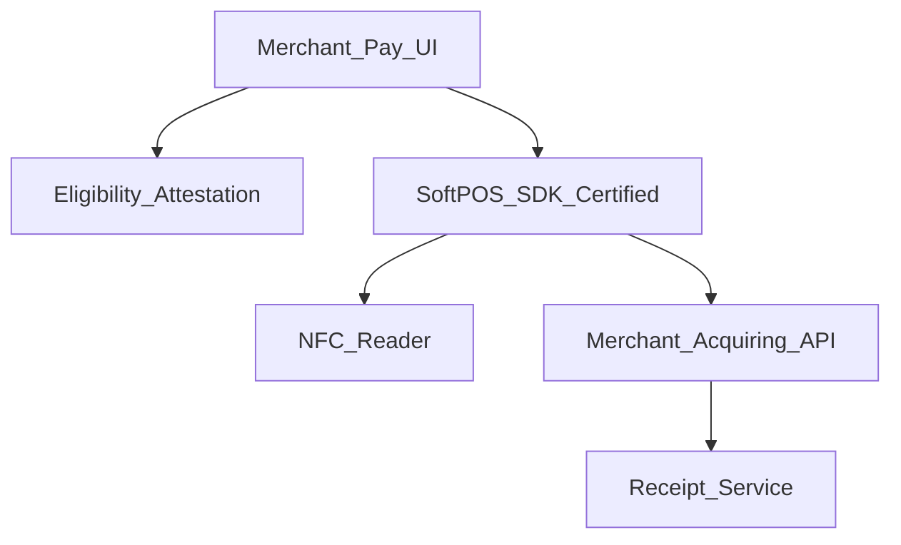
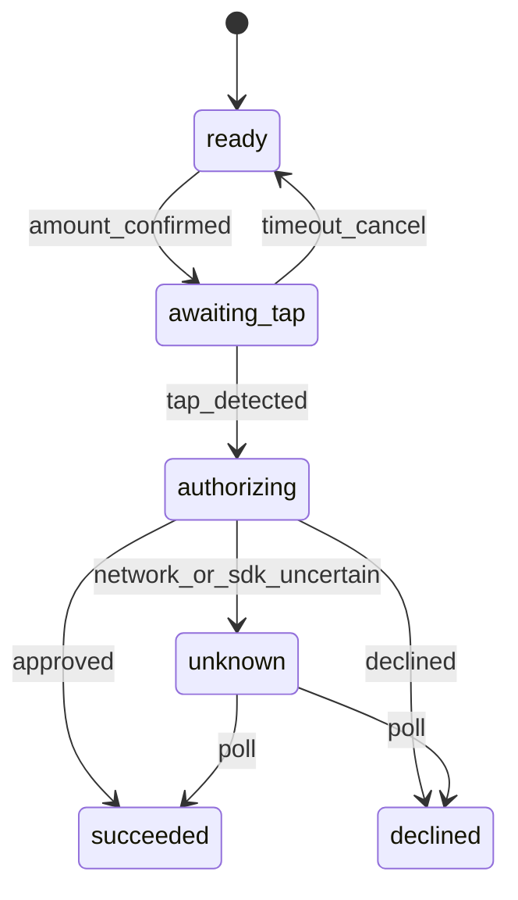

# 34 — Model Solution: SoftPOS / Tap-to-Phone

## Timed outline (45–60 min)

| Min | Focus |
|-----|--------|
| 0–6 | Merchant MVP: amount → tap → result |
| 6–18 | Device eligibility; NFC; PCI/software PIN |
| 18–40 | Txn state machine; receipts; offline store-forward limits |
| 40–55 | Failures, attestation, metrics |

## Clarify and scope

**Prompt:** “Design tap-to-phone / SoftPOS for a merchant Android app.”

**MVP:** eligible device accepts contactless card/phone tap for a keyed amount; show approved/declined/pending; digital receipt; tip optional; refund initiate (server).

**Defer:** Scheme certification project plan, kernel vendor bake-off—mention **certified SDK** boundary.

**Platform:** SoftPOS is primarily **Android NFC** today; say iOS constraints aloud (limited / partner-specific).

## NFRs

- Only attestation-passing devices
- Amount confirmation before tap
- No PAN stored by merchant app
- Clear pending when auth unknown
- Battery/NFC UX (screen on, orientation)

## Architecture



## Data model

```text
MerchantSession: merchantId, terminalId, location?, staffId?
Payment:
  localId, paymentId?, amountMinor, tipMinor?, currency,
  status (ready|awaiting_tap|authorizing|succeeded|declined|unknown|reversed),
  clientMutationId, schemeMask?, rrn?
```

## Eligibility

1. On launch / before pay: check OS version, NFC, Play integrity / attestation, SoftPOS SDK enabled flag.
2. Fail closed with upgrade path if ineligible.
3. Remote config kill switch for SoftPOS rail.

## Transaction flow



1. Merchant enters amount (minor units) + optional tip → confirm.
2. Prompt “Tap card / phone”; keep screen awake.
3. Certified SDK handles contactless + cryptogram; app gets opaque result / paymentId.
4. App persists attempt; verifies with acquiring API if needed.
5. Show large approved/declined UI; receipt share (SMS/QR/print).

**PIN on glass:** if required, use certified PIN UI path; FLAG_SECURE; never roll your own PIN keypad for scheme data.

## Offline / store-and-forward

- Only if acquiring policy allows; hard caps on amount/count/age.
- UI: “Stored—will submit when online”; not “Paid” unless policy explicitly uses deferred auth language.
- On sync fail: unknown + support path.

## Refunds / voids

- Initiate via `paymentId`; staff step-up.
- Client does not “reverse locally” without API.

## Failures

| Case | Behavior |
|------|----------|
| Tap timeout | Return ready; no charge |
| Double tap | SDK/single-flight; same idempotency |
| NFC busy / airplane | Block with CTA |
| Kill mid-authorize | Resume → poll paymentId |
| Attestation flips mid-day | Disable SoftPOS; fall back to QR (Ch 27) |

## Security

- Attestation continuous or periodic re-check.
- No card data in app logs; SDK boundary.
- Staff auth for high-value / refund.
- Device binding of terminalId to merchant.
- Physical: encourage merchant not to leave unlocked phone unattended (product copy).

## Trade-offs

| Decision | Alternative | Why |
|----------|-------------|-----|
| Certified SDK | Build contactless kernel | Compliance reality |
| Fail closed on attestation | Warn only | Fraud / scheme rules |
| QR fallback | SoftPOS only | Conversion when NFC fails |

## Metrics

eligibility_pass_rate, tap_timeout_rate, auth_latency p95, unknown_rate, refund_rate, attestation_fail, battery_cancel_rate.

## Staff stretch

- Multi-mid / multi-store terminal profiles
- Tip adjust after auth (where allowed)
- Accessibility for visually impaired merchants
- Chargeback evidence packaging (Ch 38)

## Follow-ups

- Tap to pay on iPhone partner path
- SoftPOS + inventory SKU line items

## See also

- [Ch 27 QR](27-qr-payments.md) · [Ch 21](21-checkout-payment-sdk.md) · [Ch 31](31-fraud-challenge-step-up.md) · [Ch 28](28-secure-auth-device-binding.md)
