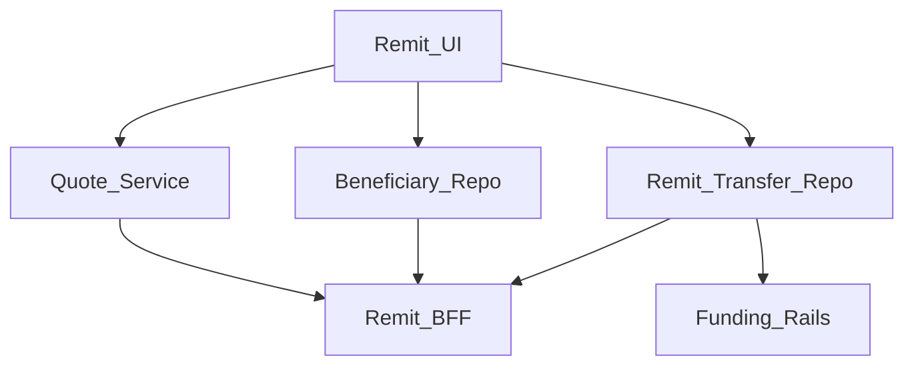
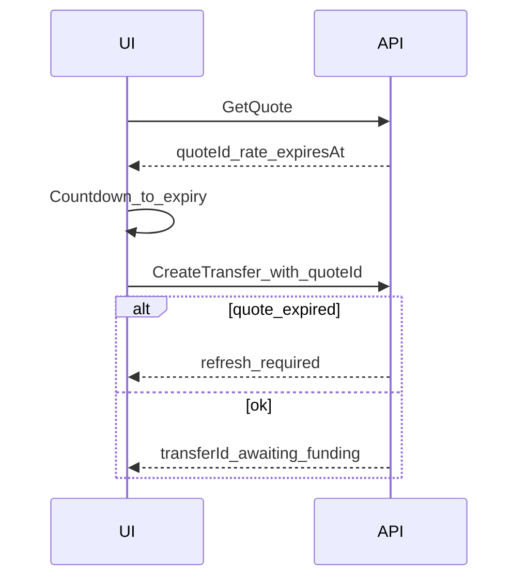

# 35 — Model Solution: Cross-border Remittance

## Timed outline (45–60 min)

| Min | Focus |
|-----|--------|
| 0–6 | MVP: quote → beneficiary → pay → track |
| 6–18 | FX quote lock; compliance gates |
| 18–40 | Funding rail; status tracking; receipts |
| 40–55 | Failures, cool-off, metrics |

## Clarify and scope

**Prompt:** “Design a mobile remittance / cross-border transfer flow.”

**MVP:** select corridor (from/to currency/country); get FX quote; add/select beneficiary; fund via local rail (UPI/card/bank); track transfer states to payout; receipts.

**Defer:** treasury hedging, partner bank integrations internals—BFF abstracts partners.

## NFRs

- Quote lock TTL honesty (rate can move)
- Compliance holds visible (`compliance_review`)
- Idempotent create; pending tracking first-class
- Beneficiary changes may trigger cool-off (Ch 37)
- Amounts: source + destination minor units + FX rate + fees broken out

## Architecture



## Data model

```text
FxQuote:
  quoteId, sourceCurrency, targetCurrency, rate,
  sourceAmountMinor, targetAmountMinor, feeMinor[],
  expiresAt

Beneficiary:
  id, country, method (bank|wallet|cash_pickup),
  fields{}, status (active|cool_off|blocked), createdAt

RemitTransfer:
  localId, transferId?, quoteId, beneficiaryId,
  status (quoted|funded|processing|compliance_hold|
          payout_pending|succeeded|failed|refunded|unknown),
  clientMutationId, trackingRef?
```

## Quote lock UX



- Show rate, fees, **you pay** vs **they receive** clearly.
- On expiry: force refresh; never silently reprice after confirm.
- Optional “rate changed” modal if requote differs beyond epsilon.

## Funding + tracking

1. Create transfer with `quoteId` + idempotency key.
2. Fund via Ch 21/22/23; link `fundingPaymentId`.
3. States progress via poll + push wakeups.
4. Timeline UI: Funded → Processing → Payout → Delivered.
5. Compliance hold: explain “under review” + docs upload if required (reuse Ch 26 patterns lightly).

**Truth:** transfer status from Remit API, not funding rail alone (funding success ≠ payout success).

## Offline

- Browse corridors/beneficiaries cached OK.
- Quote + create + fund require network.
- Tracking: show last known status + “updated at.”

## Failures

| Case | Behavior |
|------|----------|
| Quote expired at pay | Requote + reconfirm |
| Funding unknown | Ch 24 poller; transfer stays non-terminal |
| Partner payout delay | payout_pending with ETA if any |
| Failed payout | refunded/failed; show path of funds |
| Kill mid-fund | resume funding verification first |

## Security & compliance UX

- Sanction/PEP messaging high-level; don’t overshare rules.
- Step-up for new corridor / high amount / new beneficiary.
- Cool-off for new beneficiaries (Ch 37).
- Mask account numbers; FLAG_SECURE on confirm.

## Trade-offs

| Decision | Alternative | Why |
|----------|-------------|-----|
| quoteId binding | Client sends free rate | Prevents rate disputes |
| Separate funding vs payout states | Single “Paid” | Matches cross-border reality |
| Push + poll tracking | Email only | Mobile expectations |

## Metrics

quote_to_create, quote_expiry_rate, funding_success, time_to_payout p50/p95, compliance_hold_rate, requote_accept_rate.

## Staff stretch

- Multi-currency wallet source
- Cash pickup code display security
- Corridor kill switch
- Fee transparency / regulatory disclosure layouts

## Follow-ups

- BNPL funding (Ch 36) unlikely; card funding 3DS
- Dispute / trace (Ch 38)

## See also

- [Ch 21](21-checkout-payment-sdk.md) · [Ch 23](23-wallet-transfer.md) · [Ch 37](37-beneficiary-cool-off.md) · [Ch 26](26-kyc-onboarding.md)
