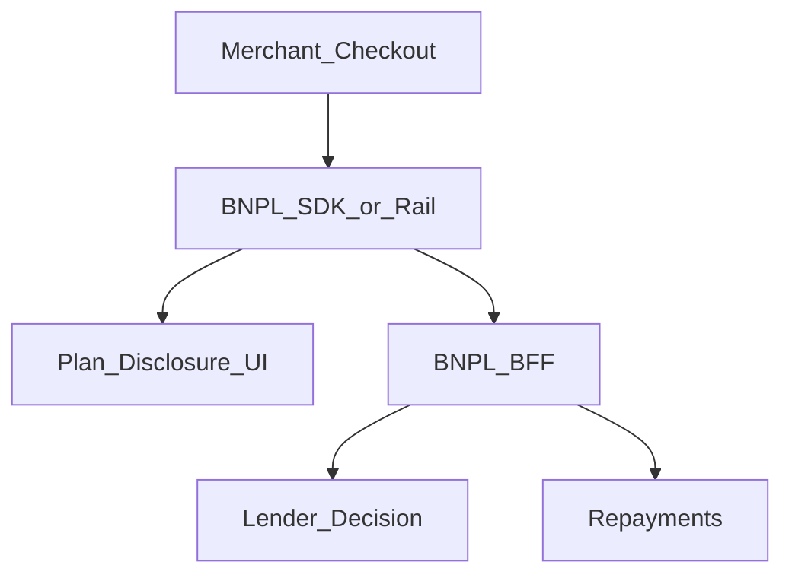
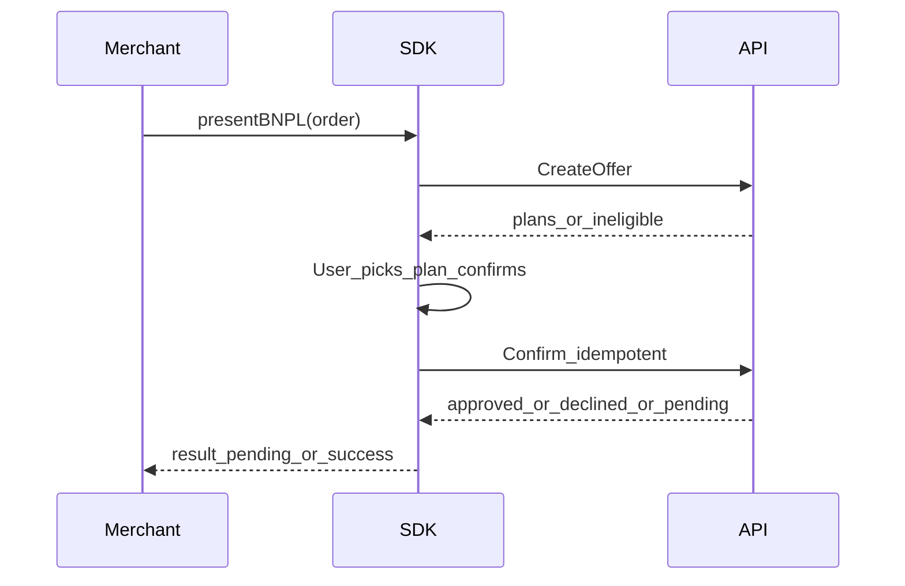

# 36 — Model Solution: BNPL at Checkout

## Timed outline (45–60 min)

| Min | Focus |
|-----|--------|
| 0–6 | MVP: offer → eligibility → schedule → confirm |
| 6–18 | Merchant SDK vs lender; credit decision UX |
| 18–40 | Capture/order link; repayments; delinquencies |
| 40–55 | Privacy, failures, metrics |

## Clarify and scope

**Prompt:** “Design BNPL (buy now pay later) as a checkout rail in a merchant app/SDK.”

**MVP:** show BNPL option; run eligibility (soft); present installment plan; user confirms; create loan/order; merchant gets paid signal from lender/PSP; user sees repayment schedule.

**Defer:** underwriting model, collections agency workflows—client shows states from API.

## NFRs

- Clear APR/fee/installment disclosures before confirm
- Credit decision is server-side; client doesn’t “approve”
- Idempotent checkout; pending while decisioning
- Privacy: don’t leak credit decline reasons in analytics

## Architecture



## Data model

```text
BnplOffer:
  offerId, merchantOrderId, amountMinor,
  plans[] // n installments, fee, aprDisclosureRef,
  expiresAt, eligibility (unknown|eligible|ineligible)

BnplCheckout:
  localId, checkoutId?, offerId, planId,
  status (offered|decisioning|approved|declined|
          captured|cancelled|unknown),
  clientMutationId

Repayment:
  id, dueAt, amountMinor, status (upcoming|paid|overdue|failed)
```

## Flow



Rules:

1. Disclosure screen mandatory (schedule, fees, late fee summary).
2. Confirm → `decisioning`; spinner with “Checking eligibility.”
3. `approved` still may need identity step-up (Ch 26/31) before capture.
4. Merchant host gets `pending` until lender capture confirmed—**not** optimistic order success from UI click.
5. Decline: neutral copy + other rails; avoid shaming.

## Repayments (borrower app)

- Schedule list from server; pay installment via Ch 21/22.
- Autopay mandate optional (Ch 32).
- Overdue: banners + deep link; do not silently re-attempt forever without policy.

## Offline

- Cannot complete BNPL decisioning offline.
- Cached schedule view OK with “as of.”

## Failures

| Case | Behavior |
|------|----------|
| Kill mid-decisioning | Resume by orderId/offerId; poll status |
| Offer expired | New offer; re-disclose |
| Approved then capture fail | unknown/failed; merchant reconciles via server |
| Double confirm | Idempotency key |
| Repayment fails | retry + alternate rail |

## Security & privacy

- Minimize PII in merchant process; prefer lender hosted KYC/step-up.
- Decline reason codes mapped to generic UX.
- FLAG_SECURE on disclosure confirm if regulated copy requires.
- Device bind for borrower app repayments.

## Trade-offs

| Decision | Alternative | Why |
|----------|-------------|-----|
| Lender-hosted decision UX | Fully white-label forms | Compliance + PCI/KYC isolation |
| pending to merchant | Instant order confirm | Matches credit reality |
| Explicit plan pick | Default plan buried | Disclosure quality |

## Metrics

offer_view → plan_select → confirm → approved/declined; decision_latency; capture_success; repayment_on_time; abandon_on_disclosure.

## Staff stretch

- Split tender (BNPL + card)
- Merchant refunds → loan adjust states
- Multi-lender waterfall (show one UI)
- Accessibility for disclosure documents

## Follow-ups

- Statements (Ch 25 #12 patterns)
- Hardship / payment holiday UX
- Fraud synthetic identity (Ch 31)

## See also

- [Ch 21](21-checkout-payment-sdk.md) · [Ch 29](29-saved-cards-tokenization.md) · [Ch 32](32-upi-autopay-mandates.md) · [Ch 31](31-fraud-challenge-step-up.md)
