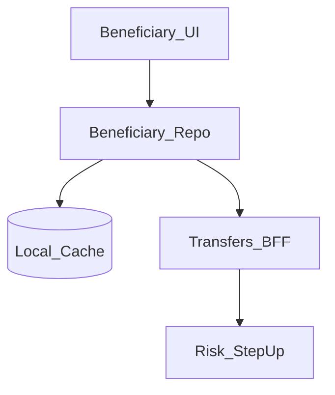
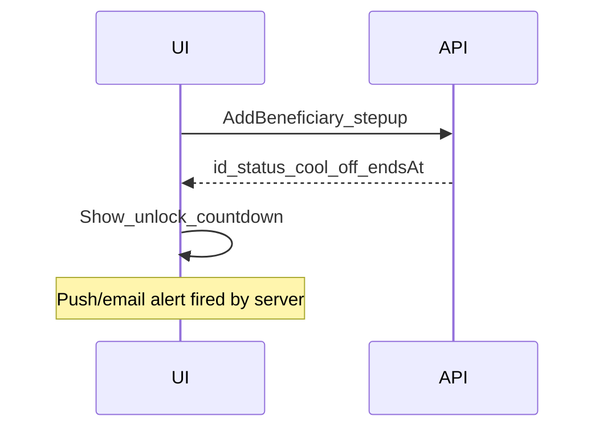

# 37 — Model Solution: Beneficiary Cool-off

## Timed outline (45–60 min)

| Min | Focus |
|-----|--------|
| 0–6 | MVP: add beneficiary → cool-off → transfer |
| 6–18 | Why cool-off; states; notifications |
| 18–40 | Early pay limits; edit/delete; device change |
| 40–55 | Bypass resistance, failures, metrics |

## Clarify and scope

**Prompt:** “Design beneficiary management with cool-off for bank/wallet transfers.”

**MVP:** add beneficiary (account/IFSC/VPA/wallet handle); cool-off period before full-limit transfers; optional low-value allowance during cool-off; notify user; remove/edit rules; list with status badges.

**Defer:** core banking beneficiary registration protocols—BFF contracts only.

## NFRs

- Cool-off clock is **server time**
- Client cannot skip via local clock or airplane mode tricks
- Clear UX for “transfers unlock at …”
- Step-up to add/edit high-risk beneficiaries
- Alerts on add (email/push) for account-takeover detection

## Architecture



## Data model

```text
Beneficiary:
  id, displayName, type (bank|vpa|wallet),
  maskedAccountOrHandle, ifscOrRailsMeta?,
  status (pending_verification|cool_off|active|blocked|deleted),
  coolOffEndsAt?, lowValueLimitMinor?,
  createdAt, lastUsedAt?

TransferAttempt checks beneficiary.status before create
```

## Add flow



1. Step-up (OTP/biometric) before add (Ch 31/28).
2. Validate fields client-side lightly; server authoritative.
3. Persist `cool_off` + `coolOffEndsAt` from server.
4. Home banner: new beneficiary cooling down.

## Transfer gating

| Beneficiary state | Transfer UX |
|-------------------|-------------|
| cool_off | Block full amount OR allow ≤ lowValueLimitMinor with extra confirm |
| active | Normal transfer (Ch 23) |
| blocked | No transfer; support CTA |
| pending_verification | Wait |

On create transfer API, server re-checks; client pre-check is UX only.

## Edit / delete

- Edit account numbers often = **new** beneficiary + new cool-off (say product rule).
- Nickname edit may skip cool-off.
- Delete: confirm; in-flight transfers unaffected; cannot pay deleted id.

## Device / takeover signals

- New device login → existing beneficiaries may re-enter partial cool-off (policy).
- Alert on add must not be only in-app (out-of-band push/email).
- Attacker with phone but not email still faces delay.

## Bypass resistance

| Attack | Defense |
|--------|---------|
| Set device clock forward | Server `coolOffEndsAt` |
| Airplane until “done” | Status from API on sync |
| Deep link `activate=true` | Ignored |
| Local DB patch active | API rejects transfer |

## Failures

| Case | Behavior |
|------|----------|
| Add unknown network | pending local draft ≠ beneficiary exists |
| Cool-off ended but cache stale | Refresh before send |
| Step-up fails | Do not create |
| Duplicate beneficiary | Server dedupe; show existing status |

## Security & privacy

- Mask accounts in lists/screenshots where possible.
- FLAG_SECURE on full account reveal.
- Analytics: event “beneficiary_added” without full account.

## Trade-offs

| Decision | Alternative | Why |
|----------|-------------|-----|
| Server clock cool-off | Client timer only | Anti-fraud |
| Small limit during cool-off | Hard zero | UX vs risk balance |
| Edit = new cool-off | In-place edit | Prevents swap attack |

## Metrics

add_to_active_time, transfer_blocked_cool_off, low_value_during_cool_off, add_alert_open_rate, stepup_fail_on_add.

## Staff stretch

- Trusted beneficiary program after N successful pays
- Geo/time anomaly extends cool-off
- Corporate dual-control approvals

## Follow-ups

- Remittance beneficiaries (Ch 35)
- Dispute unauthorized beneficiary add (Ch 38)

## See also

- [Ch 23](23-wallet-transfer.md) · [Ch 28](28-secure-auth-device-binding.md) · [Ch 31](31-fraud-challenge-step-up.md)
