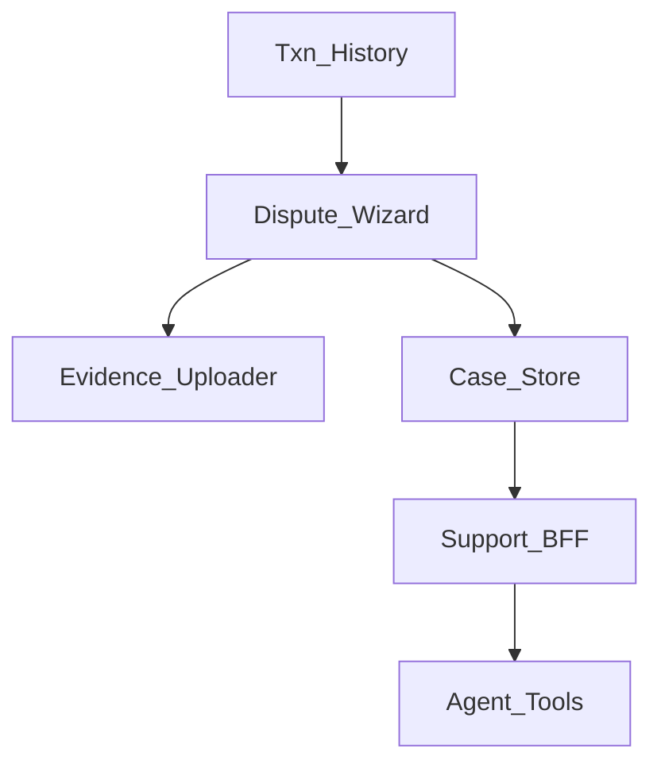
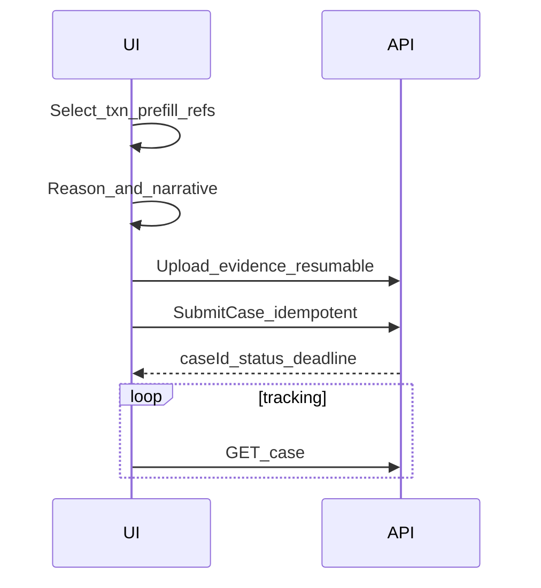

# 38 — Model Solution: Payment Disputes / Chargeback Support UX

## Timed outline (45–60 min)

| Min | Focus |
|-----|--------|
| 0–6 | MVP: find txn → raise dispute → track |
| 6–18 | Evidence packaging; PII-safe chat |
| 18–40 | States; provisional credit UX; deadlines |
| 40–55 | Failures, agent tools, metrics |

## Clarify and scope

**Prompt:** “Design in-app support for payment disputes / chargebacks / ‘I didn’t get stuff’.”

**MVP:** from history, start dispute; pick reason; attach evidence; submit; track status; get notifications; expose refs for agents.

**Defer:** scheme chargeback reason-code encyclopedias, issuer ops—map to BFF statuses.

## NFRs

- Prefill paymentId, UTR/RRN, amount, timestamps
- No card PAN in tickets; mask accounts
- Deadlines visible (`submit by`, `respond by`)
- Idempotent submit; draft durable on kill
- Don’t promise refund until server says so

## Architecture



## Data model

```text
DisputeCase:
  caseId?, localId, paymentId, reasonCode,
  status (draft|submitted|in_review|need_info|
          won|lost|cancelled|unknown),
  deadlineAt?, provisionalCreditMinor?,
  clientMutationId

EvidenceAsset:
  localUri, remoteId?, type (image|pdf|text),
  uploadStatus
```

## Flow



1. Entry from Ch 24 history detail (“Get help”).
2. Prefill immutable txn snapshot (amount, time, merchant, refs).
3. Reason taxonomy (unauthorized, not received, duplicate, quality…).
4. Evidence via resumable upload (Ch 20 patterns); encrypt-at-rest until ack.
5. Submit → `in_review`; show timeline.
6. `need_info`: deep link back to wizard with requested fields.
7. Outcome: won/lost + any provisional credit messaging **from server**.

## Provisional credit

- If server grants provisional credit, show balance “as of” with caveat it may reverse.
- Never invent credit locally.

## Chat / messaging

- Secure thread tied to `caseId` (Ch 14 patterns).
- Composer blocks pasting full PAN; warn on sensitive patterns.
- Agents see same refs; user can copy paymentId/UTR one tap.

## Offline

- Draft dispute + queued uploads OK.
- Submit when online; show draft badge.

## Failures

| Case | Behavior |
|------|----------|
| Kill mid-upload | Resume chunks |
| Duplicate submit | Idempotency |
| Deadline passed | Block submit; explain |
| Payment still pending | Suggest wait / parallel pending recovery |
| Upload virus/reject | Re-ask evidence |

## Security & privacy

- Evidence retention policy copy; delete local after server ack when allowed.
- FLAG_SECURE optional on narrative if includes personal data.
- Analytics: reason category only, not free-text.

## Trade-offs

| Decision | Alternative | Why |
|----------|-------------|-----|
| Prefill from history | Blank form | Fewer wrong-txn cases |
| Server outcomes only | Optimistic “refunded” | Money truth |
| Resumable evidence | Single POST | Large photo KYC-like reliability |

## Metrics

dispute_start → submit, time_to_submit, need_info_rate, upload_fail, won/lost, CSAT after close, wrong_txn_rate.

## Staff stretch

- Merchant vs consumer dispute surfaces differ
- Auto-bundle SoftPOS/QR logs (Ch 34/27) as evidence
- Fraud overlap: unauthorized → also lock device (Ch 28)
- SLA timers & business-hours copy

## Follow-ups

- Bill pay complaints (Ch 30)
- Remittance trace (Ch 35)
- In-app support without formal chargeback (rank 11 catalog)

## See also

- [Ch 24](24-txn-history-pending-recovery.md) · [Ch 20](20-photo-camera-upload.md) · [Ch 14](14-messaging-chat.md) · [Ch 31](31-fraud-challenge-step-up.md)
