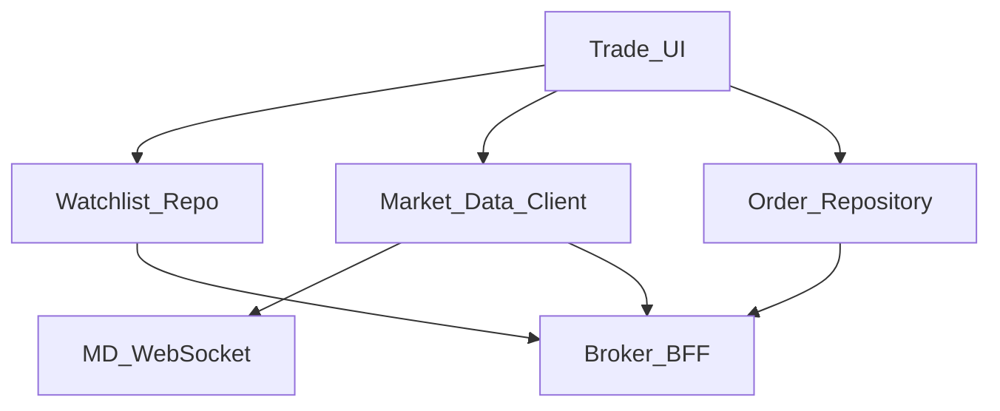
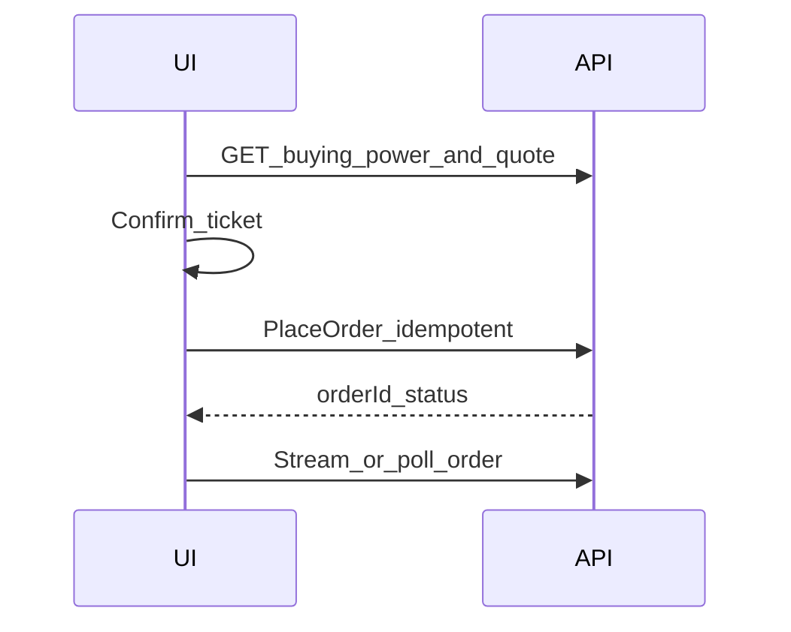

# 39 — Model Solution: Trading Watchlist + Orders

## Timed outline (45–60 min)

| Min | Focus |
|-----|--------|
| 0–6 | MVP: watchlist, quotes, place order, order status |
| 6–18 | Market data vs order truth; stale quotes |
| 18–40 | Order ticket; idempotency; partial fills |
| 40–55 | Offline, risk checks, metrics |

## Clarify and scope

**Prompt:** “Design mobile trading: watchlist + place equity/crypto order.”

**MVP:** watchlist CRUD; streaming/polling quotes; place market/limit order; view open/filled/cancelled; positions snapshot.

**Defer:** matching engine, exchange connectivity—mobile consumes BFF/market-data contracts.

**Compliance:** this is **not** money-ledger fintech identical to UPI, but order + cash balance still need server truth.

## NFRs

- Quotes labeled with age; never trade on silently stale UI
- Order create idempotent; kill-safe
- Risk checks (buying power) server-side
- Clear market-closed / halt states

## Architecture



## Data model

```text
WatchlistItem: symbol, sortRank, addedAt
Quote: symbol, bid, ask, last, asOf, source
Order:
  localId, orderId?, symbol, side, type, qty,
  limitPrice?, status (draft|submitted|open|partial|
                       filled|cancelled|rejected|unknown),
  clientMutationId, filledQty, avgPrice?
Position: symbol, qty, avgCost, asOf
CashBuyingPower: amountMinor, asOf
```

## Market data

| Mode | Use |
|------|-----|
| WebSocket | Foreground watchlist |
| Poll | Fallback / background sparingly |
| Snapshot on ticket open | Always refresh before enable Buy |

Show **as-of** timestamp; if age > threshold, disable one-tap or force refresh.

## Place order



1. Ticket: side, qty, type, estimated notional from **fresh** quote.
2. Disclosures (market order slippage warning).
3. Step-up for high notional / new device (Ch 31).
4. Submit with idempotency key; local row `submitted/unknown`.
5. Partial fills: update filledQty from server events.
6. **Forbidden:** mark filled from local guess.

## Watchlist offline

- Cached symbols + last quotes OK with stale banner.
- Place order requires network.
- Outbox for cancel requests with clear pending cancel UX.

## Failures

| Case | Behavior |
|------|----------|
| Kill mid-submit | Poll by clientMutationId |
| Duplicate tap | Single-flight + same key |
| Rejected | Show reason; ticket editable |
| MD disconnect | Banner; widen poll |
| Market halt | Server status on symbol |

## Security

- Session + device bind for trading app.
- FLAG_SECURE optional on positions if product requires.
- No “password in order ticket.”
- Biometric app lock (Ch 28).

## Android UI: Views (XML) and Compose

The hard UI problem is a list where many rows change several times a second. Basis: [Ch 4 — Android UI toolkits](../part-2-building-blocks/04-client-architecture.md#android-ui-toolkits-views-xml-and-compose).

| Concern | Views (XML) | Compose |
|---------|-------------|---------|
| Partial update | `ListAdapter` + `DiffUtil.ItemCallback.getChangePayload` → `onBindViewHolder(holder, pos, payloads)` rebinds only the price | `LazyColumn` `items(key = symbol)` + `@Immutable` row model → only changed rows recompose |
| Diff cost | `AsyncListDiffer` off main thread | Snapshot of immutable list per tick; skip unchanged via stability |
| Tick rate | Conflate ticks (e.g. 4/s) before `submitList` | Same conflation in ViewModel `Flow` (`sample`) — UI never sees raw socket rate |
| Flash on change | `ItemAnimator` change animation off (or payloads, which skip it) | `animateColorAsState` on the price cell only |
| Derived UI | Compute "N stale" banner in ViewModel | `derivedStateOf` for scroll-dependent bits (e.g. show "jump to top") |
| Visible-only subscribe | `LinearLayoutManager` first/last visible → subscribe set | `LazyListState.layoutInfo.visibleItemsInfo` via `snapshotFlow` |

```kotlin
@Immutable
data class Quote(val symbol: String, val ltp: Long, val changeBps: Int)

// Views: payload = new quote -> rebind one TextView, no full bind / flash
object QuoteDiff : DiffUtil.ItemCallback<Quote>() {
    override fun areItemsTheSame(a: Quote, b: Quote) = a.symbol == b.symbol
    override fun areContentsTheSame(a: Quote, b: Quote) = a == b
    override fun getChangePayload(a: Quote, b: Quote): Any? = if (a.symbol == b.symbol) b else null
}
fun onBind(holder: QuoteVH, q: Quote, payloads: List<Any>) {
    if (payloads.isEmpty()) holder.bindAll(q)
    else holder.price.text = (payloads.last() as Quote).ltp.toString()
}

// Compose: stable key + immutable item -> only changed rows recompose
@Composable
fun Watchlist(quotes: List<Quote>) = LazyColumn {
    items(quotes, key = { it.symbol }) { q -> Text("${q.symbol} ${q.ltp}") }
}
```

**Mixed codebase:** a hot `RecyclerView` watchlist is a reasonable thing to leave as Views; Compose rows can live inside it via `ComposeView` in the ViewHolder (default `ViewCompositionStrategy` disposes on detach or pool release), but measure jank before and after.

## Trade-offs

| Decision | Alternative | Why |
|----------|-------------|-----|
| Disable trade on stale quote | Allow always | Fewer bad fills / complaints |
| Server buying power | Client compute | Prevents overspend races |
| WS + poll fallback | WS only | Mobile networks |

## Metrics

quote_age_at_order, order_ack_latency, unknown_order_rate, partial_fill_rate, md_reconnect_rate, watchlist_size.

## Staff stretch

- Bracket / OCO orders
- Options multileg complexity (mention defer)
- Paper trading mode flag
- Accessibility for rapidly changing quotes (reduce motion)

## Follow-ups

- Crypto chain settlement delays vs equity
- Corporate actions impacting positions UX

## See also

- [Ch 09 Realtime](../part-2-building-blocks/09-realtime-and-push.md) · [Ch 23](23-wallet-transfer.md) · [Ch 31](31-fraud-challenge-step-up.md) · [Ch 28](28-secure-auth-device-binding.md)
