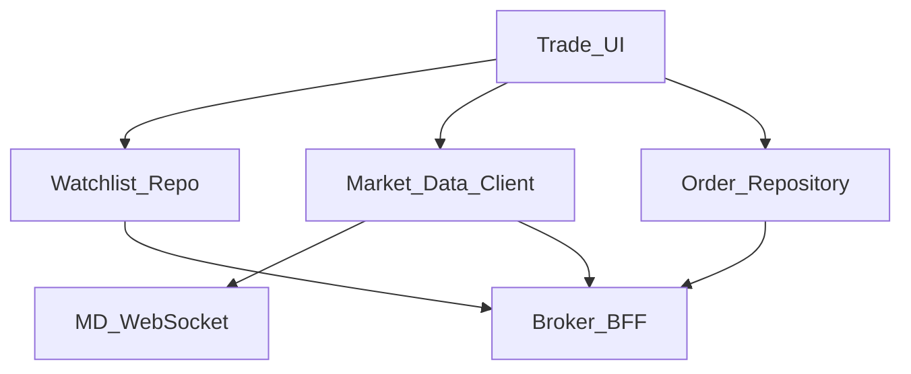
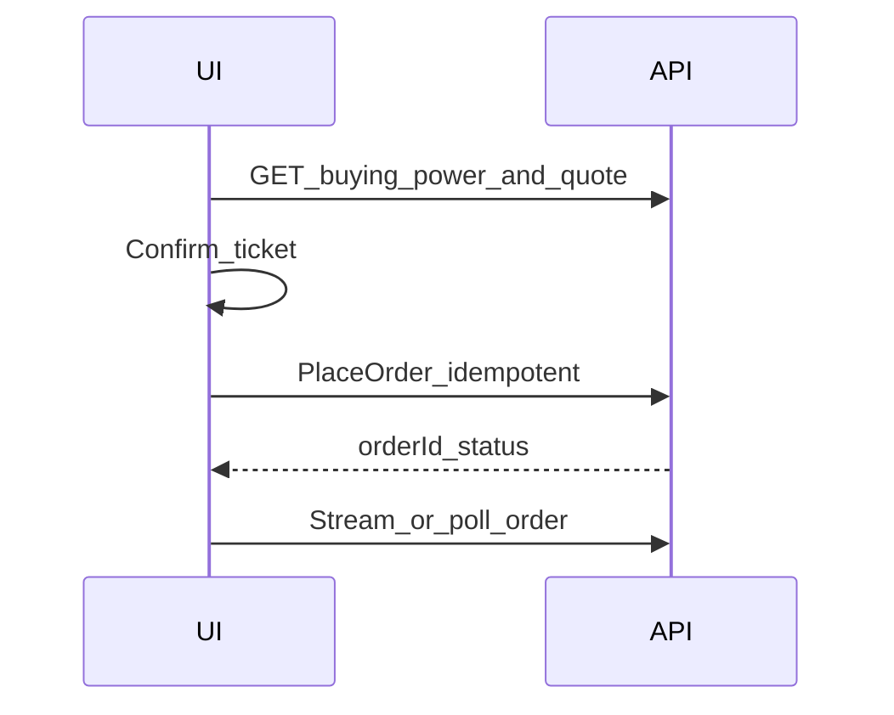

# 39 — Model Solution: Trading Watchlist + Orders

## Timed outline (45–60 min)

| Min | Focus |
|-----|--------|
| 0–6 | MVP: watchlist, quotes, place order, order status |
| 6–18 | Market data vs order truth; stale quotes |
| 18–40 | Order ticket; idempotency; partial fills |
| 40–55 | Offline, risk checks, metrics |

## Clarify and scope

**Prompt:** “Design mobile trading: watchlist + place equity/crypto order.”

**MVP:** watchlist CRUD; streaming/polling quotes; place market/limit order; view open/filled/cancelled; positions snapshot.

**Defer:** matching engine, exchange connectivity—mobile consumes BFF/market-data contracts.

**Compliance:** this is **not** money-ledger fintech identical to UPI, but order + cash balance still need server truth.

## NFRs

- Quotes labeled with age; never trade on silently stale UI
- Order create idempotent; kill-safe
- Risk checks (buying power) server-side
- Clear market-closed / halt states

## Architecture



## Data model

```text
WatchlistItem: symbol, sortRank, addedAt
Quote: symbol, bid, ask, last, asOf, source
Order:
  localId, orderId?, symbol, side, type, qty,
  limitPrice?, status (draft|submitted|open|partial|
                       filled|cancelled|rejected|unknown),
  clientMutationId, filledQty, avgPrice?
Position: symbol, qty, avgCost, asOf
CashBuyingPower: amountMinor, asOf
```

## Market data

| Mode | Use |
|------|-----|
| WebSocket | Foreground watchlist |
| Poll | Fallback / background sparingly |
| Snapshot on ticket open | Always refresh before enable Buy |

Show **as-of** timestamp; if age > threshold, disable one-tap or force refresh.

## Place order



1. Ticket: side, qty, type, estimated notional from **fresh** quote.
2. Disclosures (market order slippage warning).
3. Step-up for high notional / new device (Ch 31).
4. Submit with idempotency key; local row `submitted/unknown`.
5. Partial fills: update filledQty from server events.
6. **Forbidden:** mark filled from local guess.

## Watchlist offline

- Cached symbols + last quotes OK with stale banner.
- Place order requires network.
- Outbox for cancel requests with clear pending cancel UX.

## Failures

| Case | Behavior |
|------|----------|
| Kill mid-submit | Poll by clientMutationId |
| Duplicate tap | Single-flight + same key |
| Rejected | Show reason; ticket editable |
| MD disconnect | Banner; widen poll |
| Market halt | Server status on symbol |

## Security

- Session + device bind for trading app.
- FLAG_SECURE optional on positions if product requires.
- No “password in order ticket.”
- Biometric app lock (Ch 28).

## Trade-offs

| Decision | Alternative | Why |
|----------|-------------|-----|
| Disable trade on stale quote | Allow always | Fewer bad fills / complaints |
| Server buying power | Client compute | Prevents overspend races |
| WS + poll fallback | WS only | Mobile networks |

## Metrics

quote_age_at_order, order_ack_latency, unknown_order_rate, partial_fill_rate, md_reconnect_rate, watchlist_size.

## Staff stretch

- Bracket / OCO orders
- Options multileg complexity (mention defer)
- Paper trading mode flag
- Accessibility for rapidly changing quotes (reduce motion)

## Follow-ups

- Crypto chain settlement delays vs equity
- Corporate actions impacting positions UX

## See also

- [Ch 09 Realtime](../part-2-building-blocks/09-realtime-and-push.md) · [Ch 23](23-wallet-transfer.md) · [Ch 31](31-fraud-challenge-step-up.md) · [Ch 28](28-secure-auth-device-binding.md)
