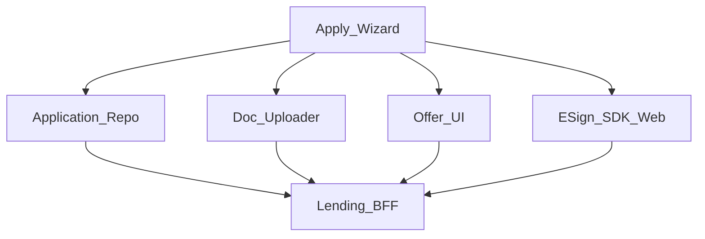
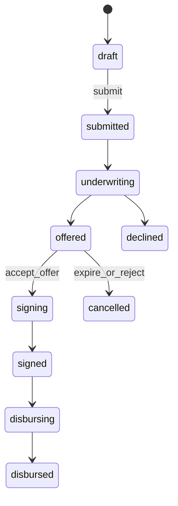

# 40 — Model Solution: Lending Apply + E-sign

## Timed outline (45–60 min)

| Min | Focus |
|-----|--------|
| 0–6 | MVP: apply → underwrite → e-sign → disburse track |
| 6–18 | Funnel state machine; resume; PII |
| 18–40 | Doc upload; offer; e-sign; mandates |
| 40–55 | Failures, compliance, metrics |

## Clarify and scope

**Prompt:** “Design personal loan / credit apply flow on mobile with e-sign.”

**MVP:** multi-step application; bureau/consent; offer presentation; e-sign agreement; track disbursement; optional Autopay setup for EMI.

**Defer:** underwriting model, legal PDF generation internals—client renders offers + signing session.

## NFRs

- Resume application after kill
- Consents explicit and versioned
- Offer TTL; no silent reprice after accept
- E-sign ceremony audited (server)
- PII minimized at rest post-submit

## Architecture



## Data model

```text
LoanApplication:
  applicationId?, localId, productCode,
  status (draft|submitted|underwriting|offered|
          declined|signing|signed|disbursing|
          disbursed|cancelled|unknown),
  stepId, consents[], updatedAt, clientMutationId

LoanOffer:
  offerId, principalMinor, apr, tenureMonths,
  emiMinor, expiresAt, disclosuresRef

SignSession:
  sessionId, provider, status, expiresAt
```

## Funnel



1. Wizard steps with local draft persistence (like Ch 26).
2. Consents: checkbox + linked policy version ids.
3. Submit → underwriting; poll/push for offered/declined.
4. Offer screen: APR, EMI, fees, total cost; countdown TTL.
5. Accept → e-sign session (SDK/WebView); on return verify API.
6. After signed: disbursement tracking; credit to bank/wallet.
7. Optional EMI Autopay mandate (Ch 32).

**Never** show “loan approved & money sent” from client-only signals.

## Docs & KYC reuse

- Reuse Ch 26 capture/upload; don’t duplicate PII if KYC already approved.
- Re-KYC triggers when policy requires.

## E-sign

| Concern | Approach |
|---------|----------|
| Provider | Hosted e-sign / certified SDK |
| Kill mid-sign | Resume session status from API |
| Success hint from WebView | Always `GET` application status |
| Decline to sign | Back to offered if not expired |

## Offline

- Edit draft fields OK.
- Submit/sign/disburse require network.
- Cached offer view only if not expired; else refresh.

## Failures

| Case | Behavior |
|------|----------|
| Offer expired at accept | New underwriting or refreshed offer |
| Sign session expired | New session |
| Disbursement unknown | Poll; support refs |
| Duplicate submit | Idempotency |
| Decline | Neutral UX + cooldown copy |

## Security & privacy

- PII encrypt-at-rest; delete local docs after ack.
- FLAG_SECURE on offer accept / sign.
- Step-up before accept/sign on new device.
- Analytics: funnel steps, not income values.

## Trade-offs

| Decision | Alternative | Why |
|----------|-------------|-----|
| Server offer TTL | Static cached offer | Fair lending / dispute avoidance |
| Hosted e-sign | Custom signature pad only | Evidence quality |
| Explicit EMI mandate opt-in | Forced autopay | Consent |

## Metrics

step_dropoff, time_in_underwriting, offer_accept_rate, sign_completion, disburse_latency, resume_after_kill_success.

## Staff stretch

- Pre-approved offers vs full apply
- Co-applicant flows
- Foreclosure / part-prepay later modules
- Accessibility for long disclosures

## Follow-ups

- BNPL contrast (Ch 36)
- Disputes on EMI debit (Ch 38)
- Device bind for borrower portal (Ch 28)

## See also

- [Ch 26 KYC](26-kyc-onboarding.md) · [Ch 32 Mandates](32-upi-autopay-mandates.md) · [Ch 31](31-fraud-challenge-step-up.md) · [Ch 20](20-photo-camera-upload.md)
