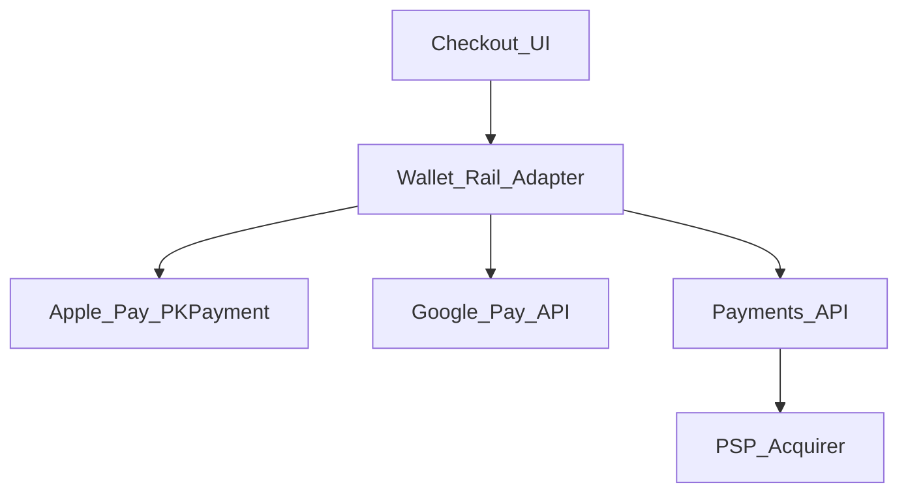
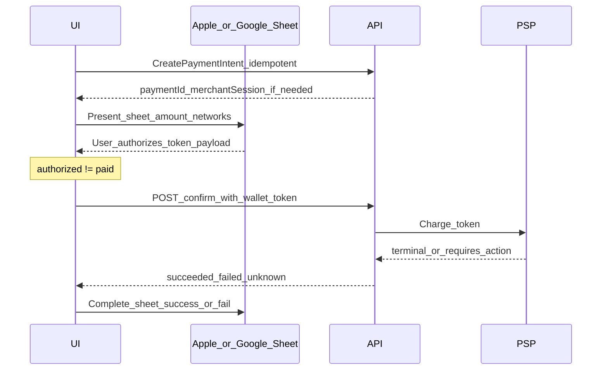

# 41 — Model Solution: Apple Pay / Google Pay Wallet Rails

## Timed outline (45–60 min)

| Min | Focus |
|-----|--------|
| 0–6 | MVP: present wallet sheet; pay; handle cancel/fail/pending |
| 6–18 | Token vs PAN; merchant vs platform tokenization |
| 18–40 | PKPayment / Google Pay API flow; server confirm |
| 40–55 | Availability, binding, failures, metrics |

## Clarify and scope

**Prompt:** “Add Apple Pay and Google Pay as checkout rails in a mobile payments app or merchant SDK.”

**MVP:** detect wallet availability; show wallet button when eligible; user authorizes in OS sheet; app receives opaque payment token/payload; server completes charge with PSP; handle success/fail/cancel/unknown.

**Out of scope:** building Apple/Google’s wallet apps; full EMV cryptogram parsing on device (PSP/acquirer handles).

**Assume:** Merchant is registered for Apple Pay / Google Pay with PSP; domain verification (web) / merchant IDs configured.

## NFRs

- Wallet button only when **canMakePayments** + supported networks
- Never treat sheet “authorized” as paid until server confirms
- Idempotent payment create on server
- Graceful fallback to card/UPI when wallet unavailable
- iOS/Android platform differences called out aloud

## Golden rule

```text
OS sheet produces a one-time payment token → PSP/server charges → client shows server status
```

Same money truth as Ch 21—wallet authorization is **not** terminal success.

## High-level architecture



## Data model

```text
WalletPaymentAttempt:
  localId, paymentId?, platform (apple|google),
  amountMinor, currency, merchantOrderId,
  status (created|sheet_presented|authorized|processing|
          succeeded|failed|cancelled|unknown),
  clientMutationId, networkBrandHint?

WalletAvailability:
  applePayAvailable, googlePayAvailable,
  supportedNetworks[], lastCheckedAt
```

## Availability check

| Platform | Check |
|----------|--------|
| **iOS** | `PKPaymentAuthorizationController.canMakePayments()` + `canMakePayments(usingNetworks:)` |
| **Android** | `PaymentsClient.isReadyToPay()` with `IsReadyToPayRequest` |

Cache availability briefly; re-check on checkout open. Hide button if false—don’t show broken wallet CTA.

## Payment flow



### iOS specifics

- `PKPaymentRequest`: country, currency, merchantCapabilities, supportedNetworks, summary items (line items + total).
- Implement `PKPaymentAuthorizationControllerDelegate`; in `didAuthorizePayment`, extract `PKPaymentToken` (paymentData blob)—send to server **immediately**; defer UI success until API returns.
- `paymentAuthorizationControllerDidFinish`: handle cancel.
- Merchant validation (Apple Pay on Web) uses session endpoint—mobile native often uses PSP-provided merchant ID config; mention you’d call server for `merchantSession` if required.

### Android specifics

- `PaymentsClient.loadPaymentData()` with `PaymentDataRequest` (price, merchant info, allowed methods).
- Receive `PaymentData` JSON; extract tokenization payload for PSP (Stripe/Razorpay/etc. each have a mapping—say “opaque to PSP adapter”).
- Activity Result / coroutine flow; handle `AutoResolveHelper` user cancel.

## Server confirm (critical)

1. Client sends: `paymentId`, wallet token/payload, `clientMutationId`.
2. Server idempotently charges via PSP wallet rail.
3. May return `requires_action` (rare on wallet) or `unknown` on timeout—poll Ch 24.
4. Only then call iOS `completion(PKPaymentAuthorizationStatus.success)` or Android equivalent success callback.

**Anti-pattern:** completing OS sheet as success before server ack → user thinks paid; merchant may not have capture.

## Relationship to saved cards (Ch 29)

| Rail | What user sees | What app stores |
|------|----------------|-----------------|
| Saved card token | Card last4 in app | `paymentMethodId` |
| Apple/Google Pay | Device wallet cards | Nothing long-term—one-time token per pay |
| Both | Wallet button + “Pay with card” | Separate flows; same payment state machine |

Wallet can coexist: prefer wallet for speed; fallback to hosted fields.

## Security

- Token payload is single-use; never log full blob
- TLS to server; pinning for finance apps
- Wallet still subject to device bind / step-up for high value (Ch 28/31)
- `Android:` verify `PaymentsClient` environment (TEST vs PRODUCTION)

## Failures

| Case | Behavior |
|------|----------|
| User cancels sheet | `cancelled`; no server charge attempt |
| Authorized but API timeout | `unknown`; poll; complete sheet as failure or pending per platform rules |
| Kill after authorize before POST | Persist token payload encrypted briefly? **Better:** server never got token → treat as failed; user may need re-auth (tokens expire fast) |
| Wallet unavailable mid-checkout | Hide button; refresh availability |
| Wrong merchant config | Fail with support message; metric `wallet_config_error` |

Note: Apple Pay tokens expire in ~60s—retry means new sheet, not replay old token.

## Android UI: Views (XML) and Compose

The wallet sheet is Google's UI; the app owns only the button and the result. Basis: [Ch 4 — Android UI toolkits](../part-2-building-blocks/04-client-architecture.md#android-ui-toolkits-views-xml-and-compose).

| Concern | Views (XML) | Compose |
|---------|-------------|---------|
| Button | `PayButton` view from `play-services-wallet`, `initialize(ButtonOptions)` with `allowedPaymentMethods` JSON | `PayButton` composable from Google's `compose-pay-button` library, or the View in `AndroidView` |
| Show / hide | `visibility = GONE` until `isReadyToPay` | `if (ready) PayButton(…)` — state from ViewModel |
| Open sheet | `loadPaymentData` task + Activity Result (wallet library ships a contract for the task result) | Same task + `rememberLauncherForActivityResult` with that contract |
| Cancel / error | `RESULT_CANCELED` → back to checkout, no error toast | Same mapping in the result callback |
| Double tap | Disable button while sheet open / confirm in flight | Same, from `uiState.inFlight` |

No snippet: the button and result contract APIs live in Play-services/Google Pay artifacts whose surface changes between versions — check the current Google Pay Android docs rather than memorising signatures.

**Mixed codebase:** the View `PayButton` in `AndroidView` works in any Compose screen and avoids an extra dependency; branding rules (size, theme) apply the same in both.

## Trade-offs

| Decision | Alternative | Why |
|----------|-------------|-----|
| Server confirm before sheet complete | Optimistic sheet success | Matches money truth |
| Platform wallet vs in-app saved card | Wallet only | Coverage + conversion |
| Single PaymentIntent from server | Client-only amount | Tamper resistance |

## Metrics

wallet_button_shown, sheet_presented, authorize_rate, cancel_rate, server_confirm_latency, unknown_after_authorize, fallback_to_card_rate.

## Staff stretch

- Recurring / subscriptions via Apple Pay merchant tokens (mention platform support evolving)
- Dynamic last4 display on button
- Multi-merchant marketplace split (platform vs seller MID)
- Accessibility: VoiceOver labels on wallet button

## Follow-ups

- Express checkout (shipping/billing contact from wallet)
- In-app provisioning of cards to wallet (issuer app—not merchant scope)

## See also

- [Ch 21 Checkout](21-checkout-payment-sdk.md) · [Ch 29 Saved cards](29-saved-cards-tokenization.md) · [Ch 31 Fraud](31-fraud-challenge-step-up.md) · [Ch 24 Recovery](24-txn-history-pending-recovery.md)
