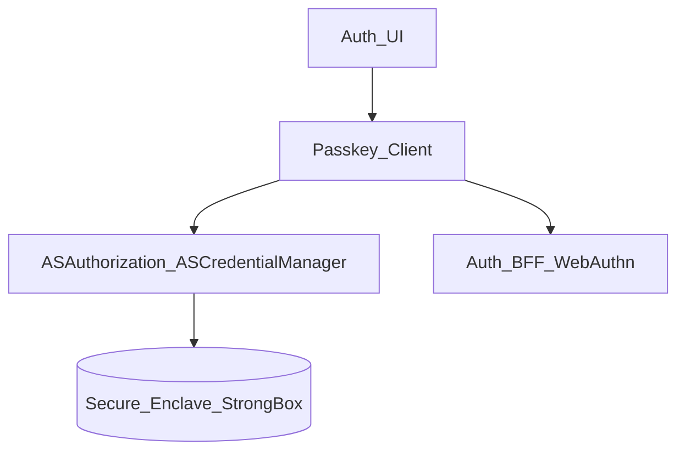
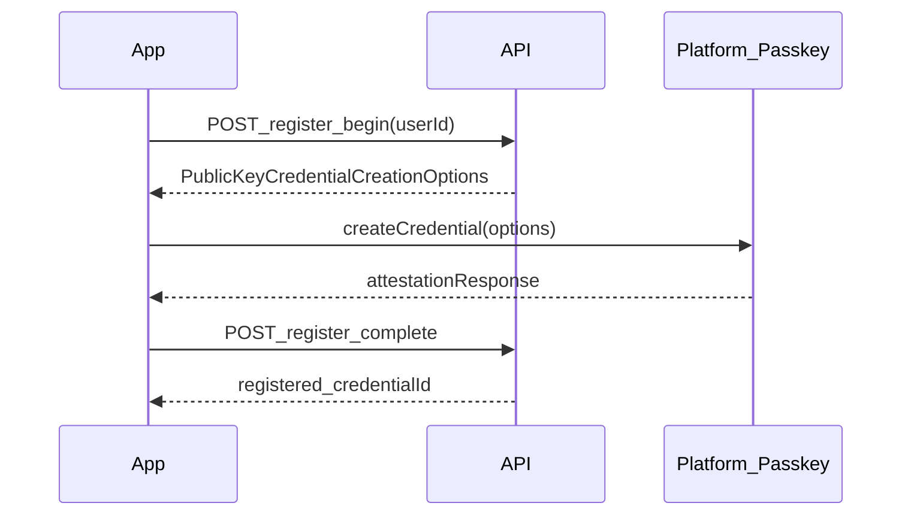
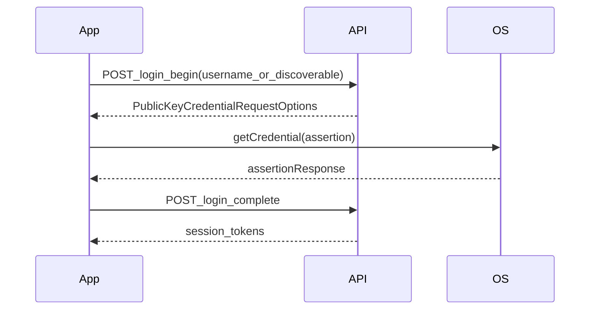

# 42 — Model Solution: Passkeys (WebAuthn) on Mobile

## Timed outline (45–60 min)

| Min | Focus |
|-----|--------|
| 0–6 | MVP: register passkey; sign-in; step-up use |
| 6–18 | Credential storage; server challenge flow |
| 18–40 | Registration + authentication ceremonies |
| 40–55 | Recovery, multi-device, failures, fintech tie-in |

## Clarify and scope

**Prompt:** “Design passkey login (and optional step-up) for a fintech mobile app.”

**MVP:** register passkey after primary login; sign in with passkey; revoke passkeys in settings; fallback OTP; optional passkey for high-value step-up (Ch 31).

**Out of scope:** full FIDO2 server implementation; cross-platform passkey sync internals (mention iCloud Keychain / Google Password Manager as platform behavior).

**Platform:** `iOS 16+` (ASAuthorizationPlatformPublicKeyCredentialProvider). `Android:` **Credential Manager** (Google Play services on Android 9+; full system UX strongest on **14+**) — state minimum versions aloud.

## NFRs

- Phishing-resistant auth (origin/rpId bound)
- Private keys never leave secure enclave / StrongBox when available
- Account recovery without passkey (SIM/email/branch—product policy)
- Revoke on device loss / account takeover
- Coexist with device binding (Ch 28)—passkey ≠ device bind alone

## How passkeys differ from biometrics app lock

| | App lock (Ch 28) | Passkey |
|--|------------------|---------|
| Unlocks | Local cached session | Server authentication |
| Secret location | App-bound biometric key | Platform credential store |
| Phishing resistance | No (local only) | Yes (rpId + challenge) |
| Use for pay step-up | Yes (local) | Only if server verifies WebAuthn assertion |

## Architecture



## Data model

```text
PasskeyCredential (server truth; client cache metadata only):
  credentialId, rpId, userHandle, createdAt, lastUsedAt?,
  deviceName?, aaguid?

LocalRegistrationState:
  registrationSessionId, status (pending|completed|failed)

AuthAttempt:
  localId, type (passkey|otp_fallback),
  status, clientMutationId
```

Client stores **credentialId list for UX** (settings); private keys stay in OS credential manager.

## Registration ceremony



Rules:

1. Always start with server challenge (`register_begin`).
2. Include `user.id`, `user.name`, `rp.id`, `rp.name`, `pubKeyCredParams`, `timeout`, `authenticatorSelection` (platform authenticator, user verification required).
3. On success, server verifies attestation (policy-dependent) and stores credential.
4. Offer registration **after** strong first factor (OTP/password)—not as only recovery.

### iOS

- `ASAuthorizationPlatformPublicKeyCredentialProvider` + `ASAuthorizationController`.
- Associated Domains: `webcredentials:yourdomain.com` for passkey linking to web (mention in interview).
- Presentation anchor from key window.

### Android

- Credential Manager API + `CreatePublicKeyCredentialRequest`.
- `digitalAssetLinks` for rpId association with web.
- Handle `CreateCredentialException` (user cancel, no screen lock).

## Authentication ceremony



- Support **discoverable credentials** (usernameless) where product allows: conditional UI on login screen.
- Server verifies signature, signCount, userHandle.
- Issue normal access/refresh tokens—same session model as Ch 28.

## Fintech-specific uses

| Use | Pattern |
|-----|---------|
| Login | Primary or second factor after identifier |
| Step-up (Ch 31) | `challenge_type=webauthn` → assertion → `challenge_verify` → resume payment |
| Device bind adjunct | Passkey proves user presence; **still** register `deviceId` separately |
| High-value pay | Passkey assertion within 60s window before `POST /payments` |

Passkey success does **not** replace payment status polling (Ch 21–24).

## Recovery & multi-device

| Scenario | UX |
|----------|-----|
| Lost passkey device | OTP + email verify → register new passkey; revoke old |
| New phone, synced passkey | iCloud/Google may sync—still run device bind + cool-off (Ch 37) |
| User disables biometrics OS-wide | Passkey may fail—fallback OTP |
| Account takeover | Server revokes all credentials; force OTP re-enrollment |

Settings screen: list passkeys (name, created, last used); revoke per credential.

## Failures

| Case | Behavior |
|------|----------|
| User cancels OS sheet | Stay on login; offer OTP |
| `register_begin` expired | Restart ceremony |
| Kill mid-registration | Resume from `register_begin` if session valid |
| Assertion replay | Server rejects old signCount |
| Emulator without secure hardware | Fail or fallback per policy |
| rpId mismatch (phishing clone app) | Ceremony fails at OS—explain why this is a feature |

## Security

- Never roll custom crypto—use platform APIs only
- Bind challenges to session + short TTL (e.g., 5 min)
- Rate-limit `login_begin` / `register_begin`
- Audit log credential create/revoke (staff mention)
- No passkey private material in app logs/crash reports

## Trade-offs

| Decision | Alternative | Why |
|----------|-------------|-----|
| Passkeys + OTP fallback | Passkeys only | Recovery + SIM swap |
| Platform authenticator required | Roaming security keys | Mobile UX |
| Discoverable credentials | Username first | UX vs enumeration debate—server policy |
| Passkey for step-up | OTP SMS | Phishing resistance |

## Metrics

passkey_register_start → complete, login_passkey_success, fallback_otp_rate, step_up_webauthn_pass, revoke_rate, ceremony_timeout_rate.

## Staff stretch

- Hybrid: passkey + device bind + attestation for tier-1 limits
- Conditional mediation UI on login (iOS 16+ / Android autofill)
- Migration plan from password-only: nudge register after N logins
- Corporate policy: disable discoverable credentials on shared tablets

## Follow-ups

- Passkeys on WebView checkout (usually avoid—use native or ASWebAuthenticationSession)
- Cross-app passkeys (same rpId web + app)

## See also

- [Ch 28 Auth / bind](28-secure-auth-device-binding.md) · [Ch 31 Fraud step-up](31-fraud-challenge-step-up.md) · [Ch 37 Cool-off](37-beneficiary-cool-off.md)
