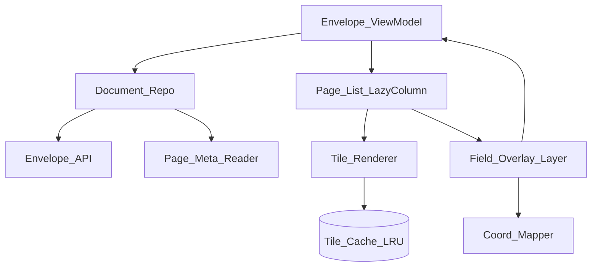
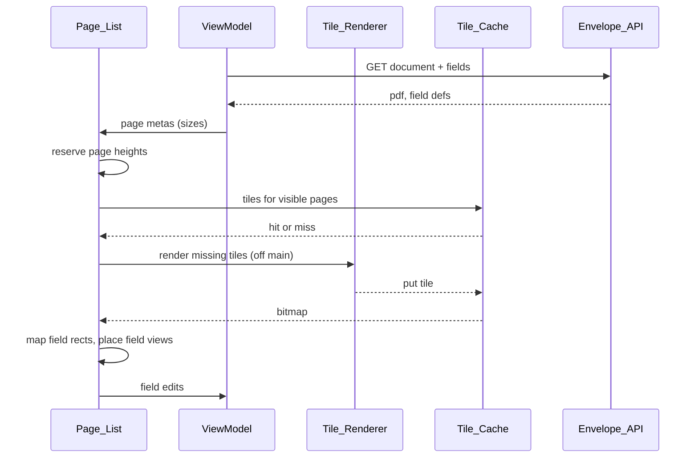

# 43 — Model Solution: PDF Viewer with Field Overlays

## Timed outline (45–60 min)

| Min | Focus |
|-----|--------|
| 0–6 | MVP: open 500-page contract, fill fields on top, "Next required field" |
| 6–18 | Page list + tile renderer + overlay layer; data flow |
| 18–40 | Coordinate mapping, zoom buckets, tile cache, accessibility, RTL |
| 40–55 | Failures (fling, rotated pages, OOM), trade-offs, metrics |

## Clarify and scope

**Prompt:** “Design a viewer for 500-page contracts with interactive fields drawn on top: tiling, zoom, coordinate mapping, accessibility and RTL.”

**MVP:** download PDF + field definitions; smooth scroll through all pages; fill signature, initials, text, date, checkbox fields; jump to next required field; works with TalkBack / VoiceOver and in RTL locales; submit filled values.

**Defer:** annotation authoring (sender places fields), PDF text search, form-field extraction from AcroForms, signature capture internals (separate pad component), offline submit.

**Assumptions:** backend serves the PDF and field definitions as page index + rect in **PDF points**; signing ceremony and audit live server-side.

## NFRs

- First page visible < 1 s; no blank pages at normal scroll speed
- 60 fps scroll and zoom; **no scroll jumps** (page heights known before render)
- Bounded memory: only visible pages ± neighbours resident; 500 pages on a low-end phone
- Every field announced with type, required-ness, page; sensible traversal order
- Field positions exact at every zoom level and orientation

## Architecture



| Component | Role |
|-----------|------|
| Page list | `LazyColumn` / `UICollectionView`; each item reserves height from page metadata before render |
| Tile renderer | Renders page tiles off main thread (`PdfRenderer` on Android, `PDFKit` / `CGPDFPage` on iOS) |
| Tile cache | LRU keyed by page, tile, zoom bucket; byte-bounded |
| Overlay layer | Fields are **real views/composables** positioned per page — focus, IME, semantics work |
| Coord mapper | One tested PDF→screen function; the place bugs hide |

`Android:` `PdfRenderer` is single-page-at-a-time and not thread-safe — one renderer per worker, serialized. `iOS:` `PDFView` is fine for read-only; custom tiling (`CATiledLayer`) when you need your own overlays and cache control.

## Data model

```text
PageMeta:
  index, widthPt, heightPt, rotate (0|90|180|270), cropBox

Field:
  id, page, type (signature|initials|text|date|checkbox),
  rect (x, y, w, h in PDF points, origin bottom-left),
  required, label, tabOrder?

FieldValue:
  fieldId, value | signatureRef, updatedAt, dirty

TileKey:
  page, col, row, zoomBucket

EnvelopeDraft:
  envelopeId, values[], lastPage, updatedAt
```

## Render + overlay flow



1. Download PDF + field definitions; read page sizes (cheap — no rendering).
2. Lay out the list with reserved heights so scroll offset is stable.
3. Render visible tiles at current zoom bucket; prefetch ±1 page.
4. Map each field rect to screen, place its view on the page item.
5. Edits flow to ViewModel → persisted draft → submitted on finish.

## Coordinate mapping

PDF user space: points (1/72 in), origin **bottom-left**. Screen: px, origin top-left.

With `s = viewWidthPx / pageWidthPt`:

```text
x_screen = x_pdf * s
y_screen = (pageHeightPt - y_pdf - h) * s
w_screen = w * s ; h_screen = h * s
```

Apply `/Rotate` and **CropBox** offset before this, or every field on that page is off.

```kotlin
data class PageMeta(val index: Int, val widthPt: Float, val heightPt: Float)
data class PdfRect(val x: Float, val y: Float, val w: Float, val h: Float)
data class ScreenRect(val left: Float, val top: Float, val width: Float, val height: Float)

fun pageHeightPx(page: PageMeta, viewWidthPx: Float): Float =
    page.heightPt * viewWidthPx / page.widthPt

// Assumes /Rotate 0 and CropBox == MediaBox
fun PdfRect.toScreen(page: PageMeta, viewWidthPx: Float): ScreenRect {
    val s = viewWidthPx / page.widthPt
    return ScreenRect(x * s, (page.heightPt - y - h) * s, w * s, h * s)
}
```

Unit-test with fixtures: rotated page, cropped page, landscape page, tablet width.

## Zoom & tiles

| Phase | Behavior |
|-------|----------|
| During pinch | Scale whole page via `graphicsLayer` / layer transform — no re-render |
| Gesture settles | Pick zoom bucket (1×, 2×, 4×); re-render visible tiles at new resolution |
| Old bucket | Keep as blurry fallback until sharp tiles arrive |
| Overlays | Re-map with new `s`; same function, no special case |

Tile size ~256–512 px; cache bounded in bytes (e.g. 1/8 of `memoryClass`), evict far pages first. Cancel renders for pages scrolled out (structured concurrency / `Task` cancellation).

## Accessibility

- Each field: semantics like “Signature, required, page 3 of 12, not filled”.
- Traversal order: page, then top→bottom, then reading direction — not view insertion order.
- **Next required field** button: screen-reader users must not explore 500 pages.
- Page image itself: one node (“Page 3 of 12”) — do not expose tiles.
- Large text / Dynamic Type affects chrome and field input sheets, not page geometry.

```kotlin
fun nextRequired(fields: List<Field>, filled: Set<String>): Field? =
    fields.filter { it.required && it.id !in filled }
        .minWithOrNull(compareBy<Field>({ it.page }, { -it.rect.y }, { it.rect.x }))
```

## RTL

| Thing | Mirrors? |
|-------|----------|
| App chrome, toolbar, field input sheet | Yes |
| Page content and field positions | **No** — absolute on page |
| Text inside a text field | Follows field content direction |
| Next-field order on RTL documents | Optional: sort x descending if doc language is RTL |

## Offline

- Downloaded PDF + fields cached encrypted; viewer works offline.
- Field edits saved to local draft (survive kill); restore last page.
- Submit requires network; queue is **not** auto-sent without user confirm (see [Ch 07](../part-2-building-blocks/07-offline-and-sync.md)).
- Server envelope version check on submit — reject if document changed.

## Failures

| Case | Behavior |
|------|----------|
| Fast fling through 500 pages | Sized placeholder; cancel off-screen renders |
| Rotated / cropped page | Normalize via `/Rotate` + CropBox before mapping |
| OOM on low-end | Byte-bounded cache; lower max zoom bucket; `onTrimMemory` evicts |
| Corrupt / password PDF | Clear error; never partial sign |
| Field defs mismatch doc version | Block fill; refetch both |
| Kill mid-fill | Restore draft + scroll position |

## Security & privacy

- PDF and draft encrypted at rest; delete on completion / sign-out.
- FLAG_SECURE / hide in app switcher on signing screens (product decision).
- No document content in logs or analytics — field ids and counts only.
- Never trust client "complete": server validates all required fields.

## Trade-offs

| Decision | Alternative | Why |
|----------|-------------|-----|
| Fields as real views | Draw fields into bitmap | Focus, IME, TalkBack for free |
| Tiles + zoom buckets | Full-page bitmap per zoom | Memory bounded at high zoom |
| Reserve heights from metadata | Measure after render | No scroll jumps |
| Custom tiling | Platform `PDFView` only | Overlay + cache control |
| Server-side render fallback (images) | Client PDF only | Weird PDFs, very old devices |

## Metrics

time_to_first_page, blank_page_frames, jank_pct_scroll, tile_cache_hit_rate, oom_rate, fields_filled_per_session, next_required_taps, a11y_service_sessions.

## Staff stretch

- Shared renderer module for Android + iOS via KMP for mapping + field logic
- Server pre-rendered low-res thumbnails for instant first paint
- Golden-image tests for overlay alignment across devices
- Large-screen / foldable: two-page spread

## Follow-ups

- Signing on a shared tablet ([Ch 44](44-in-person-signing-shared-tablet.md))
- Opening the envelope from a short link ([Ch 45](45-signing-link-url-shortener.md))
- Lending e-sign ceremony ([Ch 40](40-lending-apply-esign.md))

## See also

- [Ch 40 E-sign](40-lending-apply-esign.md) · [Ch 44 In-person](44-in-person-signing-shared-tablet.md) · [Ch 45 Short links](45-signing-link-url-shortener.md) · [Ch 16 Video player](16-video-player.md) · [Ch 07 Offline](../part-2-building-blocks/07-offline-and-sync.md)
