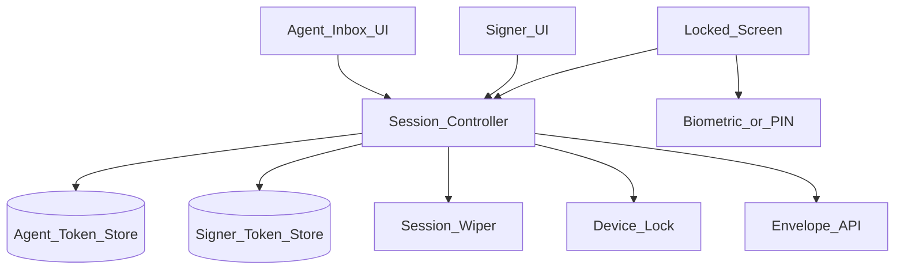
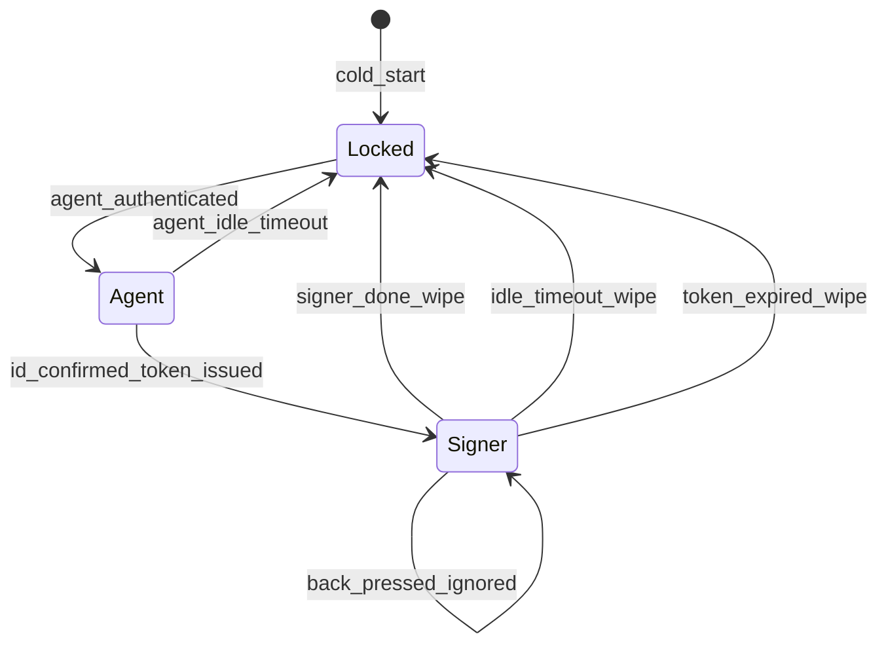
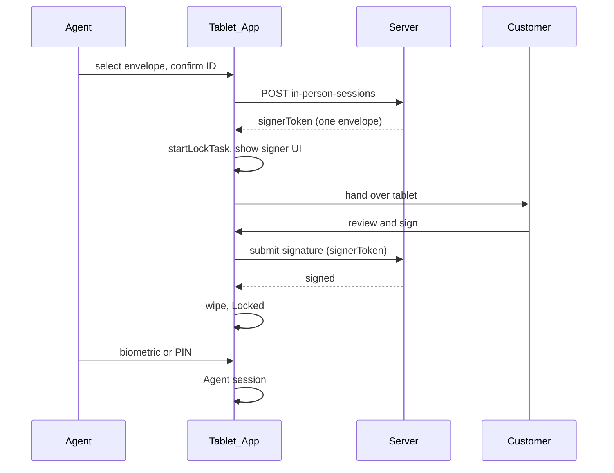

# 44 — Model Solution: In-Person Signing on a Shared Tablet

## Timed outline (45–60 min)

| Min | Focus |
|-----|--------|
| 0–6 | MVP: agent picks envelope → customer signs → agent takes back |
| 6–18 | Session controller states; scoped signer token; device lock |
| 18–40 | Hand-off, idle timeout, wipe, agent re-auth; audit |
| 40–55 | Failures (kill, walk-away), kiosk vs personal, metrics |

## Clarify and scope

**Prompt:** “A bank agent hands a tablet to a customer to sign, then takes it back for the next customer. Design the flow.”

**MVP:** agent selects envelope; confirms customer ID; tablet enters signer session showing only that envelope; hand-back requires agent biometric/PIN; audit records “in person, hosted by agent X”.

**Defer:** remote video notarization, multi-signer queueing on one device, offline signing, MDM fleet provisioning details.

**Assumptions:** bank-managed tablets (Android Enterprise / Apple Business Manager); backend can issue envelope-scoped tokens.

## NFRs

- **Isolation:** zero data from one signer or the agent's inbox reachable by the next signer
- **Containment:** customer cannot leave the app (kiosk) or not easily (pinning)
- Idle timeout → locked screen (short; agreed with bank)
- Privacy: FLAG_SECURE, autofill off on signer inputs, no notifications during session
- Kill / crash restarts into **Locked**, never agent inbox

## Architecture



| Component | Role |
|-----------|------|
| Session controller | Owns state (Agent / Signer / Locked); decides every transition |
| Scoped token store | Signer token: short-lived, one envelope, separate from agent token |
| Device lock | Kiosk: device-owner + `startLockTask()`; personal: screen pinning |
| Wiper | Signature images, field caches, WebView storage, clipboard |

`iOS:` Guided Access / Single App Mode (supervised, via MDM) is the equivalent of lock task; Autonomous Single App Mode lets the app enter/exit itself.

## Data model

```text
TabletSession:
  Agent(agentId)
  | Signer(envelopeId, signerToken, expiresAt)
  | Locked

InPersonSession (server):
  sessionId, envelopeId, signerId, hostAgentId,
  idCheck (method, ref), deviceId,
  status (active|completed|timed_out|revoked),
  createdAt, completedAt

AuditEvent:
  sessionId, type (handed_over|viewed|signed|timed_out|handed_back),
  at, deviceId
```

## Session state machine



1. Agent opens envelope, confirms ID (document check, optional OTP to signer's phone).
2. `POST /envelopes/{id}/in-person-sessions {signerId, idCheck}` → `{signerToken, expiresIn}`; token can only read and sign that envelope.
3. App drops agent UI from back stack, enters lock task, shows signer UI.
4. Done or idle → wipe signer data → Locked.
5. Agent biometric/PIN → back to agent session.

```kotlin
sealed interface TabletSession {
    data class Agent(val agentId: String) : TabletSession
    data class Signer(val envelopeId: String, val signerToken: String, val expiresAtMs: Long) : TabletSession
    data object Locked : TabletSession
}

fun reduce(state: TabletSession, event: SessionEvent, wiper: SessionWiper): TabletSession = when {
    state is TabletSession.Agent && event is SessionEvent.IdConfirmed ->
        TabletSession.Signer(event.envelopeId, event.signerToken, event.expiresAtMs)
    state is TabletSession.Signer &&
        (event is SessionEvent.SignerDone || event is SessionEvent.IdleTimeout) -> {
        wiper.wipeSignerData(); TabletSession.Locked
    }
    state is TabletSession.Locked && event is SessionEvent.AgentAuthenticated ->
        TabletSession.Agent(event.agentId)
    else -> state // back press and everything else: no change
}
```

Pure reducer → exhaustive unit tests over (state, event) pairs.

## Hand-off sequence



## Device containment

| Mode | Guarantee | Cost |
|------|-----------|------|
| Device owner + lock task (Android) | Home/recents/notifications blocked | Managed devices only |
| Supervised Single App Mode (iOS) | Same | MDM supervision |
| Screen pinning / Guided Access (manual) | User can exit with gesture + PIN | Weaker; personal devices |
| App-only (no lock) | Back ignored only | Not acceptable for bank |

## Offline

- Signer session **requires network**: token issue and signature submit are server-side.
- Network drop mid-sign: keep signer UI, retry submit idempotently; never fall back to agent session.
- No signer data persisted for later sync (isolation beats convenience) — see [Ch 07](../part-2-building-blocks/07-offline-and-sync.md) for where offline is fine.

## Failures

| Case | Behavior |
|------|----------|
| Customer presses back / home | Lock task blocks; reducer ignores back |
| Customer walks away mid-sign | Idle timeout → wipe → Locked; draft discarded or server-side only |
| App killed in signer session | Restart into Locked; server session times out |
| Signer token expires | Wipe → Locked; agent starts new session |
| Submit unknown (network) | Idempotency key; poll status before declaring done |
| Agent forgets to take back | Locked screen shows nothing; agent idle timeout too |

## Security & privacy

- Two token stores; signer token never has inbox scope (server-enforced, not just UI).
- Agent token kept but **unusable** until re-auth (Keystore key with `setUserAuthenticationRequired`; iOS `.biometryCurrentSet` / passcode access control).
- FLAG_SECURE, autofill off (`importantForAutofill=no`, `textContentType` none), keyboard learning off (`IME_FLAG_NO_PERSONALIZED_LEARNING`).
- Suppress notifications during session (lock task does this; also DND for managed devices).
- Wipe: signature bitmaps, WebView cookies/storage, image caches, clipboard.
- Audit: host agent, device id, ID-check method, timestamps — evidence of in-person signing.

## Trade-offs

| Decision | Alternative | Why |
|----------|-------------|-----|
| Envelope-scoped signer token | Reuse agent token, hide UI | Server-enforced isolation |
| Kill → Locked | Restore last state | Never expose inbox |
| Device-owner kiosk | Screen pinning | Strong containment; needs MDM |
| Discard local draft on timeout | Persist for resume | Next customer must see nothing |
| Biometric/PIN hand-back | Simple button | Customer cannot reach agent inbox |

## Metrics

sessions_started, completion_rate, idle_timeouts, time_to_sign, handback_auth_failures, kill_during_signer, token_expiry_rate.

## Staff stretch

- Multiple signers sequentially on one envelope (wipe between each)
- Signer-side ID verification (NFC passport / Aadhaar) in-session
- Fleet: remote wipe + session revoke from admin console
- Accessibility: signer may need TalkBack — enable without leaking agent settings

## Follow-ups

- Field overlay viewer for the signer UI ([Ch 43](43-pdf-viewer-field-overlays.md))
- Remote signers via short links ([Ch 45](45-signing-link-url-shortener.md))
- Device binding for the agent ([Ch 28](28-secure-auth-device-binding.md))

## See also

- [Ch 28 Auth](28-secure-auth-device-binding.md) · [Ch 40 E-sign](40-lending-apply-esign.md) · [Ch 43 PDF viewer](43-pdf-viewer-field-overlays.md) · [Ch 45 Short links](45-signing-link-url-shortener.md) · [Ch 31 Step-up](31-fraud-challenge-step-up.md) · [Ch 07 Offline](../part-2-building-blocks/07-offline-and-sync.md)
