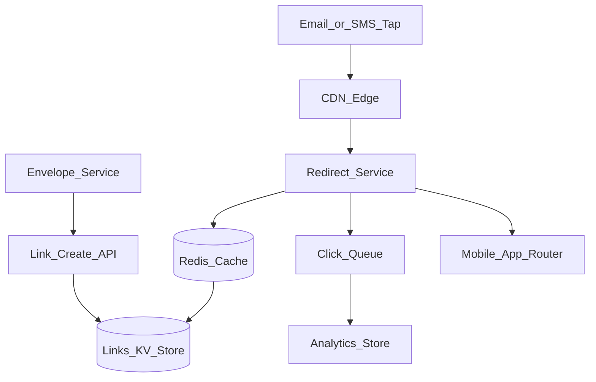
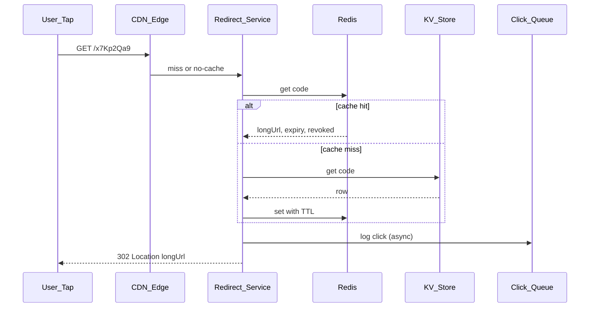

# 45 — Model Solution: URL Shortener for Signing Links

## Timed outline (45–60 min)

| Min | Focus |
|-----|--------|
| 0–5 | Requirements, scale, read/write ratio |
| 5–15 | API, schema, key generation options |
| 15–30 | Read path (edge → cache → DB); 302 vs 301; revoke |
| 30–45 | Security: link ≈ credential; enumeration; signer check |
| 45–55 | Mobile: App Links / Universal Links on short domain; router |

## Clarify and scope

**Prompt:** “Design a URL shortener for signing links (`dsgn.co/x7Kp2Qa9`) sent in signing emails/SMS. Then say what changes on mobile.”

**MVP:** create short link; redirect; optional expiry; revoke; count clicks.

**Defer:** custom aliases, vanity domains per customer, QR rendering, rich analytics dashboards.

**Scale (say it out loud):** 50M links/month × 2 years ≈ 1.2B rows; reads ≥ 100:1 writes; redirect p99 < ~50 ms; highly available.

## NFRs

- Redirect p99 < 50 ms, 99.99% available
- Codes **unguessable** (link is close to a credential)
- Revoke / expiry takes effect immediately
- Click counting never slows redirect
- App opens directly to envelope when installed

## Architecture



**API:**

```text
POST   /links {longUrl, expiresAt?}   -> {code}
GET    /{code}                        -> 302 Location: longUrl
DELETE /links/{code}                  -> revoke
```

## Data model

```text
links:
  code (PK, 10 chars base62), long_url, owner_id,
  envelope_id, created_at, expires_at?, revoked (bool)

click_events (separate stream, not this row):
  code, at, ip_hash, user_agent_class, outcome
```

Every read is by key → KV store (DynamoDB / Cassandra) partitioned by `code`.

## Key generation

| Option | Pros | Cons | Fit |
|--------|------|------|-----|
| Counter + base62 (block per server) | No collisions, no per-request coordination | Sequential → guessable | Marketing links only |
| Hash long URL (first 7 of base62(SHA-256)) | Same URL → same code | Collision check-and-retry; still derivable | Dedup use cases |
| **Secure random, 10 base62 chars** | ≈ 8 × 10¹⁷ space; unguessable | Rare collision → retry | **Pick for signing links** |

```kotlin
private val ALPHABET = ('0'..'9') + ('a'..'z') + ('A'..'Z')
private val rng = java.security.SecureRandom()

fun newCode(len: Int = 10): String =
    buildString(len) { repeat(len) { append(ALPHABET[rng.nextInt(ALPHABET.size)]) } }
// Insert with conditional put (attribute_not_exists(code)); on conflict, retry
```

## Redirect flow



| Choice | Why |
|--------|-----|
| **302 / 307**, not 301 | Browsers cache 301 forever → breaks expiry, revoke, counts |
| Cache TTL short + explicit delete on revoke | Revoke immediate |
| Negative cache for unknown codes (short) | Shields DB from enumeration |
| Expired/revoked → friendly page, not 404 | “Ask sender to resend” |

## Security (dwell here)

- Short link leads to a page that **still verifies the signer** (access code, SMS OTP, sign-in) — not straight into the document.
- Rate-limit lookups per IP / ASN; alert on high 404 ratio (enumeration).
- Expire links when envelope completes or is voided.
- No PII or envelope id in the code; long URL carries a signed, short-lived token.
- Separate short domain → isolate cookies; HSTS preload.

## Mobile

**Problem:** App Links (Android) / Universal Links (iOS) verify **a domain**; the short domain is a different domain.

| Approach | How | Trade-off |
|----------|-----|-----------|
| Verify short domain too | Host `/.well-known/assetlinks.json` and `apple-app-site-association` on `dsgn.co`; app resolves code via API | Opens app directly; app must call resolve API |
| Let browser follow redirect | 302 to main domain whose App Link opens the app | Simple; may land in browser (in-app browsers, iOS same-domain rules) |

Inside the app:

1. Route the final URL through **one deep-link router** (path → destination), not many intent filters.
2. Never trust the URL alone: fetch the envelope and check access server-side.
3. Wrong account signed in → prompt switch; not signed in → signer verification flow.
4. Cold start: hold the link through splash/login, then navigate.

`Android:` `autoVerify=true`; test with `adb shell pm get-app-links`. `iOS:` AASA served without redirects, `applinks:` entitlement; SMS/email in-app browsers may not trigger Universal Links — offer “Open in app” banner.

## Offline

- Resolving a code needs network (server is the truth for revoke/expiry).
- App may cache last resolved code → envelope id briefly for re-open, but re-check access on open.
- Queued tap while offline: show “No connection” with retry, keep the link in memory — see [Ch 07](../part-2-building-blocks/07-offline-and-sync.md).

## Failures

| Case | Behavior |
|------|----------|
| Code collision on insert | Conditional put fails → regenerate |
| Redis down | Fall through to KV; edge absorbs hot links |
| Revoked but cached at edge | Short edge TTL or purge on revoke |
| Expired link | Friendly page + resend request |
| App not installed | Browser signing page; optional install prompt |
| App Link not verified (bad AASA/assetlinks) | Falls to browser; monitor verification |
| Analytics queue down | Drop/buffer clicks; redirect unaffected |

## Security & privacy

- Codes from `SecureRandom`; never sequential.
- Click logs hash IPs; retention limits.
- Short link ≠ access: server-side signer auth always.
- Deep-link params validated; no auto-actions (sign) from a link.

## Trade-offs

| Decision | Alternative | Why |
|----------|-------------|-----|
| Random 10-char codes | Counter + base62 | Unguessable for credential-like links |
| 302 | 301 | Expiry, revoke, analytics |
| KV store by code | Relational with joins | All reads by key; horizontal scale |
| Async click logging | Inline counter update | Keeps redirect fast |
| Verify short domain in app | Rely on redirect | Reliable app open |

## Metrics

redirect_p99, cache_hit_rate, 404_rate_per_ip, revoke_propagation_ms, app_open_vs_browser_ratio, link_to_envelope_open_conversion, collision_retries.

## Staff stretch

- Multi-region: random codes → any region creates; replicate for reads
- Custom aliases: separate namespace + uniqueness check
- Per-tenant vanity domains (cert + AASA per domain)
- One-time links that burn after first successful signer verification

## Follow-ups

- Envelope viewer after open ([Ch 43](43-pdf-viewer-field-overlays.md))
- In-person alternative when link delivery fails ([Ch 44](44-in-person-signing-shared-tablet.md))
- Signer auth / step-up ([Ch 28](28-secure-auth-device-binding.md), [Ch 31](31-fraud-challenge-step-up.md))

## See also

- [Ch 43 PDF viewer](43-pdf-viewer-field-overlays.md) · [Ch 44 In-person](44-in-person-signing-shared-tablet.md) · [Ch 40 E-sign](40-lending-apply-esign.md) · [Ch 28 Auth](28-secure-auth-device-binding.md) · [Ch 07 Offline](../part-2-building-blocks/07-offline-and-sync.md)
