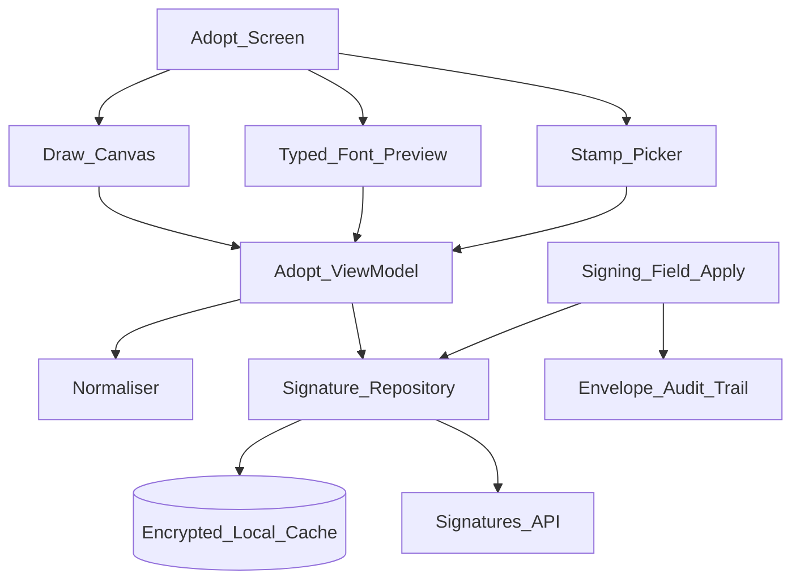
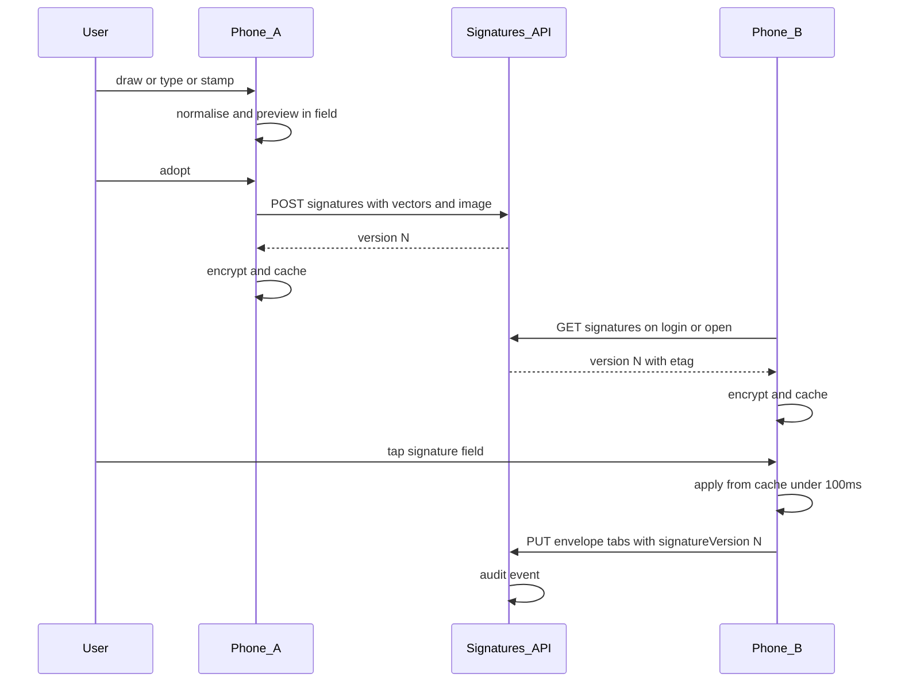

# 46 — Model Solution: Save a Signature Once, Reuse It Everywhere

## Timed outline (45–60 min)

| Min | Focus |
|-----|--------|
| 0–6 | MVP: create (draw / type / stamp) → adopt → reuse on any device |
| 6–18 | Normalise + preview; vectors vs image; versioning |
| 18–40 | Sync across devices; apply to field; audit trail |
| 40–55 | Offline, cache security, failures, metrics |

## Clarify and scope

**Prompt:** “Users adopt a signature by drawing it, typing their name in a signature font, or using a stamp, then reuse it on every device. Design it.”

**MVP:** three creation sources (draw ink, typed name in a bundled script font, stamp/seal where regions use them, e.g. Japanese eHanko); adopt a **signature** and **initials**; preview inside a field before saving; tap a signature field on any device to apply; change it later without touching already-signed documents.

**Defer:** ink capture internals (pressure, smoothing — see [Ch 43](43-pdf-viewer-field-overlays.md) for field overlays), stroke-simplification algorithm details, handwriting biometrics / signature verification, enterprise stamp provisioning admin.

**Ask them:** “Is the drawn signature stored as vectors or only as an image?”

## NFRs

- Apply adopted signature to a field in **< 100 ms** (local cache, no network on the hot path)
- Pixel-consistent across iOS, Android, web and the sealed PDF
- Encrypted at rest on device; wiped on logout / account switch
- Encrypted at rest on server; per-account scope
- Every application audited: signature version, time, device, envelope, field
- Adopting a new signature never mutates signed documents

## Architecture



- **Normaliser:** simplify strokes (fewer points, same shape), crop to stroke bounds, fit field aspect ratio.
- **Repository:** cache-first read, server is source of truth; one adopted version per kind per account.
- **Apply:** part of the envelope field-value update — the server logs the audit event, not a separate call.

## Data model

```text
AdoptedSignature:
  id, userId, accountId,
  kind (signature|initials),
  source (drawn|typed|stamp),
  strokes?      // vectors, drawn only
  fontName?     // typed only; bundled font id
  stampId?      // stamp only
  imageUrl      // PNG every renderer can draw
  imageHash, version, createdAt, createdOnDevice

FieldApplication (server, on envelope):
  envelopeId, tabId, signatureId, signatureVersion,
  appliedAt, deviceId, ipHint, clientMutationId

LocalCacheEntry:
  kind, signature (encrypted blob), etag, fetchedAt
```

```kotlin
enum class SignatureSource { DRAWN, TYPED, STAMP }
enum class SignatureKind { SIGNATURE, INITIALS }
data class Pt(val x: Float, val y: Float)

interface SignatureRepository {
    suspend fun current(kind: SignatureKind): AdoptedSignature? // cache first, then server
    suspend fun adopt(sig: AdoptedSignature): AdoptedSignature   // POST -> new version
    fun clearOnLogout()                                          // wipe encrypted cache
}
```

## Adopt and reuse flow



1. Create via one of three sources; show it **inside a sample field** before saving (catches “tiny scribble in a big box”).
2. Normalise: simplify → crop → scale to fit, keeping aspect ratio.
3. Adopt uploads **both** vectors (if drawn) and a rendered PNG once → server returns new `version`.
4. Other devices fetch on login / signing-session open (conditional GET with etag), cache encrypted.
5. Tap field → apply instantly from cache; value syncs with the rest of the envelope's field updates.
6. Change later → new version; signed envelopes keep pointing at the version they used.

```kotlin
// Crop to stroke bounds, then scale to fit the field box keeping aspect ratio.
fun normalise(strokes: List<List<Pt>>, boxW: Float, boxH: Float): List<List<Pt>> {
    val all = strokes.flatten()
    if (all.isEmpty()) return strokes
    val minX = all.minOf { it.x }; val minY = all.minOf { it.y }
    val w = (all.maxOf { it.x } - minX).coerceAtLeast(1f)
    val h = (all.maxOf { it.y } - minY).coerceAtLeast(1f)
    val s = minOf(boxW / w, boxH / h)
    return strokes.map { st -> st.map { Pt((it.x - minX) * s, (it.y - minY) * s) } }
}
```

## Creation sources

| Source | Stored as | Render notes |
|--------|-----------|--------------|
| Drawn | Vectors + PNG | Vectors stay sharp at any size; PNG for any renderer |
| Typed | Name + `fontName` + PNG | Fonts **bundled** (same files iOS/Android/web) — never system fonts |
| Stamp | `stampId` + PNG | Region-specific (eHanko); may be org-provisioned |

## Offline

- Cached signature applies offline; field value queues with the envelope's offline signing outbox ([Ch 07](../part-2-building-blocks/07-offline-and-sync.md)).
- Adopt offline: keep draft locally; upload on reconnect; until then apply locally with `pendingAdopt` flag — server assigns version on sync.
- Completing/sealing the envelope requires network.

## Failures

| Case | Behavior |
|------|----------|
| Adopted on A, B has stale cache | Etag check on session open; stale apply still valid (version recorded) |
| Adopt upload fails | Retry with idempotency key; keep local draft |
| Font missing on a platform | Never — bundled; server PNG is fallback renderer |
| Empty / one-dot drawing | Block adopt; min stroke length + bounds |
| Logout mid-sign | Wipe cache; pending field values stay in envelope outbox, tied to user |
| Account switch (multi-account) | Cache keyed by account; never cross-apply |
| Concurrent adopt on two devices | Last write wins as newest version; both versions retained |

## Security & privacy

- Device cache: encrypt with key in Keystore / Keychain; exclude from backups; wipe on logout.
- Server: images encrypted at rest; access scoped to owner; signed short-lived image URLs.
- Apply requires an authenticated signing session — the signature alone authorises nothing.
- Optional step-up (biometric) before first apply on a new device ([Ch 28](28-secure-auth-device-binding.md)).
- Analytics: source, kind, latency — never strokes or image.
- Audit: signature version + time + device per application; immutable.

## Trade-offs

| Decision | Alternative | Why |
|----------|-------------|-----|
| Vectors **and** image | Image only | Sharp at any size + universal renderer |
| Versioned, immutable | Overwrite in place | Signed docs keep the exact mark used |
| Server profile, cache per device | Device-only storage | “Adopt once, reuse everywhere” |
| Bundled script fonts | System fonts | Identical render on every platform |
| Apply logged with field update | Separate audit call | One write, no orphan events |

## Metrics

adopt_completion_rate, adopt_source_mix, apply_latency_p95, cache_hit_rate, stale_version_applies, readopt_rate, cross_device_reuse_rate.

## Staff stretch

- Per-account policy: disallow typed signatures, require drawn or stamp
- Accessibility: typed/stamp path for users who can't draw; screen-reader labels on apply
- Signature as a sealed, device-bound credential vs plain image (evidence strength)
- Migration when normaliser changes — old versions render unchanged

## Follow-ups

- Field overlay rendering on the PDF ([Ch 43](43-pdf-viewer-field-overlays.md))
- Shared tablet: never cache a signer's signature on a shared device ([Ch 44](44-in-person-signing-shared-tablet.md))
- Small-screen signing ([Ch 47](47-small-screen-signing.md))

## See also

- [Ch 40 Lending e-sign](40-lending-apply-esign.md) · [Ch 29 Saved cards](29-saved-cards-tokenization.md) · [Ch 28 Auth](28-secure-auth-device-binding.md) · [Ch 43 Overlays](43-pdf-viewer-field-overlays.md) · [Ch 44 Shared tablet](44-in-person-signing-shared-tablet.md) · [Security](../part-2-building-blocks/11-security-and-privacy.md)
