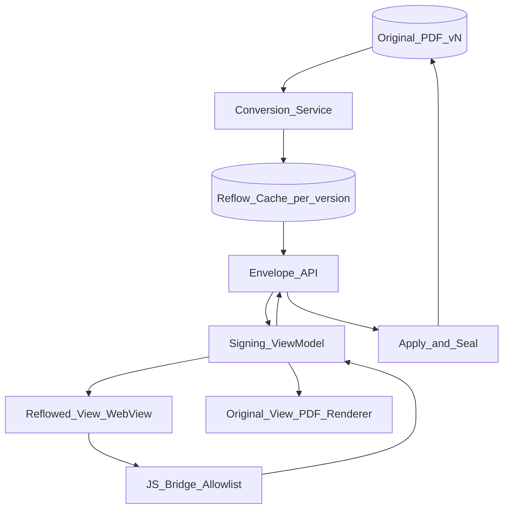
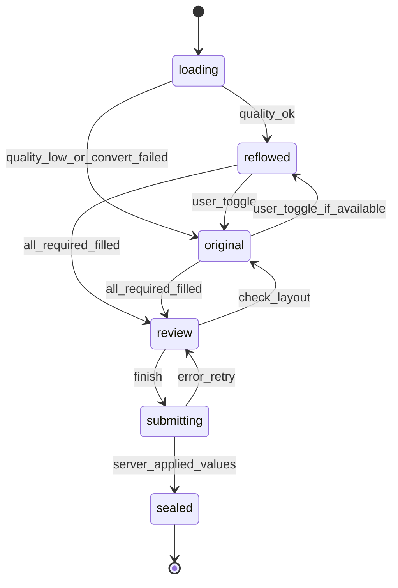

# 47 — Model Solution: Mobile-Friendly Signing on Small Screens

## Timed outline (45–60 min)

| Min | Focus |
|-----|--------|
| 0–6 | MVP: reflowed reading view + inline fields; signed record = original PDF |
| 6–18 | Convert once on server; quality score; fallback |
| 18–40 | Shared field state by tab id; WebView bridge; view toggle |
| 40–55 | Security of the bridge, failures, legal record, metrics |

## Clarify and scope

**Prompt:** “A 20-page PDF is hard to read on a phone. Design a mobile-friendly view where text reflows to the screen width and fields appear inline, while the signed record stays the original PDF.”

**MVP:** reflowed text that wraps to screen width (no pinch-zoom); fields inline in the text; one-tap toggle to the original layout with values carried over; sign → server applies values to the **original PDF** and seals it.

**Defer:** conversion engine internals (layout analysis, OCR for scans), tagged-PDF authoring, editing document text, full WCAG remediation of source PDFs.

**Ask them:** “How do you decide when a document is suitable for the mobile-friendly view?”

## NFRs

- First readable screen **< 1 s** after download; view toggle **< 300 ms**
- Same output on iOS, Android, web — one server conversion per document version
- Fidelity: never show a broken conversion; auto-fallback to original layout
- Bridge security: allow-listed messages only; no document-supplied JavaScript
- Legal record unchanged: what is sealed is the original PDF + values

## Architecture



- **Convert once, server-side:** PDF + field definitions → HTML with the **same tab ids** + quality score; cached per document version.
- **Phone:** WebView with a tiny bridge (or native text views for simple content); original view uses the PDF renderer + overlays ([Ch 43](43-pdf-viewer-field-overlays.md)).
- **One ViewModel** holds values keyed by `tabId`, not by position — both views read/write the same map.

## Data model

```text
ResponsiveDoc (GET /envelopes/{id}/documents/{doc}/responsive):
  docId, version, html, fields[], quality (0..1), etag

Field:
  tabId, type (signature|initials|text|date|checkbox),
  required, page, anchorRect   // rect used by original view

SigningState:
  view (reflowed|original), values: Map<tabId, value>,
  focusedTabId?, dirtyTabIds[], lastSyncedAt
```

```kotlin
sealed interface SigningView {
    data class Reflowed(val html: String, val fields: List<Field>) : SigningView
    data class Original(val pdfUrl: String, val fields: List<Field>) : SigningView
}
// Values keyed by tab id: both views share one map.
data class SigningState(val view: SigningView, val values: Map<String, String> = emptyMap())

fun chooseView(quality: Double, r: SigningView.Reflowed, o: SigningView.Original): SigningView =
    if (quality >= 0.8) r else o
```

## View selection and toggle



1. App requests the doc; server returns HTML + fields + quality score (or original only).
2. `quality ≥ threshold` → reflowed; else original, silently — no broken view ever shown.
3. Fill inline; each change writes `values[tabId]`; debounced `PUT /envelopes/{id}/tabs`.
4. Toggle any time: same map, so values carry over; scroll position mapped by nearest `tabId`.
5. Before finish: offer “check original layout” review.
6. Finish → server applies values to the original PDF at each field's rect, seals, returns status.

## WebView bridge

| Rule | Why |
|------|-----|
| Only `change` / `focus` messages | Smallest attack surface |
| `tabId` must be in known set | Drop forged / unknown fields |
| No JS from document content | Converted HTML is sanitised; CSP blocks inline/remote script |
| No file / network access from WebView | Content loaded from app, not navigated |
| Values validated natively | Type, length, required — same rules as original view |

```kotlin
fun parseBridge(type: String, tabId: String, value: String?, known: Set<String>): BridgeMsg? {
    if (tabId !in known) return null            // unknown field: drop
    return when (type) {
        "change" -> value?.let { BridgeMsg.FieldChanged(tabId, it) }
        "focus" -> BridgeMsg.FieldFocused(tabId)
        else -> null                             // not on the allow-list
    }
}
```

`Android:` `WebViewCompat.addWebMessageListener` with origin allow-list; JavaScript only for the bundled bridge. `iOS:` `WKScriptMessageHandler` on a named handler; `WKContentRuleList` to block loads.

## Offline

- Cache HTML + fields per version once downloaded; reading and filling work offline.
- Field values queue in the envelope outbox ([Ch 07](../part-2-building-blocks/07-offline-and-sync.md)); finish/seal needs network.
- Version changed on server while offline → re-fetch, re-map values by `tabId`, flag any removed fields.

## Failures

| Case | Behavior |
|------|----------|
| Tables, columns, scanned pages | Low quality score → original view automatically |
| Conversion not ready yet | Show original now; offer reflowed when ready |
| Value fails validation on seal | Return to review, focus the `tabId` |
| Field missing from HTML | Quality score penalised; field still reachable in original view |
| WebView renderer crash | Recreate; restore values from ViewModel (survives) |
| Document voided mid-sign | Stop; server status wins |

## Security & privacy

- Converted HTML sanitised server-side; strict CSP; no remote resources.
- Bridge allow-list + known `tabId`s only ([Ch 11](../part-2-building-blocks/11-security-and-privacy.md)).
- Cached HTML encrypted, scoped to envelope, cleared on completion/logout.
- `FLAG_SECURE` / screenshot guard where the account requires it.
- Analytics: view mode, toggles, timings — never field values or document text.

## Android UI: Views (XML) and Compose

The reflowed view is a WebView in either toolkit; the risk is its lifecycle. Basis: [Ch 4 — Android UI toolkits](../part-2-building-blocks/04-client-architecture.md#android-ui-toolkits-views-xml-and-compose).

| Concern | Views (XML) | Compose |
|---------|-------------|---------|
| Hosting | `<WebView>` in the Fragment layout | `AndroidView(factory = { WebView(it) })` |
| Lifecycle | `onPause/onResume` forward to WebView; `destroy()` in `onDestroyView` | `onRelease = { it.destroy() }`; pause/resume via a lifecycle observer |
| Recreation | Survives while the Fragment view lives | Recreated whenever it leaves composition (tab switch, `when` branch, nav) — reload cost + lost scroll |
| Keep across toggle | Hide with `visibility` | Keep it composed (hide via `Modifier`), or hold state in ViewModel and restore |
| Bridge | `addWebMessageListener` once after creation | In `factory`, not `update` — `update` runs on every recomposition |
| Original/reflow toggle | Two Fragments or `ViewFlipper` | One composable with `when (view)`; values map in the shared ViewModel |

```kotlin
@Composable
fun ReflowedView(html: String, modifier: Modifier = Modifier) = AndroidView(
    factory = { ctx -> WebView(ctx).apply { settings.javaScriptEnabled = true /* bundled bridge only */ } },
    update = { wv ->
        if (wv.tag != html) { // update runs on every recomposition: reload only on change
            wv.tag = html
            wv.loadDataWithBaseURL("https://appassets.androidplatform.net/", html, "text/html", "utf-8", null)
        }
    },
    onRelease = { it.destroy() },
    modifier = modifier,
)
```

**Mixed codebase:** there is no Compose-native WebView — every Compose app uses `AndroidView` here, so the View-world lifecycle rules still apply.

## Trade-offs

| Decision | Alternative | Why |
|----------|-------------|-----|
| Server converts once | On-device conversion | One consistent result; device output would differ per platform |
| Original PDF is the signed record | Sign the reflowed HTML | Legal fidelity; reflow is only a reading aid |
| Values by `tabId` | By page coordinates | Same values in both views |
| Quality score + auto fallback | Always reflow | Never show a broken conversion |
| WebView + bridge | Fully native rendering | Fast to ship rich text; native for simple docs |

## Metrics

reflow_eligible_rate, reflow_usage, toggle_rate, time_to_first_readable_p95, completion_rate_reflow_vs_original, pinch_zoom_events, fallback_rate_by_doc_type, seal_validation_errors.

## Staff stretch

- Tune quality threshold per doc type with completion data
- Accessibility: reflow helps Dynamic Type / font scale and screen readers
- Large-screen / foldable: side-by-side reflow + original
- Pre-convert at envelope send time to hide latency

## Follow-ups

- PDF field overlays for the original view ([Ch 43](43-pdf-viewer-field-overlays.md))
- AI summary of the agreement ([Ch 48](48-ai-agreement-summary.md))
- Adopted signature applied inline ([Ch 46](46-saved-signature-reuse.md))

## See also

- [Ch 40 Lending e-sign](40-lending-apply-esign.md) · [Ch 43 Overlays](43-pdf-viewer-field-overlays.md) · [Ch 46 Signature](46-saved-signature-reuse.md) · [Ch 48 AI summary](48-ai-agreement-summary.md) · [Performance](../part-2-building-blocks/10-performance-battery-lifecycle.md) · [Security](../part-2-building-blocks/11-security-and-privacy.md)
