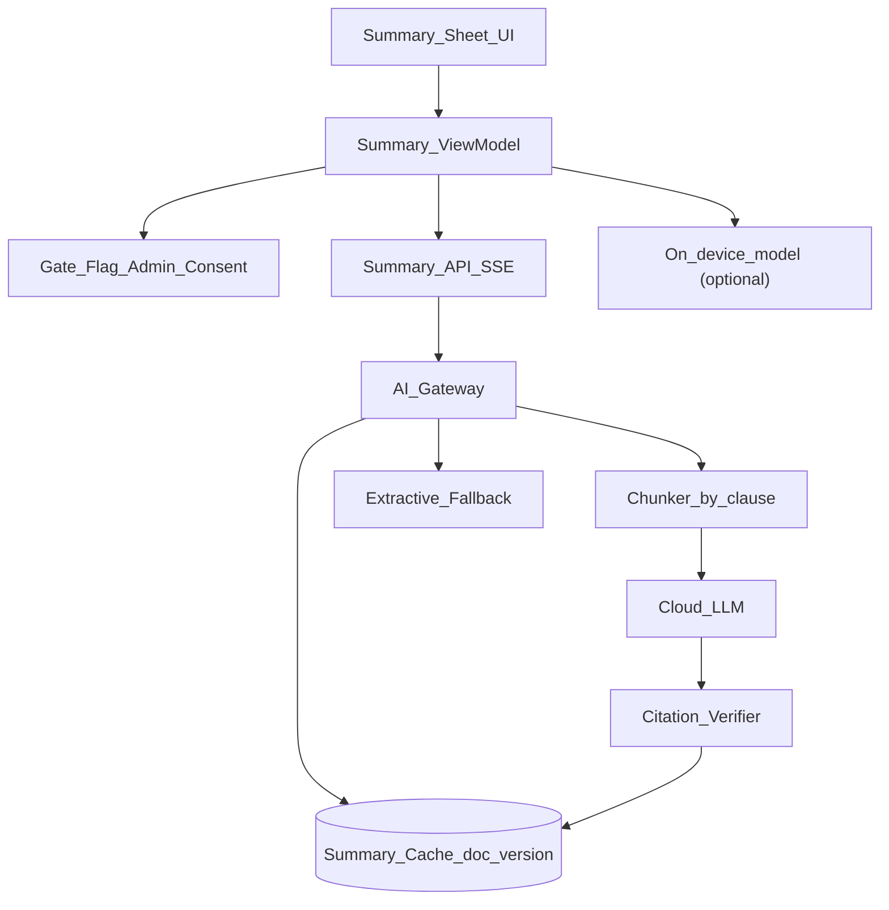
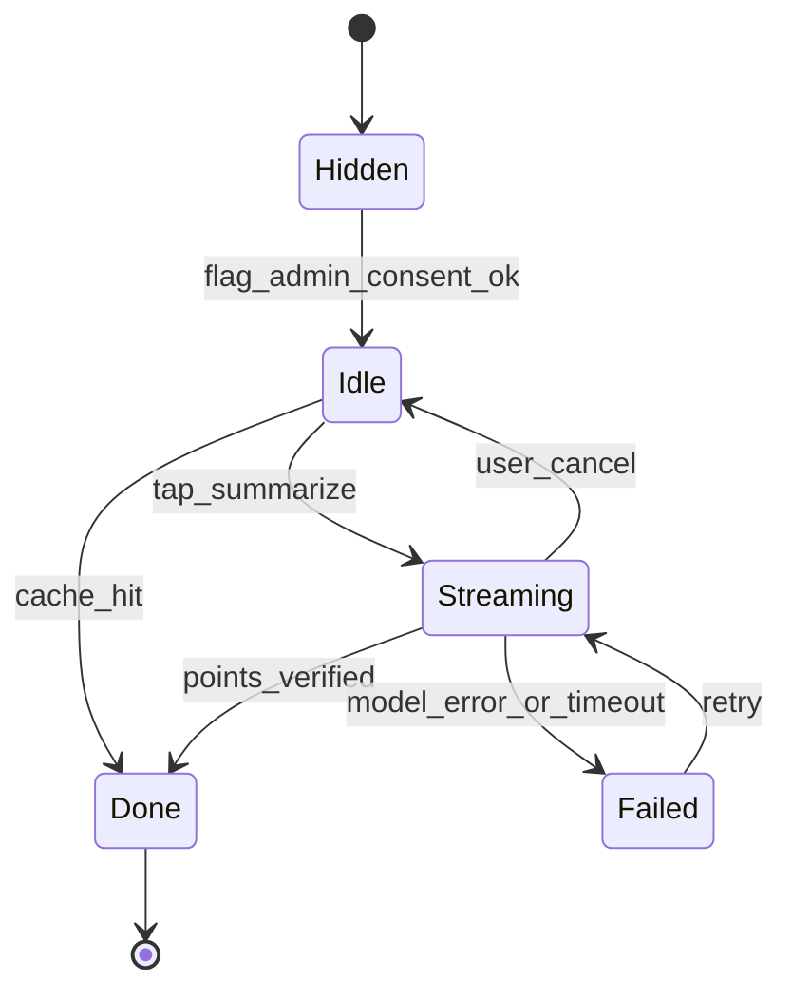
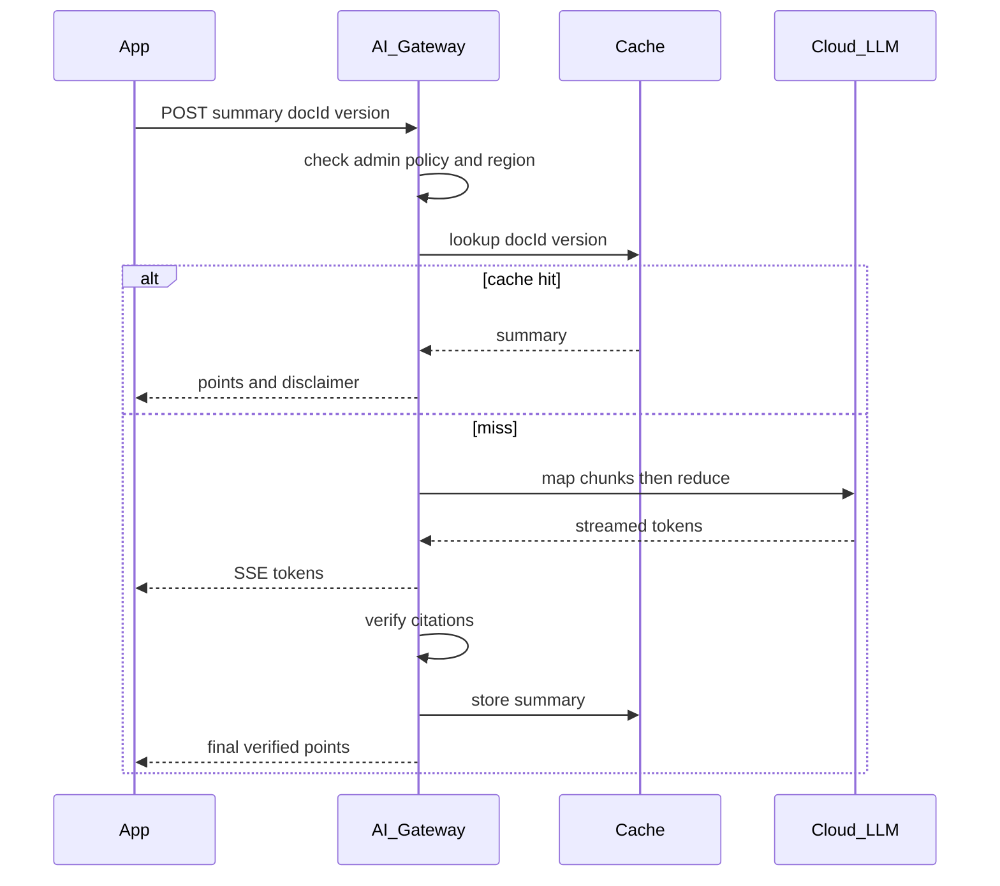

# 48 — Model Solution: AI Summary of a Long Agreement

## Timed outline (45–60 min)

| Min | Focus |
|-----|--------|
| 0–6 | MVP: “Summarize” → key points with citations; never replaces the document |
| 6–18 | Where the model runs: cloud vs on-device; gating (flag, admin, consent) |
| 18–40 | Streaming UI state machine; grounding + citations; caching per version |
| 40–55 | Safety, privacy, cost, evals, fallback, metrics |

## Clarify and scope

**Prompt:** “Before signing a 60-page agreement, the signer taps Summarize. Design the feature for Android: where the model runs, how the answer appears, and how you keep it safe and affordable.”

**MVP:** tap Summarize → streamed key points (parties, term, fees, renewal, termination, obligations); each point **cites** the clause/page it came from and deep-links there; persistent “AI-generated, may be inaccurate — read the agreement” note; hidden when the account admin disallows AI.

**Defer:** Q&A chat over the document, risk scoring / “is this clause bad?”, translation, redlining suggestions, model training/fine-tuning.

**Hard line:** summaries describe what the text says; **no legal advice**, no recommendation to sign or not.

**Ask them:** “Is summarisation on mobile the same service as the web's AI features, and what are the data-residency rules?”

## NFRs

- First tokens **~1 s** (streaming); cached summary instant
- Every point grounded: citation to clause/page; uncited points dropped
- Privacy: respect admin setting, data residency, user consent; no document text retained beyond processing; no training on customer docs
- Cost: one model run per document **version**; per-user rate limit
- Reliability: model down → fallback, never an empty screen
- Same summary on iOS / Android / web for the same version (server-cached)

## Where the model runs

| Option | Pros | Cons |
|--------|------|------|
| **Cloud model via AI gateway** (default) | Long context / chunking for 60 pages, best quality, one cached result per version, central evals + safety | Document leaves device; residency + DPA needed; cost; latency |
| On-device: Android Gemini Nano via ML Kit GenAI Summarization (AICore) | Text stays local; no per-call cost; works offline | Supported flagships only; API in beta; small input window (a few thousand tokens) → must chunk; quality varies; model may need download |
| On-device: iOS Apple Foundation Models | Same privacy benefit | Apple Intelligence devices only; small context window; different output from Android |

**Decision:** start cloud-side behind the gateway; consider on-device as a **privacy mode** for short documents on capable devices, with availability checked at runtime and cloud/extractive fallback. Never assume on-device is present.

## Architecture



- **Gateway:** authz + admin policy + residency region routing, cache lookup, chunk by clause, map (summarise chunks) → reduce (combine), verify citations, log usage (no text).
- **Citation verifier:** every point must reference a clause id whose text supports it (string/semantic overlap check); fail → drop the point.
- **Extractive fallback:** highest-scoring sentences in document order, each with its page — no model needed.

## Data model

```text
SummaryRequest:
  docId, version, locale, mode (cloud|on_device), clientRequestId

SummaryPoint:
  text, clauseId, page, quoteSpan (start,end)   // citation

Summary (server cache key = docId + version + promptVersion + modelVersion):
  points[], disclaimer, generator (llm|extractive), createdAt

AccountAiPolicy:
  aiAllowed, region, onDeviceAllowed, retention (none)
```

```kotlin
data class SummaryPoint(val text: String, val page: Int, val clauseId: String)

sealed interface SummaryState {
    data object Hidden : SummaryState                      // flag off / admin disallows / no consent
    data object Idle : SummaryState                        // "Summarize" shown
    data class Streaming(val textSoFar: String) : SummaryState
    data class Done(val points: List<SummaryPoint>, val disclaimer: String) : SummaryState
    data class Failed(val fallback: List<SummaryPoint>, val canRetry: Boolean) : SummaryState
}

fun initialState(flagOn: Boolean, accountAllowsAi: Boolean, userConsented: Boolean): SummaryState =
    if (flagOn && accountAllowsAi && userConsented) SummaryState.Idle else SummaryState.Hidden
```

## Summary flow





1. Gate: remote flag + `AccountAiPolicy.aiAllowed` + one-time user consent (“text is sent to an AI service in your region”).
2. `POST /documents/{docId}/versions/{version}/summary` → SSE stream (OkHttp / URLSession streaming).
3. UI renders tokens as **draft**; final list replaced by **verified** points only.
4. Tap a point → jump to page/clause, highlight `quoteSpan`.
5. Leave screen → cancel the stream client-side; server still caches if the run finishes.

## Grounding & safety

| Risk | Mitigation |
|------|------------|
| Hallucinated terms | Citation required per point; verifier drops unsupported points |
| Omitted key clause (fees, auto-renew) | Prompt checklist of clause types; evals measure recall |
| Reads as legal advice | System prompt + output filter: describe, don't recommend; fixed disclaimer |
| Prompt injection inside the document | Treat doc as data; delimit; ignore instructions in content; output schema enforced |
| Wrong version summarised | Cache key includes version; envelope change invalidates |
| Over-trust | Disclaimer always visible; “Read full agreement” CTA; summary never blocks or replaces signing |

## Evals

- Golden set of agreements with human-written key points per clause type.
- Measure: citation precision (point supported by cited text), key-clause recall, numeric accuracy (amounts, dates, notice periods), advice-language rate, injection resistance.
- Gate every prompt/model change on evals; shadow-run before rollout; log `promptVersion` + `modelVersion` with each cached summary.
- On-device mode evaluated separately (different model, different output).

## Offline

- Cached summary for the current version viewable offline.
- New summary needs network (cloud); on-device mode may work offline if the model is already present.
- No queueing — summary is optional; show “available when online”.

## Failures

| Case | Behavior |
|------|----------|
| Model error / timeout | Extractive fallback + retry |
| On-device model unavailable / not downloaded | Hide on-device option; cloud or extractive |
| Document over context budget | Chunk by clause (map-reduce) |
| Stream drops mid-way | Reconnect; server may already have cached result |
| Rate limit hit | Show cached or extractive; “try again later” |
| Admin disables AI mid-session | Next gate check → `Hidden`; purge local cached summary |
| Scanned PDF, no text layer | Disable Summarize (or OCR server-side if policy allows) |

## Security & privacy

- Admin policy enforced **server-side**; client gate is UX only.
- Region routing for data residency; vendor contract: no retention, no training.
- Document text not logged; usage logs = ids, token counts, latency.
- Local summary cache encrypted, scoped to envelope, cleared on logout/completion.
- Consent versioned and auditable ([Ch 11](../part-2-building-blocks/11-security-and-privacy.md)).

## Trade-offs

| Decision | Alternative | Why |
|----------|-------------|-----|
| Cloud first | On-device first | Long docs, consistent output, wide device support |
| Cache per doc version | Generate per request | Cost + identical result for all signers/platforms |
| Verified citations | Free-form summary | Trust; hallucinations surface as missing, not wrong |
| Extractive fallback | Error screen | Always something useful, no model needed |
| Stream draft, replace with verified | Wait for full result | Perceived latency vs correctness |

## Metrics

summarize_tap_rate, time_to_first_token_p95, cache_hit_rate, citation_tap_rate, dropped_unverified_points, fallback_rate, cost_per_doc_version, eval_scores_by_model_version, user_feedback_thumbs.

## Staff stretch

- Follow-up Q&A grounded on the same clause index (RAG)
- Sender-side summary at envelope creation (pre-computed, reviewed by sender)
- Per-account custom checklist (e.g. lending: APR, fees, prepayment)
- Accessibility: summary as a screen-reader-friendly entry point to long docs

## Follow-ups

- Reading long docs on phones ([Ch 47](47-small-screen-signing.md))
- Field overlays to jump to cited clause ([Ch 43](43-pdf-viewer-field-overlays.md))
- Lending disclosures summary ([Ch 40](40-lending-apply-esign.md))

## See also

- [Ch 47 Small screens](47-small-screen-signing.md) · [Ch 43 Overlays](43-pdf-viewer-field-overlays.md) · [Ch 40 Lending e-sign](40-lending-apply-esign.md) · [Ch 46 Signature](46-saved-signature-reuse.md) · [Security](../part-2-building-blocks/11-security-and-privacy.md) · [Performance](../part-2-building-blocks/10-performance-battery-lifecycle.md)
