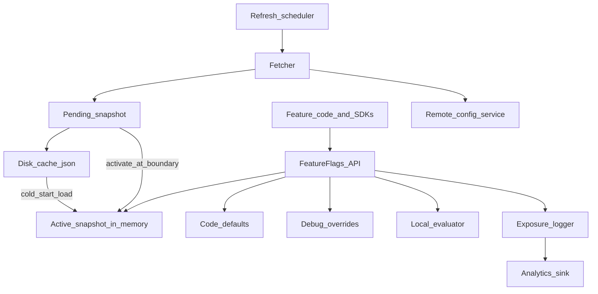
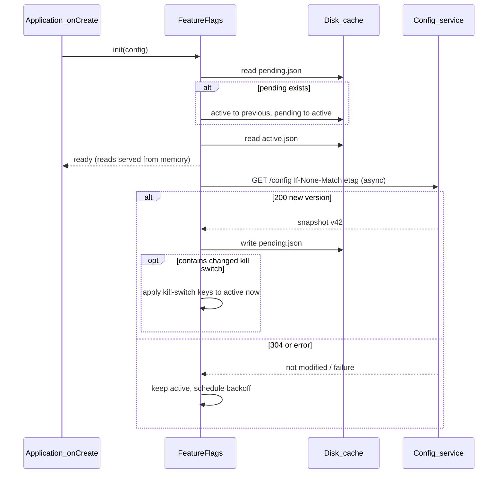
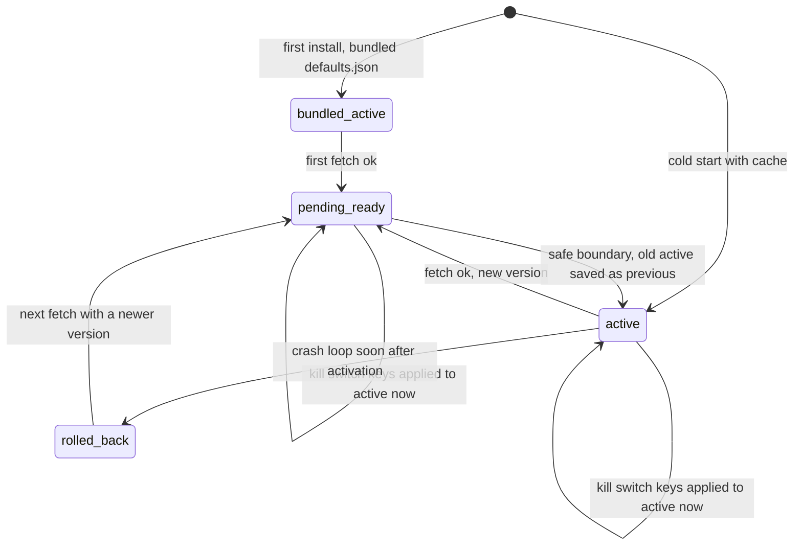

# 49 — Model Solution: Feature Flag & Remote Config Library

## Timed outline (45–60 min)

| Min | Focus |
|-----|--------|
| 0–6 | Requirements: who calls it (app teams, SDKs), what a flag is, offline + defaults |
| 6–15 | Public API: typed flags, `isEnabled`, defaults in code, observe vs snapshot |
| 15–30 | Cache + refresh policy; fetched vs activated; targeting + stable rollout |
| 30–42 | Kill switch, exposure logging, SDK vs app flags |
| 42–55 | Failures, privacy, UI wiring (Views + Compose), trade-offs, metrics |

## Clarify and scope

**Prompt:** “Design a feature flag / remote config library for Android that every team in the app (and our SDKs) can use.”

Ask before drawing anything:

| Question | Typical answer → design impact |
|----------|-------------------------------|
| Who evaluates rules — server or client? | Server by default (segments stay server-side); client keeps a small local evaluator for pre-login and offline |
| Flags only, or typed config too? | Both: booleans, ints, doubles, strings, small JSON |
| Is it used for experiments? | Yes → exposure logging is mandatory, assignment must be sticky |
| Can a value change mid-session? | Normally no (flicker, inconsistent funnels); kill switches yes |
| Who consumes it? | App feature modules **and** shipped SDKs → namespacing, no app coupling |
| Offline / first launch? | Must work with zero network: defaults compiled into code |

**MVP:** fetch config from a remote service; `isEnabled(flag)` + typed getters with code defaults; disk cache for offline and cold start; refresh on cold start / foreground with throttling; targeting by app version, user segment and percentage rollout; activation at a safe boundary; kill switch; exposure events for experiments.

**Defer:** the admin console, rule authoring UI, experiment statistics, multi-armed bandits, real-time streaming of every flag change.

## NFRs

| NFR | Target |
|-----|--------|
| Read latency | `isEnabled` is a **non-blocking in-memory** lookup — callable on the main thread, in `onBindViewHolder`, in a composable |
| Availability | Never throws; worst case returns the code default |
| Consistency | One config version per session (except kill switches); same user → same bucket on every device and platform |
| Freshness | Normal flags: next cold start or next safe boundary; client kill switch: best-effort minutes while the app is active, worst case next foreground (the server-side reject is the real kill switch) |
| Footprint | No reflection-heavy JSON; payload a few KB; no wakeups of its own in the background |
| Coupling | Core module depends only on Kotlin + coroutines; network, storage and analytics are injected |
| Privacy | Stable id is pseudonymous; no PII in targeting context sent to logs |

## Architecture



Resolution order for every read: **debug override → active snapshot → local evaluator (pre-login / offline rules) → code default**. Each layer is optional; the last one always exists.

## Public API

Requirement first: callers must not be able to typo a key, mismatch a type, or forget a default.

```kotlin
// Flags are declared once, in code, with their default — the default IS the offline behaviour.
sealed class Flag<T : Any>(val key: String, val default: T, val killSwitch: Boolean = false)
class BoolFlag(key: String, default: Boolean, killSwitch: Boolean = false) :
    Flag<Boolean>(key, default, killSwitch)
class LongFlag(key: String, default: Long) : Flag<Long>(key, default)
class StringFlag(key: String, default: String) : Flag<String>(key, default)

object CheckoutFlags {                     // owned by the checkout team, lives in its module
    val NewCheckout = BoolFlag("checkout.v2_enabled", default = false)
    val UpiIntent = BoolFlag("checkout.upi_intent", default = true, killSwitch = true)
    val MaxSavedCards = LongFlag("checkout.max_saved_cards", default = 5)
}

interface FeatureFlags {
    fun isEnabled(flag: BoolFlag): Boolean                 // non-blocking, never throws
    fun <T : Any> get(flag: Flag<T>): T                    // typed value or default
    fun <T : Any> observe(flag: Flag<T>): Flow<T>          // emits on activation (kill switches live)
    suspend fun refresh(reason: RefreshReason): RefreshResult
    fun setContext(context: TargetingContext)              // login/logout, locale change
}

enum class RefreshReason { COLD_START, FOREGROUND, LOGIN, PUSH_HINT, MANUAL }
sealed interface RefreshResult {
    data class Updated(val version: Long) : RefreshResult
    data object NotModified : RefreshResult
    data object Throttled : RefreshResult
    data class Failed(val cause: Throwable) : RefreshResult
}
```

**Configuration** (builder, all with safe defaults):

| Option | Default | Notes |
|--------|---------|-------|
| `minFetchInterval` | 12 h release / 0 debug | Server can raise it via response header (backoff) |
| `activation` | `NEXT_COLD_START` | Alternatives: `ON_NEXT_SCREEN`, `IMMEDIATE` (tests) |
| `fetchTimeout` | 3 s | Startup never waits longer than this, usually not at all |
| `stableIdProvider` | install id, then user id after login | Must be stable across reinstall for logged-in users |
| `exposureSink` | no-op | Injected so the library does not depend on an analytics SDK |
| `transport` | injected `suspend (Request) -> Response` | Reuse app's OkHttp; SDKs pass their own |

**Why typed `Flag` objects, not `getBoolean("key")`:** compile-time type safety, one place for the default, dead-flag detection by "find usages", and lint can forbid raw string access.

## Data model

```text
ConfigSnapshot:
  version (server monotonic), etag, fetchedAt, activatedAt?,
  ttlSeconds, minFetchIntervalSeconds,
  values: Map<key, FlagValue>

FlagValue:
  type (bool|long|double|string|json),
  raw, variant?, experimentId?, ruleId?, killSwitch (bool),
  requiresFresh (bool)   // past TTL → serve code default instead of stale value

TargetingContext:            // what the client sends / evaluates against
  stableId (pseudonymous), userId?, appVersionCode, osApi,
  platform, locale, country, segments[]?   // segments usually resolved server-side

LocalRule (only for client-evaluated flags):
  key, minAppVersion?, maxAppVersion?, segmentsAny[]?,
  rolloutBasisPoints (0..10000), salt, valueIfIn, valueIfOut

Stored on disk:
  files/flags/active.json     (what reads are served from)
  files/flags/pending.json    (fetched, not yet activated)
  files/flags/previous.json   (last known good: the snapshot active before the last activation)
  all writes atomic: tmp + rename
  overrides.json (debug builds only)
```

## Fetch and activation

**Fetched vs activated** is the core idea: a successful fetch only writes a **pending** snapshot. Readers keep seeing the **active** snapshot until a safe boundary, so a screen never flips layout under the user's thumb and a funnel never mixes two variants.





**First install:** there is no cache, so either (a) ship a bundled `defaults.json` snapshot built at release time, or (b) allow a **one-time short wait** (≤ fetchTimeout) on the splash screen for the first fetch and activate immediately. Pick (a) plus code defaults; never block cold start on network.

**Refresh policy:**

| Trigger | Action | Why |
|---------|--------|-----|
| Cold start | Async fetch → pending | Cheapest, covers most sessions |
| App foreground (`ProcessLifecycleOwner` `ON_START`) | Fetch if `now - fetchedAt > minFetchInterval` | Long-lived processes still converge |
| Login / logout / account switch | Fetch immediately; activate at the navigation boundary that follows | Targeting context changed |
| Silent push “config changed” (FCM data message) | Fetch, bypass interval once | Best-effort only: normal-priority data messages wait for Doze maintenance windows and non-notifying high-priority ones can be deprioritised; iOS `content-available` is throttled and not delivered after force-quit. Minutes while active, worst case next foreground |
| Periodic WorkManager | **Not** by default | Battery; foreground + push is enough; offer as opt-in for SDKs with no UI |

Throttle client-side (interval + jitter) and honour a server `Retry-After`/min-interval header so a bad release can't DDoS the config service.

## Targeting

| Dimension | Where evaluated | Notes |
|-----------|-----------------|-------|
| App version / OS API | Server (sent in request) + local guard | Local guard protects against a stale cache enabling a feature the binary can't support |
| Segment (plan, country, cohort, employee) | Server | Segment membership is server data; don't ship lists to the client |
| % rollout | Server **and** client use the same hash | Same bucket everywhere, offline or not |
| Pre-login / no network | Client `LocalRule`s | Small, explicit set — usually SDK and startup flags |

**Stable percentage rollout:** bucket = hash(salt + flagKey + stableId) mod 10 000. A per-flag salt keeps flags independent (user isn't in the first 5% of *every* rollout); raising 5% → 20% only adds users, never reshuffles. Don't use `Random` or `String.hashCode()` across platforms — iOS and backend must compute the same bucket, so use a specified hash (SHA-256 / MurmurHash3) and agree on byte order.

```kotlin
fun bucket(stableId: String, flagKey: String, salt: String): Int {
    val d = MessageDigest.getInstance("SHA-256")
        .digest("$salt:$flagKey:$stableId".toByteArray(Charsets.UTF_8))
    val n = ((d[0].toLong() and 0xFF) shl 24) or ((d[1].toLong() and 0xFF) shl 16) or
        ((d[2].toLong() and 0xFF) shl 8) or (d[3].toLong() and 0xFF)
    return (n % 10_000).toInt()                 // 0..9999 → basis points
}

data class LocalRule(
    val key: String,
    val minAppVersion: Long? = null,
    val segmentsAny: Set<String> = emptySet(),
    val rolloutBasisPoints: Int,                // 0..10000
    val salt: String,
)

data class Ctx(val stableId: String, val appVersionCode: Long, val segments: Set<String>)

fun LocalRule.matches(ctx: Ctx): Boolean =
    (minAppVersion == null || ctx.appVersionCode >= minAppVersion) &&
        (segmentsAny.isEmpty() || segmentsAny.any { it in ctx.segments }) &&
        bucket(ctx.stableId, key, salt) < rolloutBasisPoints
```

**Stable id choice:** logged-out → install-scoped random UUID (not ANDROID_ID / advertising id); logged-in → server-assigned pseudonymous user id so a user sees the same variant on phone and tablet. Bucketing on install id and then switching to user id at login can flip variants — decide per experiment which unit it randomizes on.

## Kill switch

| Aspect | Normal flag | Kill switch |
|--------|-------------|-------------|
| Purpose | Rollout, config, experiment | Turn off a broken feature/integration now |
| Activation | Next safe boundary | **Immediately** on fetch, even mid-session |
| Default direction | Usually off | Default = *safe* state (often “feature on” for legacy path, “off” for new path) — documented per flag |
| Delivery | Cold start / foreground fetch | + best-effort silent push hint to force fetch; the authoritative switch is server-side |
| UI handling | n/a | Caller `observe()`s it and degrades gracefully (hide entry point, show “temporarily unavailable”) |

**The real kill switch is server-side:** the backend rejects (or routes around) the broken call for every client immediately, with an error the app already handles. The client flag only hides the entry point so users don't hit that error — it arrives best-effort (minutes while the app is active, worst case next foreground) and never reaches old app versions or devices running a cached config.

## Exposure logging

Log when a user **actually experiences** a variant, not when config is fetched — otherwise the experiment includes users who never opened the screen and dilutes the effect.

```kotlin
class ExposureLogger(private val sink: (String, Map<String, String>) -> Unit) {
    private val seen = java.util.concurrent.ConcurrentHashMap.newKeySet<String>()

    fun onRead(key: String, variant: String?, experimentId: String?, configVersion: Long) {
        if (experimentId == null || variant == null) return          // plain flags: no event
        if (!seen.add("$experimentId:$variant:$configVersion")) return // once per session+version
        sink("flag_exposure", mapOf(
            "experiment_id" to experimentId, "variant" to variant,
            "flag" to key, "config_version" to configVersion.toString(),
        ))
    }
}
```

- Fire from the read path (`get`/`isEnabled`) — cheap set lookup; actual send is the analytics library's batch queue.
- Provide `peek(flag)` that does **not** log (for prefetching or rendering a hidden tab).
- Dedupe per session + config version; the analytics pipeline dedupes again server-side.

## SDK flags vs app flags

| Concern | App flags | SDK flags (shipped library, e.g. checkout SDK) |
|---------|-----------|-----------------------------------------------|
| Owner | App feature teams | SDK team |
| Namespace | `checkout.*`, `feed.*` | `sdk.checkout.*` — separate config **project**, separate fetch |
| Instance | App singleton (via DI) | SDK's own instance; never shares the host's cache files or `stableId` |
| Context | User + app version | SDK version + merchant/host app id + device |
| Host override | n/a | Host may pass explicit options; remote flags may only tighten (e.g. disable a payment method), never enable something the host turned off |
| Dependency | Core flags module | Core module vendored/shaded or minimal; no Firebase dependency forced on host |

Same core library, two instances — minimal coupling is the point.

## Offline

- Reads always work: active snapshot in memory → disk → bundled defaults → code defaults.
- Offline fetch failures are silent; `RefreshResult.Failed` is for callers that care (debug menu).
- `ttl` is advisory: a stale snapshot is still better than defaults, **except** flags marked `requiresFresh` (rare, e.g. legal copy) which fall back to default after TTL.
- Local rules let pre-login screens roll out without network.

## Failures

| Case | Behavior |
|------|----------|
| No network on first install | Bundled snapshot + code defaults; fetch on next foreground |
| Corrupt / partial JSON on disk | Discard file, log, keep previous good snapshot (atomic tmp+rename prevents most of this) |
| Unknown key in payload | Ignore (old binary, newer config) |
| Type mismatch (`"true"` for a bool, out-of-range long) | Return default for that key + log `flag_type_mismatch`; never crash |
| Config service 5xx / timeout | Keep active; exponential backoff with jitter; honour `Retry-After` |
| Bad config pushed (feature crashes) | Server-side reject + kill switch flip; crash-loop guard: N crashes within M seconds of activation → copy `previous.json` back to active, drop pending, report `config_rolled_back{version}` |
| Process killed mid-write | Pending file either complete (renamed) or absent |
| Login changes targeting | Fetch with new context; activate at next navigation boundary, not mid-screen |
| Clock skew | Use server `version`/ETag ordering, not device time, to pick the newer snapshot |
| Flag read before init | Returns code default (and debug-asserts) — never blocks main thread |

## Security & privacy

- Flags are **not authorization**. A rooted user can flip any client flag; the backend enforces entitlement.
- No secrets in remote config (API keys, credentials). It is readable on device.
- TLS + optionally a signed payload (server signs the snapshot; client verifies) for high-risk switches like disabling certificate pinning — better: don't make such things remotely configurable at all.
- Stable id is pseudonymous; targeting attributes sent to the service are minimised (no email/phone).
- Debug override UI and `overrides.json` compiled only into debug/internal builds.
- Exposure events respect analytics consent (the sink is the consent-aware analytics library).

## Android UI: Views (XML) and Compose

The library is UI-agnostic; the rule for both toolkits is the same: **read flags in the ViewModel, once per screen, into `UiState`** — not scattered `isEnabled` calls inside views or composables. That gives a stable value for the whole screen, testable logic, and one exposure event. Basis: [Ch 4 — Android UI toolkits](../part-2-building-blocks/04-client-architecture.md#android-ui-toolkits-views-xml-and-compose).

| Concern | Views (XML) | Compose |
|---------|-------------|---------|
| Where flags are read | ViewModel → `UiState` | Same ViewModel → `UiState` |
| Collecting | `viewLifecycleOwner.repeatOnLifecycle(STARTED)` | `collectAsStateWithLifecycle()` |
| Variant layouts | Two layouts / `ViewStub` inflated by variant; or toggle `isVisible` | `if (state.newCheckout) NewCheckout() else LegacyCheckout()` |
| Kill switch live | `observe(flag)` combined into state; Fragment hides the entry point | Same flow; recomposition hides it |
| Lists | Flag resolved once per list, passed to adapter — not in `onBindViewHolder` per row | Pass as a param; avoid reading inside each item lambda |
| Previews / tests | Fake `FeatureFlags` in ViewModel tests; Espresso with overrides | `@Preview` both variants by passing state; no library needed in previews |
| Debug menu | Internal-build Activity listing flags with override switches | Same screen in Compose |

```kotlin
data class CartUiState(val newCheckout: Boolean = false, val upiAvailable: Boolean = true)

class CartViewModel(flags: FeatureFlags) : ViewModel() {
    // Snapshot at screen entry: won't flip mid-screen when a new config is fetched.
    private val newCheckout = flags.isEnabled(CheckoutFlags.NewCheckout)

    // Kill switch: observed live, so a broken UPI path disappears without restart.
    val state: StateFlow<CartUiState> = flags.observe(CheckoutFlags.UpiIntent)
        .map { upi -> CartUiState(newCheckout = newCheckout, upiAvailable = upi) }
        .stateIn(viewModelScope, SharingStarted.WhileSubscribed(5_000), CartUiState(newCheckout))
}
```

=== "Views (XML) + Fragment"

    ```kotlin
    class CartFragment : Fragment(R.layout.fragment_cart) {
        private val vm: CartViewModel by viewModels { cartVmFactory }

        override fun onViewCreated(view: View, savedInstanceState: Bundle?) {
            val upiButton = view.findViewById<Button>(R.id.pay_upi)
            val newCheckoutBanner = view.findViewById<View>(R.id.new_checkout_banner)
            viewLifecycleOwner.lifecycleScope.launch {
                viewLifecycleOwner.repeatOnLifecycle(Lifecycle.State.STARTED) {
                    vm.state.collect { s ->
                        newCheckoutBanner.isVisible = s.newCheckout
                        upiButton.isVisible = s.upiAvailable
                    }
                }
            }
        }
    }
    ```

=== "Compose"

    ```kotlin
    @Composable
    fun CartRoute(vm: CartViewModel) {
        val state by vm.state.collectAsStateWithLifecycle()
        CartScreen(state)
    }

    @Composable
    fun CartScreen(state: CartUiState) {
        Column {
            if (state.newCheckout) Text("New checkout") // variant chosen once per screen
            if (state.upiAvailable) Button(onClick = {}) { Text("Pay with UPI") }
        }
    }
    ```

**iOS parity:** same API in Swift (`flags.isEnabled(.newCheckout)`), snapshot in an actor, activation at next launch or a navigation boundary like Android (not `sceneDidBecomeActive` — it also fires after Control Center or Notification Center is dismissed, flipping UI mid-screen), best-effort silent push via APNs `content-available` (throttled, not delivered after force-quit), identical SHA-256 bucketing so a user's variant matches across platforms.

## Trade-offs

| Decision | Alternative | Why |
|----------|-------------|-----|
| Server-side evaluation, resolved values returned | Ship all rules to client | Smaller payload, segments stay private, rules change without app release; client keeps a small local evaluator for offline/pre-login |
| Activate at safe boundary | Apply immediately | No flicker, consistent funnels; kill switches are the explicit exception |
| Typed `Flag<T>` objects with defaults in code | String keys + defaults at call site | Type safety, one default, dead-flag cleanup by usages |
| Hash-based bucketing on stable id | Server random assignment stored per user | Works offline and pre-login, deterministic across platforms; server assignment needed for complex allocation |
| Foreground + push-triggered fetch | Periodic background polling / streaming | Battery and quota; streaming only if product truly needs sub-minute config |
| Exposure on read | Exposure on fetch | Correct experiment populations |
| Build in-house thin core over a vendor (Firebase Remote Config, LaunchDarkly, Statsig…) | Call vendor SDK directly everywhere | Swap vendors, SDK isolation, testability; cost is maintaining the adapter |
| Bundled defaults snapshot | Block splash on first fetch | Cold start time beats first-session freshness |

## Metrics

| Metric | Why |
|--------|-----|
| `config_fetch_success_rate`, latency p50/p95 | Service and client health |
| `config_age_at_read` (distribution) | Are users actually on recent config? |
| `activation_lag` (fetched → activated) | Rollout speed realism |
| `defaults_served_rate` | Users running blind on code defaults |
| `flag_type_mismatch`, `snapshot_parse_error` | Bad config pushes |
| `kill_switch_propagation_time` | From flip to 90% of active devices |
| `exposure_events` vs `screen_views` | Exposure wiring sanity per experiment |
| Crash rate segmented by flag variant | Catch a bad rollout before it ramps |

## Staff stretch

- **Flag lifecycle governance:** owner + expiry date on every flag; CI fails on flags past expiry; lint for raw string keys; dashboards of stale flags (temporary flags become permanent debt).
- **Guarded rollouts:** auto-pause ramp when crash-free sessions or a guardrail metric regresses for the treatment bucket.
- **Mutual exclusion layers** for experiments touching the same surface; holdout groups.
- **Config as code:** flags declared in a shared schema that generates Kotlin + Swift + backend constants — no drift.
- **Multi-process apps** (`:sdk` or `:push` process): one writer, others read the file; or a `ContentProvider` façade.
- **SDUI interplay:** server-driven screens (Ch 50) can carry flag evaluation server-side — fewer client flags for layout.

## Follow-ups

- How do you guarantee one user sees the same variant on Android, iOS and web?
- A flag was rolled to 50% and crashes spike — walk through the next 10 minutes.
- How would you test the library itself? (fake transport, fake clock, golden bucket vectors shared with backend/iOS.)
- How would an SDK used by 1 000 merchant apps get its own flags without forcing a Firebase dependency?

## See also

- [Ch 50 — Server-driven UI](50-server-driven-ui.md) · [Ch 21 — Checkout payment SDK](21-checkout-payment-sdk.md) · [Ch 12 — Observability and quality](../part-2-building-blocks/12-observability-and-quality.md)
- [Ch 6 — Caching and storage](../part-2-building-blocks/06-caching-and-storage.md) · [Ch 7 — Offline and sync](../part-2-building-blocks/07-offline-and-sync.md) · [Ch 9 — Realtime and push](../part-2-building-blocks/09-realtime-and-push.md)
- [Ch 13 — Social feed](13-social-feed.md) · [Ch 53 — Food ordering app](53-food-ordering-app.md) · [Ch 51 — File downloader library](51-file-downloader-library.md)
