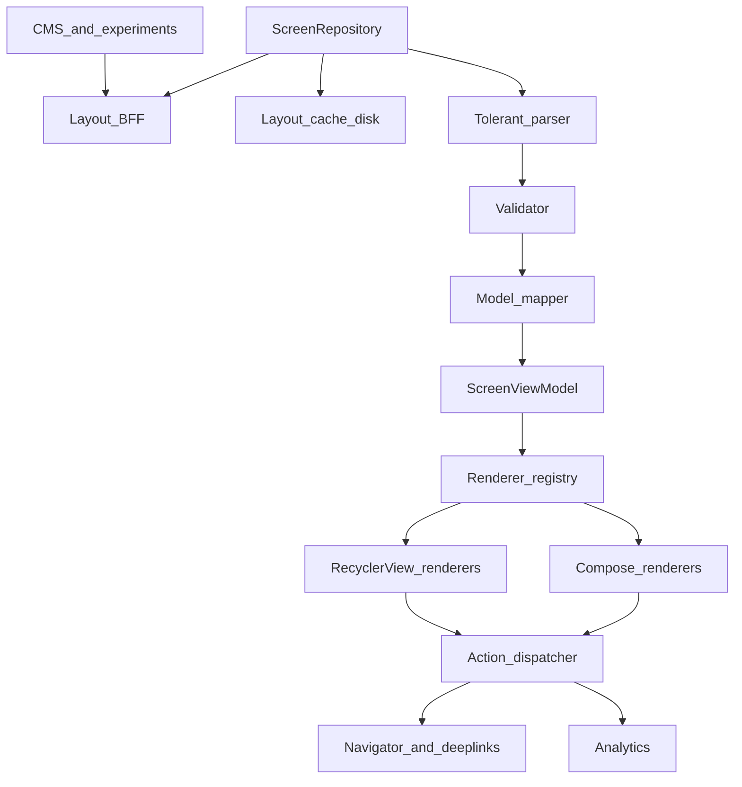
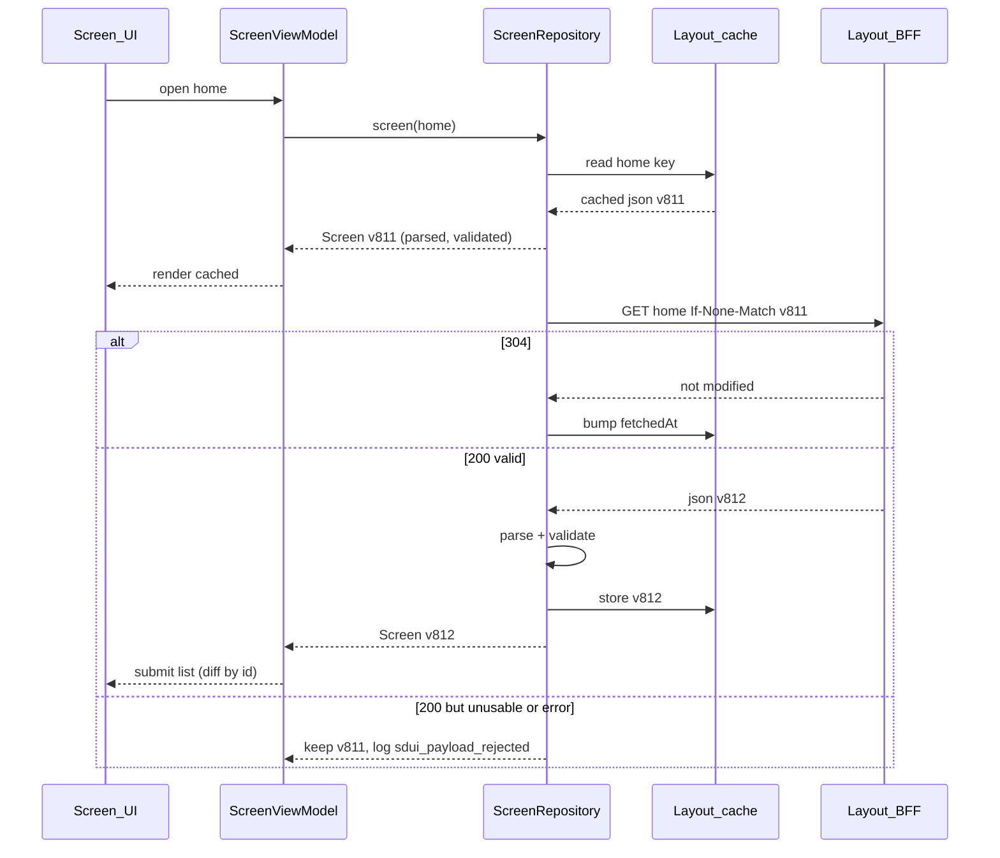
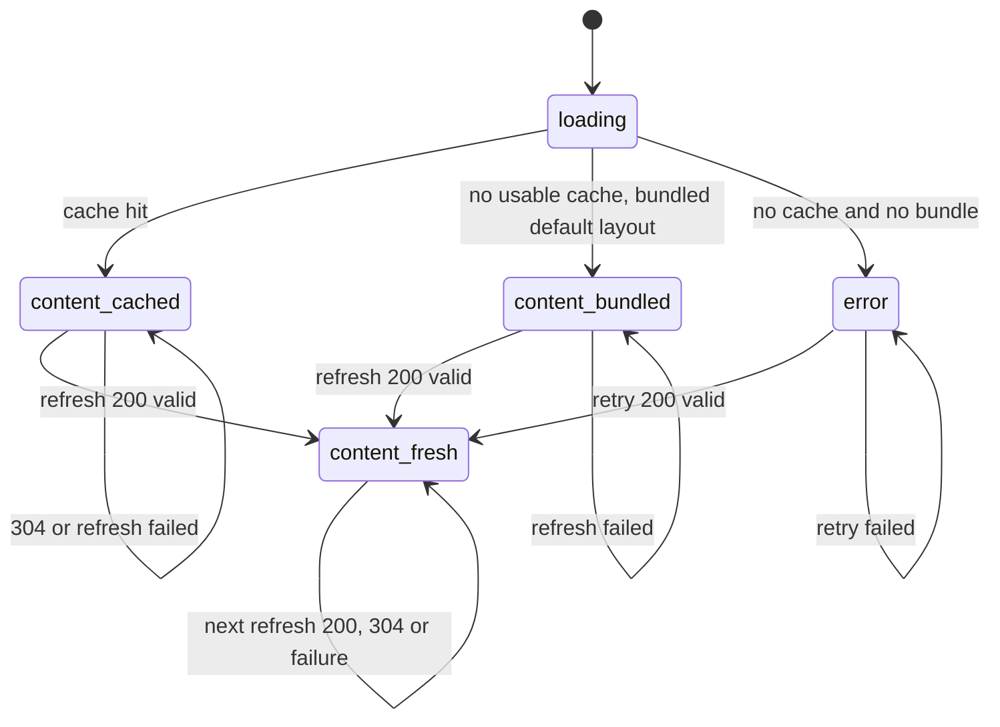

# 50 — Model Solution: Server-Driven UI System

## Timed outline (45–60 min)

| Min | Focus |
|-----|--------|
| 0–6 | Requirements: which screens, which components, what must never break |
| 6–16 | Schema: components, props, actions, versioning, capability negotiation |
| 16–30 | Client pipeline: fetch → parse → validate → map → render; registry |
| 30–42 | Rendering both ways (RecyclerView vs LazyColumn), nested carousels, caching |
| 42–55 | Failures, a11y, analytics, testing, trade-offs, metrics |

## Clarify and scope

**Prompt:** “Design a server-driven UI system so the home / promo screens can change layout without an app release.”

| Question | Typical answer → design impact |
|----------|-------------------------------|
| Which screens? | Home, campaign landing, category pages — content-heavy, list-shaped. **Not** checkout or forms with complex validation |
| How dynamic? | Order, props, which components appear; **not** arbitrary new widgets — those need a release |
| Old app versions? | Must keep working for ≥ 18 months of binaries → versioning + capability negotiation |
| Offline? | Show last good layout; never a blank screen |
| Interactivity? | Taps that navigate / open product / track; no server-shipped code |
| Who authors layouts? | Internal CMS + backend composition service; humans make mistakes → validation on both sides |

**MVP:** server returns a screen as an ordered list of typed components (text, image, button, banner, list/section, carousel) with props and actions; client parses into domain models and renders with a fixed set of native renderers; actions model (navigate, open product, track); unknown / invalid components are skipped or replaced by a declared fallback without crashing; cached layout for offline and instant start; impression + click analytics keyed by component id.

**Defer:** arbitrary layout primitives (rows/columns/flex trees), server-shipped logic/scripting, forms with validation, the CMS authoring UI, personalization ranking.

## NFRs

| NFR | Target |
|-----|--------|
| Robustness | A bad component never crashes the screen; a bad payload never blanks it |
| Startup | Cached layout renders in the first frame; network refresh behind it |
| Scroll | 60/120 fps; view/composition reuse across component types; no re-layout of unchanged items on refresh |
| Compatibility | Any server payload is safe for any shipped binary (server only sends what the client declares it supports) |
| Accessibility | Every renderer is accessible by construction; server props can't remove labels or touch targets |
| Observability | Every component impression/click attributable to (screen, layout version, component id, position) |
| Size | Payload tens of KB; images by URL, not inline |

## Architecture



Rule: **JSON never reaches the UI layer.** The parser turns wire DTOs into a sealed `Component` model; renderers only know the model. That keeps renderers testable, previewable, and identical for Views and Compose.

## API contract

**Request** — the client tells the server what it can render:

```text
GET /v1/screens/home?locale=en-IN
Headers:
  X-App-Version: 5.42.0 (5420)
  X-SDUI-Schema: 3
  X-SDUI-Components: text@1,image@1,button@1,banner@2,section@1,carousel@2,product_card@1
  X-SDUI-Actions: navigate@1,open_product@1,track@1
  If-None-Match: "home-v812-en"
```

**Response** — ordered, flat list at the top; containers (`section`, `carousel`) hold children one level deep:

```json
{
  "schemaVersion": 3,
  "screenId": "home",
  "layoutVersion": "v812",
  "ttlSeconds": 900,
  "components": [
    { "id": "hdr_1", "type": "text", "v": 1,
      "props": { "text": "Good evening, Asha", "style": "title", "a11yHeading": true } },
    { "id": "bn_diwali", "type": "banner", "v": 2,
      "props": { "imageUrl": "https://cdn.example.com/b/diwali.webp", "aspectRatio": 2.5,
                 "contentDescription": "Diwali sale, up to 40% off" },
      "action": { "type": "navigate", "url": "app://campaign/diwali" },
      "fallback": { "id": "bn_diwali_fb", "type": "image", "v": 1,
                    "props": { "imageUrl": "https://cdn.example.com/b/diwali.webp",
                               "contentDescription": "Diwali sale" } } },
    { "id": "car_trending", "type": "carousel", "v": 2,
      "props": { "title": "Trending" },
      "children": [
        { "id": "p_101", "type": "product_card", "v": 1,
          "props": { "title": "Kurta", "priceMinor": 129900, "currency": "INR",
                     "imageUrl": "https://cdn.example.com/p/101.webp" },
          "action": { "type": "open_product", "productId": "101" } }
      ] },
    { "id": "btn_all", "type": "button", "v": 1,
      "props": { "label": "See all offers" },
      "action": { "type": "navigate", "url": "app://offers" } }
  ]
}
```

| Field | Rule |
|-------|------|
| `id` | Stable across refreshes for the same logical item — the list diff key, the analytics key, the saved-state key |
| `type` + `v` | Component type and its **props schema version**; client renders only if it supports `type@>=v` |
| `fallback` | Optional simpler component to use when `type@v` unsupported (e.g. banner@2 → image@1) |
| `action` | Data, not code: a typed intent the client maps to an allow-listed handler |
| `schemaVersion` | Envelope version; a major bump the client doesn't know → treat as unusable, use cache |
| `layoutVersion` / ETag | Cache validation, analytics attribution, rollback target |

**Versioning rules:** additive props are minor (old clients ignore unknown keys); renamed/removed/semantics-changed props bump the component `v`; a new component is a new `type`. The server filters/downgrades by the client's declared capabilities — the fallback in the payload is a second line of defence, not the primary mechanism.

## Data model

```text
Screen:
  screenId, schemaVersion, layoutVersion, fetchedAt, ttlSeconds,
  components: List<Component>

Component (sealed; every variant has id):
  Text(id, text, style, heading)
  Image(id, url, aspectRatio, contentDescription?, action?)
  Banner(id, imageUrl, aspectRatio, contentDescription, action?)
  Button(id, label, style, action)
  Section(id, title?, children)   // wire-only: the mapper flattens it (title → Text(heading=true),
                                  // children spliced into the parent list) — no Section model or renderer
  Carousel(id, title?, children: List<Component>)       // horizontal, nested list
  ProductCard(id, title, priceMinor, currency, imageUrl, action)

Action (sealed):
  Navigate(url)               // allow-listed app:// routes or https on allow-listed hosts
  OpenProduct(productId)
  Track(event, params)
  None

Cache row (Room or file per key):
  key = screenId + locale + userSegmentHash,
  envelopeSchemaVersion (from the payload, not the client),
  etag, layoutVersion, json (raw, re-parsed on load), fetchedAt, ttlSeconds
```

Caching the **raw JSON** (not parsed models) means a newer binary can re-parse an old cache with its newer parser; the key deliberately **excludes** the client's schema version (otherwise every app update misses its own cache). Instead the row stores the payload's envelope `schemaVersion`; on load, if this binary can't read that major version, the row is discarded and the bundled layout is used until the refresh lands.

## Load flow





Something cached or bundled is always rendered before the network answers; the network-first path exists only out of `error`, which should be unreachable for the home screen — ship a **bundled default layout** (JSON in assets, built at release) as the last resort.

## Parsing, validation and unknown components

Tolerance is per component, not per screen: one bad item is dropped, its siblings render.

| Situation | Behaviour |
|-----------|-----------|
| Unknown `type` | Use `fallback` if present and supported; else drop; log `sdui_unknown_component{type}` |
| Supported type, `v` too new | Same as unknown (fallback or drop) |
| Required prop missing / wrong type | Drop that component; log `sdui_invalid_component{type,field}` |
| Unknown extra props | Ignore (forward compatible) |
| Duplicate `id` | Keep first; log — duplicate keys crash `LazyColumn` and break `DiffUtil` |
| Unknown action type / non-allow-listed URL | Render component, action becomes `None`; log |
| Empty container after drops | Drop the container too (no empty “Trending” header) |
| Envelope `schemaVersion` unknown major / JSON unparsable | Reject whole payload → keep cache / bundled |
| Too many dropped (> X%) | Reject payload, keep previous — likely a bad publish, not a few new types |

```kotlin
sealed interface Action {
    data class Navigate(val url: String) : Action
    data class OpenProduct(val productId: String) : Action
    data class Track(val event: String, val params: Map<String, String>) : Action
    data object None : Action
}

sealed interface Component { val id: String }
data class TextC(override val id: String, val text: String, val heading: Boolean) : Component
data class BannerC(override val id: String, val imageUrl: String, val aspectRatio: Float,
                   val contentDescription: String, val action: Action) : Component
data class ImageC(override val id: String, val url: String, val aspectRatio: Float,
                  val contentDescription: String?, val action: Action) : Component
data class ButtonC(override val id: String, val label: String, val action: Action) : Component
data class ProductCardC(override val id: String, val title: String, val priceMinor: Long,
                        val currency: String, val imageUrl: String, val action: Action) : Component

fun formatPrice(minor: Long, currency: String): String {
    val cur = Currency.getInstance(currency)                    // throws on bad code → parser drops card
    return NumberFormat.getCurrencyInstance().apply { this.currency = cur }
        .format(BigDecimal.valueOf(minor, cur.defaultFractionDigits))
}
data class CarouselC(override val id: String, val title: String?,
                     val children: List<Component>) : Component

// Registry of parsers: type -> (max supported version, parser). Also the source of X-SDUI-Components.
class ComponentRegistry(
    private val parsers: Map<String, Pair<Int, (JSONObject, String) -> Component?>>,
    private val onDrop: (type: String, reason: String) -> Unit,
) {
    fun capabilities(): String = parsers.entries.joinToString(",") { "${it.key}@${it.value.first}" }

    fun parse(o: JSONObject): Component? {
        val id = o.optString("id").ifEmpty { onDrop(o.optString("type"), "no_id"); return null }
        val type = o.optString("type")
        val entry = parsers[type]
        if (entry == null || entry.first < o.optInt("v", 1)) {
            return o.optJSONObject("fallback")?.let(::parse) ?: run { onDrop(type, "unsupported"); null }
        }
        return runCatching { entry.second(o, id) }.getOrNull() ?: run { onDrop(type, "invalid"); null }
    }

    fun parseList(arr: JSONArray?): List<Component> {
        if (arr == null) return emptyList()
        val seen = HashSet<String>()
        return (0 until arr.length()).mapNotNull { i -> arr.optJSONObject(i)?.let(::parse) }
            .filter { seen.add(it.id) }                     // drop duplicate ids
            .filterNot { it is CarouselC && it.children.isEmpty() }
    }
}

val allowedHttpsHosts = setOf("www.example.com")
fun isAllowedUrl(url: String): Boolean = Uri.parse(url).let { u ->
    u.scheme == "app" || (u.scheme == "https" && u.host in allowedHttpsHosts)
}

fun parseAction(o: JSONObject?): Action = when (o?.optString("type")) {
    "navigate" -> o.optString("url").takeIf(::isAllowedUrl)
        ?.let { Action.Navigate(it) } ?: Action.None
    "open_product" -> o.optString("productId").takeIf { it.isNotEmpty() }
        ?.let { Action.OpenProduct(it) } ?: Action.None
    "track" -> o.optString("event").takeIf { it.isNotEmpty() }?.let { event ->
        val p = o.optJSONObject("params")
        Action.Track(event, p?.keys()?.asSequence()?.associateWith { p.optString(it) }.orEmpty())
    } ?: Action.None
    else -> Action.None
}
```

`org.json` is shown for brevity; in production use kotlinx.serialization with a polymorphic DTO and a **default deserializer** for unknown `type` (so unknowns become a `Unknown` DTO instead of throwing), then map DTO → model with the same rules.

## Actions model

| Action | Handler | Notes |
|--------|---------|-------|
| `navigate(url)` | App deep-link router | Same router as push/links; allow-listed schemes/hosts; unknown route → no-op + log, never open arbitrary WebView |
| `open_product(id)` | Typed navigation to product screen | Typed beats URL when the client owns the route |
| `track(event, params)` | Analytics | Often attached alongside another action |
| (later) `add_to_cart`, `copy_code`, `share` | Use-case in ViewModel | Each new action type = client release + capability header |

Renderers never navigate themselves; they call `onAction(component, action)`. The ViewModel/dispatcher adds analytics (`component_click{screen,layoutVersion,id,position}`), debounces double taps, and routes. One dispatcher serves both toolkits.

## Offline and caching

| Layer | Policy |
|-------|--------|
| Layout JSON | Stale-while-revalidate: render cache immediately, revalidate with ETag; TTL decides whether to also show a subtle “updating” state, never to hide content |
| Cache key | screen + locale + segment hash; row carries the payload's envelope `schemaVersion`, checked on read; clear on logout (personalized layouts) |
| Images | Image loader (Coil/Glide) disk cache; prefetch first-viewport images after layout fetch |
| Bundled default | Per critical screen in assets — first install offline still renders |
| Prices / stock inside cards | Layout cache can be hours old; volatile data either short-TTL or fetched separately by id and merged — never sell at a cached price |
| Size cap | Few screens × few KB; LRU on screen keys |

## Failures

| Case | Behavior |
|------|----------|
| Network down on open | Cached / bundled layout; retry on connectivity regain |
| Payload malformed or unknown schema major | Keep previous layout; `sdui_payload_rejected` alert to backend owners |
| One component invalid | Drop it, render rest |
| Unknown component on old app | Fallback or drop (server should already have filtered by capabilities) |
| Duplicate ids | De-dupe before render (prevents `LazyColumn` crash, `DiffUtil` glitches) |
| Image 404 | Placeholder with same aspect ratio — no layout jump; analytics flag |
| Action route missing in this version | No-op + toast-free; log for server to stop sending |
| Refresh arrives while user is mid-scroll | Diff by id keeps scroll position; avoid replacing the item the user is looking at — or defer apply until next open for big changes |
| Bad layout published | Server rollback to previous `layoutVersion`; client-side % dropped guard protects meanwhile |
| Process death | ViewModel re-reads from cache; list position restored by RecyclerView/LazyColumn; carousel positions from `SavedStateHandle` (Views) or saveable lazy-item state (Compose), keyed by carousel id |

## Security & privacy

- **No executable content** from the server: no JS, no expression language that can call app APIs. Data only.
- Action URLs allow-listed; `https` navigation only to owned hosts; never pass auth tokens into server-supplied URLs.
- Layout endpoint authenticated like other APIs; personalized layouts cached per user and cleared on logout.
- Validate text lengths/URL schemes to avoid UI spoofing (e.g. fake “system” dialogs styled by props) — styles are tokens (`title`, `body`), not raw colors/fonts.
- Analytics carries component ids, not user-entered data.

## Accessibility

| Concern | Approach |
|---------|----------|
| Labels | Images/banners **require** `contentDescription` in schema (validator rejects missing unless `decorative: true`) |
| Headings | `a11yHeading` prop → `heading()` semantics / `ViewCompat.setAccessibilityHeading` |
| Touch targets | Renderer enforces ≥ 48dp; server can't shrink |
| Colors / text size | Server picks **tokens**, not hex/sp; renderers honour dark mode, contrast and font scale |
| Grouping | Product card merges descendants (one TalkBack stop: “Kurta, ₹1,299, button”) |
| Order | Reading order = list order; carousel announces position (“3 of 10”) |

## Android UI: Views (XML) and Compose

Rendering is the centre of SDUI: a heterogeneous, server-ordered list with nested horizontal lists. Both toolkits get the **same** `List<Component>` from the ViewModel. Basis: [Ch 4 — Android UI toolkits](../part-2-building-blocks/04-client-architecture.md#android-ui-toolkits-views-xml-and-compose).

| Concern | Views (XML) — RecyclerView | Compose — LazyColumn |
|---------|---------------------------|----------------------|
| Dispatch | `getItemViewType` → **one view type per component type**; `onCreateViewHolder` picks renderer | `when (component)` over the sealed model — exhaustive, compiler flags a missing renderer |
| Identity / diff | `ListAdapter` + `DiffUtil.ItemCallback`: `areItemsTheSame` = same `id` and same type; `areContentsTheSame` = data class `==` | `items(key = { it.id })` — stable identity, state and animations follow the item |
| Reuse | Per-view-type recycling; type count = component types (bounded) | `contentType = { it::class }` so compositions are reused only between same-type items |
| Nested carousel | Inner `RecyclerView` per carousel VH; **shared `RecycledViewPool`** across carousels; `initialPrefetchItemCount`; save/restore `LayoutManager` state per carousel id | `LazyRow` inside the item; its `rememberLazyListState()` is saveable and the parent's key keeps it per carousel |
| Scroll-state restore | Save each inner LayoutManager's `onSaveInstanceState()` into a ViewModel-held store backed by `SavedStateHandle`, keyed by carousel id — on recycle and for visible carousels from `onSaveInstanceState`/`onDestroyView`; no saved state → `scrollToPosition(0)` so a reused VH doesn't keep another carousel's offset | Automatic via `SaveableStateHolder` keyed by item `key` |
| Images | Glide/Coil into `ImageView` with fixed aspect ratio from props | `AsyncImage` (Coil) with `Modifier.aspectRatio` |
| Unknown at render time | Impossible — parser dropped it; no “unknown” view type to inflate | Same; `when` has no `else` |
| Impressions | `OnScrollListener` + visible range / `ViewTreeObserver`; ≥ 50% visible for 1 s | `LazyListState.layoutInfo.visibleItemsInfo` in `snapshotFlow` |
| Screenshot tests | Paparazzi/Roborazzi per ViewHolder variant | Paparazzi/Roborazzi per composable; `@Preview` per component |

=== "Views (XML) — RecyclerView"

    ```kotlin
    object ComponentDiff : DiffUtil.ItemCallback<Component>() {
        override fun areItemsTheSame(a: Component, b: Component) = a.id == b.id && a::class == b::class
        override fun areContentsTheSame(a: Component, b: Component) = a == b   // data classes
    }

    abstract class SduiVH(v: View) : RecyclerView.ViewHolder(v) {
        abstract fun bind(c: Component, onAction: (Component, Action) -> Unit)
        open fun onRecycled() {}
    }

    // Lives in the ViewModel: survives rotation in memory and process death via SavedStateHandle.
    class CarouselScrollStore(private val handle: SavedStateHandle) {
        operator fun get(id: String): Parcelable? = handle["carousel:$id"]
        operator fun set(id: String, state: Parcelable?) { handle["carousel:$id"] = state }
    }

    class SduiAdapter(
        private val onAction: (Component, Action) -> Unit,
        private val scroll: CarouselScrollStore,                       // from the ViewModel
        private val childPool: RecyclerView.RecycledViewPool = RecyclerView.RecycledViewPool(),
    ) : ListAdapter<Component, SduiVH>(ComponentDiff) {               // childPool shared by all carousels

        override fun getItemViewType(position: Int) = when (getItem(position)) {
            is TextC -> T_TEXT
            is ImageC -> T_IMAGE
            is BannerC -> T_BANNER
            is ButtonC -> T_BUTTON
            is ProductCardC -> T_PRODUCT
            is CarouselC -> T_CAROUSEL
        }

        override fun onCreateViewHolder(parent: ViewGroup, viewType: Int): SduiVH = when (viewType) {
            T_TEXT -> TextVH(TextView(parent.context))
            T_BUTTON -> ButtonVH(Button(parent.context))
            T_PRODUCT -> ProductVH(LinearLayout(parent.context))
            T_CAROUSEL -> CarouselVH(RecyclerView(parent.context), childPool, scroll)
            else -> CardVH(FrameLayout(parent.context))   // image + banner: fixed-ratio image card
        }

        override fun onBindViewHolder(holder: SduiVH, position: Int) =
            holder.bind(getItem(position), onAction)

        override fun onViewRecycled(holder: SduiVH) = holder.onRecycled()

        // Visible carousels are never "recycled" on rotation/background: save them explicitly.
        // Call from Fragment.onSaveInstanceState and onDestroyView.
        fun saveVisibleCarousels(rv: RecyclerView) {
            for (i in 0 until rv.childCount) (rv.getChildViewHolder(rv.getChildAt(i)) as? SduiVH)?.onRecycled()
        }

        companion object { const val T_TEXT = 1; const val T_IMAGE = 2; const val T_BANNER = 3
                           const val T_BUTTON = 4; const val T_PRODUCT = 5; const val T_CAROUSEL = 6 }
    }

    class ProductVH(private val root: LinearLayout) : SduiVH(root) {
        private val image = ImageView(root.context)
        private val title = TextView(root.context)
        private val price = TextView(root.context)
        init {
            root.orientation = LinearLayout.VERTICAL
            root.addView(image); root.addView(title); root.addView(price)
            image.importantForAccessibility = View.IMPORTANT_FOR_ACCESSIBILITY_NO
        }
        override fun bind(c: Component, onAction: (Component, Action) -> Unit) {
            c as ProductCardC
            title.text = c.title
            price.text = formatPrice(c.priceMinor, c.currency)
            root.contentDescription = "${c.title}, ${price.text}"       // one TalkBack stop
            root.setOnClickListener { onAction(c, c.action) }
            // image loader (Coil/Glide) loads c.imageUrl into `image`
        }
    }

    class CarouselVH(
        private val rv: RecyclerView,
        private val pool: RecyclerView.RecycledViewPool,
        private val saved: CarouselScrollStore,
    ) : SduiVH(rv) {
        private val lm = LinearLayoutManager(rv.context, RecyclerView.HORIZONTAL, false)
            .apply { initialPrefetchItemCount = 3 }     // prefetch inner items with the row
        private var adapter: SduiAdapter? = null
        private var boundId: String? = null

        init { rv.layoutManager = lm; rv.setRecycledViewPool(pool) }

        override fun bind(c: Component, onAction: (Component, Action) -> Unit) {
            c as CarouselC
            boundId = c.id
            val a = adapter ?: SduiAdapter(onAction, saved, pool).also { adapter = it; rv.adapter = it }
            a.submitList(c.children) {
                val s = saved[c.id]
                if (s != null) lm.onRestoreInstanceState(s) else lm.scrollToPosition(0) // no stale offset
            }
        }

        override fun onRecycled() { boundId?.let { saved[it] = lm.onSaveInstanceState() } }
    }
    ```

    `TextVH`, `ButtonVH`, `CardVH` are thin like `ProductVH`: bind props, set `contentDescription`, `setOnClickListener { onAction(c, action) }`. In a real app each inflates an XML layout (`item_sdui_banner.xml` with a fixed-ratio `ImageView` in a `ConstraintLayout`). The fragment does `adapter.submitList(state.components)` inside `repeatOnLifecycle(STARTED)`.

=== "Compose — LazyColumn"

    ```kotlin
    @Composable
    fun SduiScreen(components: List<Component>, onAction: (Component, Action) -> Unit) {
        LazyColumn {
            items(components, key = { it.id }, contentType = { it::class }) { c ->
                RenderComponent(c, onAction)
            }
        }
    }

    @Composable
    fun RenderComponent(c: Component, onAction: (Component, Action) -> Unit) {
        when (c) {   // exhaustive over the sealed model: a new type without a renderer won't compile
            is TextC -> Text(
                c.text,
                style = if (c.heading) MaterialTheme.typography.titleLarge
                        else MaterialTheme.typography.bodyMedium,
                modifier = if (c.heading) Modifier.semantics { heading() } else Modifier,
            )
            is ImageC -> RemoteImage(
                c.url, c.contentDescription,
                Modifier.fillMaxWidth().aspectRatio(c.aspectRatio)
                    .clickable(enabled = c.action != Action.None) { onAction(c, c.action) },
            )
            is BannerC -> RemoteImage(
                c.imageUrl, c.contentDescription,
                Modifier.fillMaxWidth().aspectRatio(c.aspectRatio)
                    .clickable { onAction(c, c.action) },
            )
            is ButtonC -> Button(onClick = { onAction(c, c.action) }) { Text(c.label) }
            is ProductCardC -> Column(
                Modifier.width(160.dp).clickable { onAction(c, c.action) }
                    .semantics(mergeDescendants = true) {},
            ) {
                RemoteImage(c.imageUrl, null, Modifier.aspectRatio(1f))
                Text(c.title)
                Text(formatPrice(c.priceMinor, c.currency), style = MaterialTheme.typography.labelLarge)
            }
            is CarouselC -> Column {
                c.title?.let { Text(it, Modifier.semantics { heading() }) }
                // rememberLazyListState is saveable; the parent item key (c.id) keeps one per carousel
                LazyRow(state = rememberLazyListState()) {
                    items(c.children, key = { it.id }, contentType = { it::class }) { child ->
                        RenderComponent(child, onAction)
                    }
                }
            }
        }
    }
    ```

    `RemoteImage` is the app's wrapper over Coil `AsyncImage` (placeholder with the same aspect ratio). The route composable collects `vm.state` with `collectAsStateWithLifecycle()` and passes `state.components`.

**Say aloud:** *Views get reuse from view types and a shared pool; Compose gets it from `key` + `contentType`. In both, the stable server `id` is what makes refresh cheap — without it, every refresh re-binds everything and loses carousel scroll.* `notifyDataSetChanged()` or `items(list)` without keys are the classic SDUI jank bugs.

**Mixed codebase:** migrate renderer by renderer — a RecyclerView adapter can host a Compose renderer through a `ComposeView` ViewHolder (keep the default `ViewCompositionStrategy`, `DisposeOnDetachedFromWindowOrReleasedFromPool` since Compose 1.2, which disposes when the holder is released from the pool rather than on every detach), and a Compose screen can host a legacy View renderer via `AndroidView`. The parser, registry and action dispatcher don't change.

**Open registry vs sealed `when`:** feature modules that contribute components (e.g. a payments module owns `upi_offer_card`) favour an open map `type → (parser, renderer)` registered via DI; a single-team app favours the sealed model and compile-time exhaustiveness. A common hybrid: sealed core components + one `Plugin(id, type, payload)` variant dispatched through the map.

**iOS parity:** same JSON; `Codable` with a lossy decoding wrapper for unknown types; `UICollectionView` with diffable data source + compositional layout (orthogonal sections for carousels) or SwiftUI `LazyVStack` with `ForEach(id: \.id)` and nested `ScrollView(.horizontal)`.

## Testing

| Layer | Test |
|-------|------|
| Schema contract | Backend + client share JSON **fixtures** (one per component × version, plus invalid ones) in a contract repo; backend validates generated layouts against JSON Schema in CI; client parser tests assert each fixture parses or drops as expected |
| Forward compatibility | Fuzz: unknown types, unknown props, missing required props, huge strings, duplicate ids → never throws |
| Capability negotiation | Backend tests: for each supported old client capability set, the response contains only supported types |
| Renderers | Screenshot tests (Paparazzi/Roborazzi) per component variant, light/dark, font scale 2.0, RTL |
| Lists | Diff test: refresh with one changed item → only that item rebinds; carousel scroll preserved |
| Actions | Every action type routed; non-allow-listed URL → `None` |
| A11y | Accessibility Test Framework checks in Espresso / Compose UI tests (labels, touch targets) |
| End-to-end | Staging CMS publish → app renders; rollback path exercised |

## Analytics

- `screen_layout_loaded{screen, layoutVersion, source=cache|network|bundled, dropped_count}`
- `component_impression{screen, layoutVersion, id, type, position}` — once per screen visit, ≥ 50% visible ≥ 1 s
- `component_click{…same…, action_type}`
- `sdui_unknown_component`, `sdui_invalid_component`, `sdui_payload_rejected` — server owners get alerts per layoutVersion
- Experiments: layout variants assigned server-side; `layoutVersion` carries the variant so exposure = layout render (see [Ch 49](49-feature-flag-library.md))

## Trade-offs

| Decision | Alternative | Why |
|----------|-------------|-----|
| Fixed component catalogue (text, banner, carousel…) | Generic layout primitives (row/column/flex) | Generic = a browser engine on the client: perf, a11y and design consistency suffer; catalogue keeps design-system control |
| Server filters by declared capabilities + payload fallback | Client-side fallback only | Old clients get a designed experience, not holes |
| Per-component tolerance | Fail whole screen on any error | One bad CMS entry shouldn't blank home; % threshold still catches bad publishes |
| Cache raw JSON | Cache parsed models | Re-parse on app update, simpler migrations |
| Flat top-level list + one nesting level | Arbitrary trees | Maps directly to RecyclerView/LazyColumn; nested lists only for carousels |
| SDUI for content screens only | SDUI everywhere | Forms, checkout and animations are cheaper and safer native |
| Typed actions + allow-list | Arbitrary URL / script | Security and testability |
| Sealed `when` (Compose) / view-type per component (Views) | One generic “card” view with flags | Clear renderers, proper reuse, exhaustiveness |

## Metrics

| Metric | Why |
|--------|-----|
| Time to first content (cache vs network) | Perceived start speed |
| `% screens from cache / bundled / network` | Cache effectiveness |
| Dropped / unknown component rate by app version | Capability negotiation working? |
| Payload rejection rate per layoutVersion | Bad publishes |
| Frame time / jank % on SDUI screens | Renderer and diff health |
| Component CTR by position and type | Product value of layouts |
| Layout rollout → rollback time | Operational safety |

## Staff stretch

- **Design-system tokens over the wire:** spacing/color/typography tokens versioned with the app; server picks tokens only.
- **Partial updates:** patch a section (`replace id=car_trending`) over WebSocket or on pull-to-refresh rather than a full screen.
- **Pagination of long layouts:** cursor for sections below the fold; render placeholders keyed by section id.
- **Preview tooling:** CMS previews on real device via a debug deep link that loads a draft layout with a signed token.
- **Prefetch:** warm next-likely screens' layouts and first images on Wi-Fi / charging.
- **Shared renderer library** across apps (consumer, merchant) — governance of who adds components and how versions are retired.

## Follow-ups

- Server sends a new component type tomorrow — what happens on a two-year-old app?
- How do you keep scroll position in each carousel when the home layout refreshes?
- A product's price changed but the cached layout shows the old price — fix?
- How would you migrate the RecyclerView renderers to Compose without a big-bang rewrite?
- How do you stop the CMS team from publishing an inaccessible banner?

## See also

- [Ch 49 — Feature flags & remote config](49-feature-flag-library.md) · [Ch 13 — Social feed](13-social-feed.md) · [Ch 19 — News reader](19-news-reader.md)
- [Ch 6 — Caching and storage](../part-2-building-blocks/06-caching-and-storage.md) · [Ch 7 — Offline and sync](../part-2-building-blocks/07-offline-and-sync.md) · [Ch 12 — Observability and quality](../part-2-building-blocks/12-observability-and-quality.md)
- [Ch 21 — Checkout payment SDK](21-checkout-payment-sdk.md) · [Ch 52 — Stories](52-stories.md) · [Ch 53 — Food ordering app](53-food-ordering-app.md)
