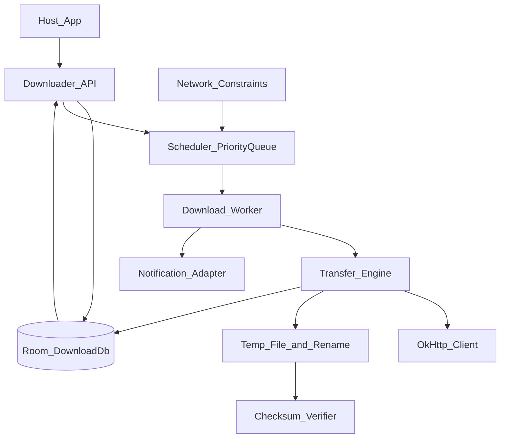
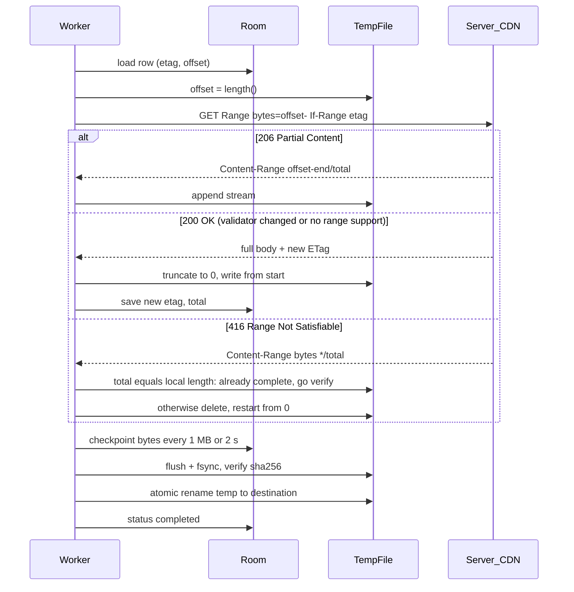
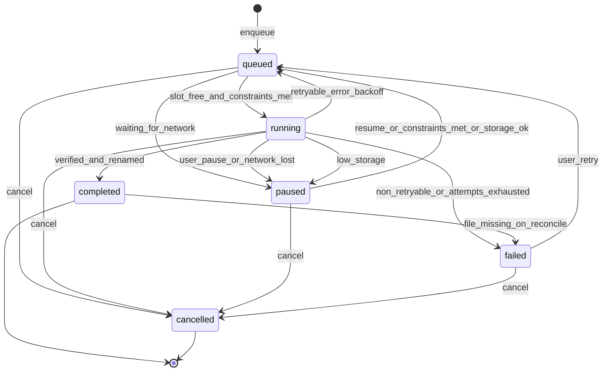

# 51 — Model Solution: File Downloader Library

## Timed outline (45–60 min)

| Min | Focus |
|-----|--------|
| 0–6 | Requirements: start/pause/resume/cancel, many files, priority, progress, survive restart |
| 6–15 | Public API + config + defaults; who owns threads, storage, notifications |
| 15–35 | Engine: queue + concurrency, Range resume with validators, temp file → atomic rename, checksum |
| 35–45 | Background execution: WorkManager vs foreground service vs user-initiated jobs vs `DownloadManager` |
| 45–55 | Failures (disk full, 416, ETag change, kill), metrics, stretch |

## Clarify and scope

**Prompt:** “Design a reusable Android library that downloads files for host apps (podcasts, PDFs, offline video, app assets).”

**Requirements first (before any tech):**

| # | Requirement | Notes to confirm |
|---|-------------|------------------|
| R1 | Start, pause, resume, cancel one download | Pause = keep partial bytes; cancel = delete them |
| R2 | Many files at once, with priority | Higher priority starts first; does it preempt running ones? (default: no) |
| R3 | Progress: bytes so far, total if known, status | Total unknown when no `Content-Length` / chunked |
| R4 | Resume from the byte offset when server supports partial content | Fall back to restart when it doesn't |
| R5 | Persist metadata; recover after app restart / process death | Downloads were “running” when killed → re-queue |
| R6 | Retry with backoff; react to network changes | Optional “Wi-Fi / unmetered only” |
| R7 | Visible to user while long downloads run | Notification with progress + actions |

**MVP:** HTTP(S) GET downloads to app-specific storage; R1–R7; integrity check when caller supplies a hash.

**Defer:** segmented multi-connection downloads, P2P, HLS/DASH offline (Media3 `DownloadService` owns that — Ch 16), writing to shared `Downloads/` via MediaStore (one helper later), upload.

**Assumptions:** host passes auth headers via a provider callback; server is a CDN that usually honors `Range` and returns `ETag`/`Last-Modified`.

## NFRs

- **No partial final files:** a file at `destination` is either complete or absent (temp file + atomic rename); “verified” only when the caller supplies `sha256` — otherwise completeness rests on `Content-Length` / `Content-Range` total matching
- Resume does not re-download already-fetched bytes (when server allows)
- Progress at most ~4 updates/s per item to UI; DB writes throttled (e.g. every 1 MB or 2 s)
- Survives process death, reboot (re-queue on next app start or via WorkManager persistence)
- Bounded concurrency (default 3) — battery, sockets, and server fairness
- Library adds no UI dependency to core artifact; notifications are configurable
- Minimal coupling: host's OkHttp instance optional; no global singletons beyond one `Downloader`

## Architecture



| Component | Owns |
|-----------|------|
| `Downloader` (API) | Validate requests, write rows, expose `Flow`s |
| Scheduler | Priority ordering, concurrency cap, constraints → enqueue work |
| Worker | Process lifetime (foreground / WorkManager), cancellation |
| Transfer engine | One HTTP transfer: Range, validators, streaming to temp file |
| Room DB | Source of truth for state + offsets; UI reads from here |

**Golden rule:** progress UI reads the **DB-backed `Flow`**, not the worker. The worker can die; the row survives.

## Public API

```kotlin
data class DownloadRequest(
    val url: String,
    val destination: File,                   // app-specific dir by default
    val priority: Priority = Priority.NORMAL,
    val sha256: String? = null,              // verify when present
    val expectedBytes: Long? = null,         // pre-flight storage check
    val headers: Map<String, String> = emptyMap(),
    val networkPolicy: NetworkPolicy = NetworkPolicy.ANY,
    val tag: String? = null,                 // host grouping, e.g. "episode:42"
)

enum class Priority { LOW, NORMAL, HIGH }
enum class NetworkPolicy { ANY, UNMETERED_ONLY }

sealed interface DownloadState {
    data object Queued : DownloadState
    data class Running(val bytes: Long, val total: Long?) : DownloadState // total null = unknown
    data class Paused(val bytes: Long, val total: Long?, val reason: PauseReason) : DownloadState
    data class Completed(val file: File) : DownloadState
    data class Failed(val error: DownloadError, val retryable: Boolean) : DownloadState
    data object Cancelled : DownloadState
}

enum class PauseReason { USER, WAITING_FOR_NETWORK, WAITING_FOR_UNMETERED, LOW_STORAGE }
enum class DownloadError { HTTP_4XX, HTTP_5XX, NETWORK, DISK_FULL, CHECKSUM_MISMATCH, REMOTE_CHANGED, UNKNOWN }

interface Downloader {
    suspend fun enqueue(request: DownloadRequest): String   // returns id; idempotent on (url, destination)
    suspend fun pause(id: String)
    suspend fun resume(id: String)
    suspend fun cancel(id: String)                          // deletes temp file
    fun observe(id: String): kotlinx.coroutines.flow.Flow<DownloadState>
    fun observeAll(tag: String? = null): kotlinx.coroutines.flow.Flow<List<Pair<String, DownloadState>>>
}
```

**Config + defaults** (builder, all optional):

| Option | Default | Why |
|--------|---------|-----|
| `maxConcurrent` | 3 | Throughput vs battery/sockets |
| `okHttpClient` | Library-owned | Host can share its pool/interceptors |
| `headerProvider` | none | Fresh auth token per attempt (don't freeze tokens in rows) |
| `notificationFactory` | Generic progress notification | Host branding / channel |
| `retryPolicy` | Exponential, 30 s → 5 min, max 5 attempts per error streak | Avoid hammering |
| `minFreeBytes` | 50 MB headroom | Don't fill the device |
| `progressThrottleMs` | 250 | UI smoothness without DB churn |

Pause / resume / cancel are **intent writes to the DB first**, then signal the worker — so a kill between the two steps still converges.

## Data model

```text
DownloadEntity (Room, table downloads):
  id (UUID, PK), url, destinationPath, tempPath,
  priority (0..2), networkPolicy, tag?,
  status (queued|running|paused|completed|failed|cancelled),
  pauseReason?, errorCode?, attempt (int),
  bytesDownloaded (long), totalBytes (long?),
  etag?, lastModified?, acceptRanges (bool?),
  sha256Expected?, createdAt, updatedAt, workRequestId?
  UNIQUE(url, destinationPath)

Index: (status, priority DESC, createdAt) — scheduler pick order
```

`bytesDownloaded` is a **durable checkpoint**. Write order while streaming: append → `flush()` + `fd.sync()` → then write the checkpoint row, so the checkpoint never claims bytes that aren't on disk. On resume: `offset = min(checkpoint, tempFile.length())`, truncate the temp file to `offset` (bytes past the last checkpoint may be torn by a kill), then append from there.

## Transfer flow (resume with validation)



| Step | Detail |
|------|--------|
| First request | Plain `GET`; record `ETag`, `Last-Modified`, `Accept-Ranges`, `Content-Length` |
| Resume | `Range: bytes=N-` + `If-Range: <validator>` — server returns 206 only if the file is unchanged, else 200 with full body (one round trip, no stale splice) |
| Validator must be strong | RFC 9110 §13.1.5: `If-Range` needs a **strong** validator — a strong `ETag`, else the `Last-Modified` date (strong only if it is ≥ 1 s older than the response `Date`). Weak ETag (`W/…`) or no validator → no Range, restart from 0 |
| 206 checks | `Content-Range` start must equal N; otherwise discard and restart |
| Streaming | `source.read(buffer, 64 KB)` → `FileOutputStream(append = true)`; check `isStopped`/`ensureActive()` per chunk so pause/cancel is prompt |
| Finish | `fd.sync()`, checksum over the temp file, then `File.renameTo` / `Files.move(ATOMIC_MOVE)` in the **same directory** (same filesystem) |
| Gzip | Send `Accept-Encoding: identity` — byte offsets must be of the stored file, and OkHttp's transparent gzip breaks Range math |

### Queue + concurrency

- Scheduler query: `status = queued ORDER BY priority DESC, createdAt` limit `maxConcurrent - running`.
- Implementation: a `Semaphore(maxConcurrent)` inside one long-running coroutine scope **or** one WorkManager request per download with unique work name = download id. With per-item work, enforce the cap in the scheduler (only enqueue N at a time) — WorkManager has no per-tag concurrency limit.
- Priority change = update row; does not preempt running transfers (avoid thrash); optional “preempt LOW” flag for HIGH.

### State machine



## Background execution (Android-specific)

| Option | Fit | Catch |
|--------|-----|-------|
| `DownloadManager` (system) | Fire-and-forget public files, survives app death, system notification, built-in resume | No real pause API, coarse progress (poll a cursor), limited header/auth control, no checksum hook, OEM quirks, can't share host OkHttp |
| WorkManager `CoroutineWorker` + `setForeground()` | **Default.** Persistent, constraint-aware (`NetworkType.CONNECTED` / `UNMETERED`), survives reboot, backoff built in | ~10 min execution window unless foreground; foreground start can be refused from background (Android 12+ restrictions) |
| Foreground service (`foregroundServiceType="dataSync"`) | Long user-visible transfers | Android 14+ requires the type + `FOREGROUND_SERVICE_DATA_SYNC` permission; Android 15 caps `dataSync` at ~6 h per 24 h and calls `onTimeout()` |
| User-initiated data transfer job (Android 14+, `JobInfo.Builder.setUserInitiated(true)`) | User tapped “Download” and expects it to finish; long-running, not subject to the same quota | Needs `RUN_USER_INITIATED_JOBS` permission, must be started while app is visible, must post a notification via `setNotification()`; JobScheduler API, not WorkManager |

**Decision:** WorkManager per download with `setForeground(ForegroundInfo(id, notification, FOREGROUND_SERVICE_TYPE_DATA_SYNC))` as the default; on API 34+ an opt-in path for user-tapped large files using user-initiated jobs. Expose `DownloadManager` mode only for “save public file, don't care about progress”.

WorkManager runs foreground work inside its own `SystemForegroundService`. With targetSdk 34+, the host (or the library's manifest, which merges into it) must declare that service's type and the matching permission, or `setForeground` throws:

```xml
<manifest xmlns:android="http://schemas.android.com/apk/res/android"
    xmlns:tools="http://schemas.android.com/tools">
    <uses-permission android:name="android.permission.FOREGROUND_SERVICE" />
    <uses-permission android:name="android.permission.FOREGROUND_SERVICE_DATA_SYNC" />
    <application>
        <service
            android:name="androidx.work.impl.foreground.SystemForegroundService"
            android:foregroundServiceType="dataSync"
            tools:node="merge" />
    </application>
</manifest>
```

Network constraint: `NetworkPolicy.UNMETERED_ONLY` → `NetworkType.UNMETERED`; when Wi-Fi drops mid-transfer WorkManager stops the worker → we persist `paused(WAITING_FOR_UNMETERED)` → re-runs when met. Also listen to `ConnectivityManager.NetworkCallback` while running so a lost socket fails fast instead of waiting for read timeout.

```kotlin
class DownloadWorker(ctx: Context, params: WorkerParameters) : CoroutineWorker(ctx, params) {
    override suspend fun doWork(): Result {
        val id = inputData.getString("id") ?: return Result.failure()
        setForeground(foregroundInfo(id, bytes = 0, total = null))
        return try {
            transfer(id) { bytes, total -> setForeground(foregroundInfo(id, bytes, total)) }
            Result.success()
        } catch (e: HttpError) {
            when {
                e.code == 408 || e.code == 429 || e.code >= 500 -> retryOrFail(id, e.retryAfterSec)
                (e.code == 401 || e.code == 403) && firstAuthFailure(id) ->
                    Result.retry()               // next attempt asks headerProvider for fresh headers
                else -> {                        // 404, 410, second 401/403, other 4xx
                    markFailed(id, DownloadError.HTTP_4XX, retryable = false)
                    Result.failure()
                }
            }
        } catch (e: java.io.IOException) {      // timeout, reset, DNS: network-class errors only
            retryOrFail(id, retryAfterSec = null)
        }
    }

    private fun foregroundInfo(id: String, bytes: Long, total: Long?): ForegroundInfo {
        val n = NotificationCompat.Builder(applicationContext, "downloads")
            .setSmallIcon(android.R.drawable.stat_sys_download)
            .setContentTitle("Downloading")
            .setOngoing(true)
            .setOnlyAlertOnce(true)
            .setProgress(100, total?.let { (bytes * 100 / it).toInt() } ?: 0, total == null)
            .build()
        return if (Build.VERSION.SDK_INT >= 29)
            ForegroundInfo(id.hashCode(), n, ServiceInfo.FOREGROUND_SERVICE_TYPE_DATA_SYNC)
        else ForegroundInfo(id.hashCode(), n)
    }

    /** Backoff retry; when the server sent Retry-After, re-enqueue with that initial delay instead. */
    private suspend fun retryOrFail(id: String, retryAfterSec: Long?): Result =
        if (runAttemptCount >= 5) { markFailed(id, DownloadError.NETWORK, retryable = true); Result.failure() }
        else if (retryAfterSec != null) { reenqueue(id, delaySec = retryAfterSec); Result.success() }
        else Result.retry()

    private suspend fun transfer(id: String, onProgress: suspend (Long, Long?) -> Unit) { /* engine */ }
    private suspend fun firstAuthFailure(id: String): Boolean = TODO("DB flag: true once per download")
    private suspend fun markFailed(id: String, error: DownloadError, retryable: Boolean) { /* Room */ }
    private fun reenqueue(id: String, delaySec: Long) { /* unique work, setInitialDelay */ }
}
```

Throttle `setForeground` / notification updates (≤ 1/s) — notification updates are rate-limited by the system and dropped otherwise.

### Range request (engine core)

```kotlin
class HttpError(val code: Int, val retryAfterSec: Long? = null) : java.io.IOException("HTTP $code")

/** If-Range needs a strong validator (RFC 9110 §13.1.5): strong ETag, else Last-Modified; null = can't resume. */
fun ifRangeValidator(etag: String?, lastModified: String?): String? = when {
    etag != null && !etag.startsWith("W/") -> etag
    lastModified != null -> lastModified
    else -> null
}

/** Range only with a strong validator; otherwise the caller restarts from 0. */
fun buildRequest(url: String, offset: Long, validator: String?): Request =
    Request.Builder().url(url)
        .header("Accept-Encoding", "identity")
        .apply {
            if (offset > 0 && validator != null) {
                header("Range", "bytes=$offset-")
                header("If-Range", validator)
            }
        }.build()

sealed interface Start {
    data class Append(val offset: Long) : Start   // 206 at the expected offset
    data object FromZero : Start                  // 200: truncate temp, write full body
    data object AlreadyComplete : Start           // 416 but local length == remote total: verify + rename
    data object Discard : Start                   // bad Content-Range, or 416 with a size mismatch
}

fun resolveStart(response: Response, requestedOffset: Long, localLength: Long): Start =
    when (response.code) {
        206 -> {
            val start = response.header("Content-Range")
                ?.removePrefix("bytes ")?.substringBefore('-')?.toLongOrNull()
            if (start == requestedOffset) Start.Append(requestedOffset) else Start.Discard
        }
        200 -> Start.FromZero
        416 -> {                                   // Content-Range: bytes */<total>
            val total = response.header("Content-Range")?.substringAfter("*/", "")?.toLongOrNull()
            if (total != null && total == localLength) Start.AlreadyComplete else Start.Discard
        }
        else -> throw HttpError(response.code, response.header("Retry-After")?.toLongOrNull())
    }
```

## Storage checks

| Check | When | How |
|-------|------|-----|
| Free space before start | `expectedBytes` or `Content-Length` known | `StatFs(dir.path).availableBytes` ≥ remaining + `minFreeBytes`; else `paused(LOW_STORAGE)` |
| App-specific external quota | API 26+ | `StorageManager.getAllocatableBytes(uuid)` + `allocateBytes(fd, n)` lets the system clear cache for you |
| During write | Always | `IOException` with ENOSPC → `paused(LOW_STORAGE)`, keep partial; re-enqueue with WorkManager `Constraints.setRequiresStorageNotLow(true)` so it resumes when the system clears the low-storage state (`ACTION_DEVICE_STORAGE_OK` is deprecated and not delivered to manifest receivers since API 26) |
| Location | Default | `context.filesDir`/`getExternalFilesDir()` — no storage permission; shared `Downloads/` via MediaStore only on request |
| Temp naming | Always | `<dest>.part` in **same directory** so rename is atomic |

## Recovery after process death / reboot

1. On `Downloader` init (App startup): `UPDATE downloads SET status='queued' WHERE status='running'` — a row can't be running if no process is.
2. Reconcile each queued/paused row: offset = `tempFile.length()` (missing temp → 0).
3. WorkManager already persisted its requests; unique work name = id with `ExistingWorkPolicy.KEEP` prevents duplicates when the reconcile re-enqueues.
4. Orphan sweep: `.part` files with no row → delete; `completed` rows with missing file → mark failed (user cleared storage).

## Offline

- Enqueue offline is allowed → `queued` with `paused(WAITING_FOR_NETWORK)` shown; starts on connectivity (WorkManager constraint).
- Completed files are the offline product; the library exposes `observeAll()` so the host can show “available offline”.
- Do not retry in a tight loop when offline — constraint-based wake-up only.

## Failures

| Case | Behavior |
|------|----------|
| Server ignores Range (200 on resume) | Truncate temp, restart; record `acceptRanges=false` so next resume doesn't bother |
| File changed upstream (If-Range mismatch → 200) | Restart from 0 with new ETag; status shows progress reset |
| 416 | Parse `Content-Range: bytes */total`: local length == total → previous run was killed before rename, so verify + rename; else delete temp, restart once; second 416 → `failed(REMOTE_CHANGED)` |
| 401/403 | Ask `headerProvider` for fresh headers, retry once; then `failed(HTTP_4XX, retryable=false)` (signed URL expired → host re-issues URL) |
| 404/410 | `failed`, not retryable |
| 5xx / 408 / 429 / timeout / reset | Retry with backoff (honor `Retry-After` via a delayed re-enqueue); keep partial. Every other 4xx fails without retry |
| Disk full | `paused(LOW_STORAGE)`; notify user; never delete other downloads to make room |
| Checksum mismatch | Delete temp, one full retry, then `failed(CHECKSUM_MISMATCH)` |
| Process killed mid-write | Reconcile on start; last partial chunk may be garbage → if checksum later fails, full retry |
| Double tap “Download” | `enqueue` idempotent on (url, destination) → returns existing id |
| Cancel during write | Coroutine cancel → close stream → delete `.part` → row `cancelled` |
| Foreground start not allowed (Android 12+ from background) | Catch `ForegroundServiceStartNotAllowedException`; run as regular work with constraints (may be stopped after ~10 min, resumes via Range) |
| `dataSync` timeout (Android 15) | `onTimeout` → pause + reschedule; suggest user-initiated job for huge files |

## Security & privacy

- HTTPS only by default; allow cleartext only if host opts in (network security config still applies).
- Never persist auth headers in the DB — `headerProvider` supplies them per attempt.
- Validate `destination` is inside allowed dirs (no path traversal via server-supplied filenames; sanitize `Content-Disposition` names).
- Checksum (SHA-256) when host provides it; for executable payloads (plugins/models) also verify a **signature**, not just a hash from the same server.
- Files in app-specific storage are private to the app; encryption at rest optional (e.g. Tink streaming AEAD) for sensitive docs — costs CPU and breaks Range-append simplicity (encrypt per segment).
- Notification text shows filename only if host marks it non-sensitive.

## Android UI: Views (XML) and Compose

The library ships no screens in core; a sample “Downloads” list shows how hosts consume `observeAll()`. Basis: [Ch 4 — Android UI toolkits](../part-2-building-blocks/04-client-architecture.md#android-ui-toolkits-views-xml-and-compose).

| Concern | Views (XML) | Compose |
|---------|-------------|---------|
| List | `RecyclerView` + `ListAdapter`, stable ids = download id | `LazyColumn(items, key = { it.id })` |
| Progress ticks | `DiffUtil.ItemCallback.getChangePayload()` returns a `Progress` payload → `onBindViewHolder(holder, pos, payloads)` updates only the `ProgressBar` — no full rebind, no flicker | Keep progress **out of the row model**: rows carry stable metadata; bytes live in a `SnapshotStateMap<id, Float>` read *inside* the `progress = { … }` lambda, which runs at draw time — ticks redraw the bar without recomposing the row. (Passing a new `row` per tick would recompose the item anyway) |
| Indeterminate (unknown total) | `progressBar.isIndeterminate = true` | `LinearProgressIndicator()` without progress |
| Actions | Pause/Resume/Cancel buttons → ViewModel | Same lambdas hoisted to ViewModel |
| Collection | `repeatOnLifecycle(STARTED)` | `collectAsStateWithLifecycle()` — stops ticking off-screen |
| Throttle | ViewModel `sample(250)` on the Flow | Same ViewModel |

```kotlin
data class DownloadRow(val id: String, val name: String, val bytes: Long, val total: Long?)  // Views list model

object RowDiff : DiffUtil.ItemCallback<DownloadRow>() {
    override fun areItemsTheSame(a: DownloadRow, b: DownloadRow) = a.id == b.id
    override fun areContentsTheSame(a: DownloadRow, b: DownloadRow) = a == b
    // Only progress changed -> partial bind
    override fun getChangePayload(a: DownloadRow, b: DownloadRow): Any? =
        if (a.copy(bytes = b.bytes, total = b.total) == b) "progress" else null
}

// Compose: stable metadata per row; progress (0..1) updated by the ViewModel in a SnapshotStateMap
data class DownloadMeta(val id: String, val name: String, val totalKnown: Boolean)

@Composable
fun DownloadList(
    rows: List<DownloadMeta>,
    progress: SnapshotStateMap<String, Float>,
    onPause: (String) -> Unit,
) {
    LazyColumn {
        items(rows, key = { it.id }) { row ->
            Column(Modifier.padding(16.dp)) {
                Text(row.name)
                if (row.totalKnown) {
                    // Read at draw time inside the lambda: ticks don't recompose this item
                    LinearProgressIndicator(progress = { progress[row.id] ?: 0f })
                } else {
                    LinearProgressIndicator()
                }
                TextButton(onClick = { onPause(row.id) }) { Text("Pause") }
            }
        }
    }
}
```

**Mixed codebase:** the Compose list can sit in a Fragment via `ComposeView`; nothing in the library changes because both read the same ViewModel `StateFlow`.

**iOS parity:** `URLSession` background configuration (`URLSessionConfiguration.background`) gives OS-managed transfers that continue after suspension, with `resumeData` for pause/resume; same Range/ETag rules apply on your own engine.

## Trade-offs

| Decision | Alternative | Why |
|----------|-------------|-----|
| Own engine on WorkManager | System `DownloadManager` | Pause, real progress, auth headers, checksum, host OkHttp |
| `If-Range` with a strong validator | Blind `Range` | Never splice two versions of a file |
| Temp file + atomic rename | Write to final path | Consumers never see half files |
| Room metadata | SharedPreferences / WorkManager data only | Queryable queue, Flow to UI, survives kill |
| Per-download work + scheduler cap | One giant worker for all | Isolation, per-item retry/backoff; costs scheduler logic |
| Single connection per file | Multi-segment parallel | Simpler, CDN-friendly; segments only for huge files on slow links |
| No preemption by priority | Pause LOW when HIGH arrives | Avoid wasted reconnects; opt-in flag |

## Metrics

download_success_rate, resume_success_rate (206 vs forced restart), bytes_wasted_on_restart, median/p95 throughput, time_to_first_byte, failures by `DownloadError`, checksum_mismatch_rate, low_storage_pauses, fgs_start_denied count, process_death_recoveries.

## Staff stretch

- Multi-segment downloads (N parallel Ranges into one sparse file) for large files on high-latency links
- Delta updates (binary diff) for asset packs
- Bandwidth-aware scheduling: defer LOW to charging + unmetered
- Shared cache across host features (dedupe same URL by content hash)
- Play Asset Delivery / Media3 `DownloadService` for app bundles and DRM video instead of rolling your own

## Follow-ups

- How do you test? MockWebServer scripting 206/200/416 + truncated bodies; Robolectric/instrumented WorkManager with `WorkManagerTestInitHelper`; kill-process test on device
- Signed URLs expiring mid-download?
- What if two features enqueue the same URL to different destinations?

## See also

- [Ch 5 Networking](../part-2-building-blocks/05-networking-and-apis.md) · [Ch 6 Caching & storage](../part-2-building-blocks/06-caching-and-storage.md) · [Ch 7 Offline & sync](../part-2-building-blocks/07-offline-and-sync.md) · [Ch 8 Media](../part-2-building-blocks/08-media-images-video.md) · [Ch 16 Video player](16-video-player.md) · [Ch 20 Photo upload](20-photo-camera-upload.md) · [Ch 49 Feature flags](49-feature-flag-library.md)
