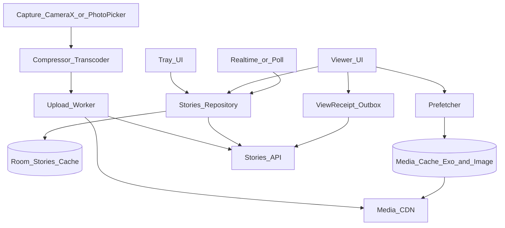
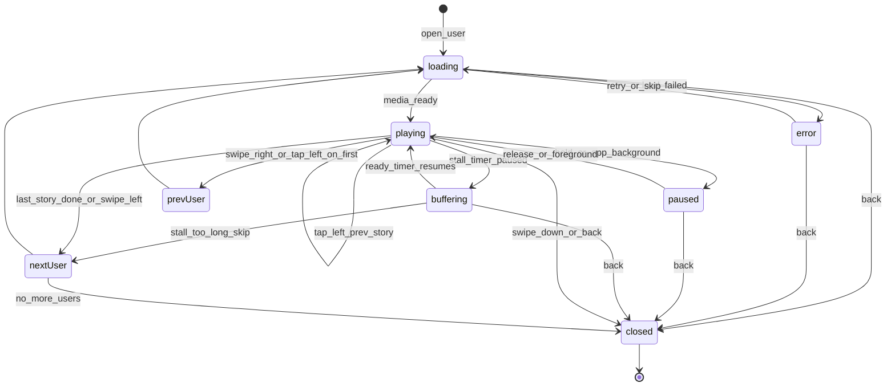
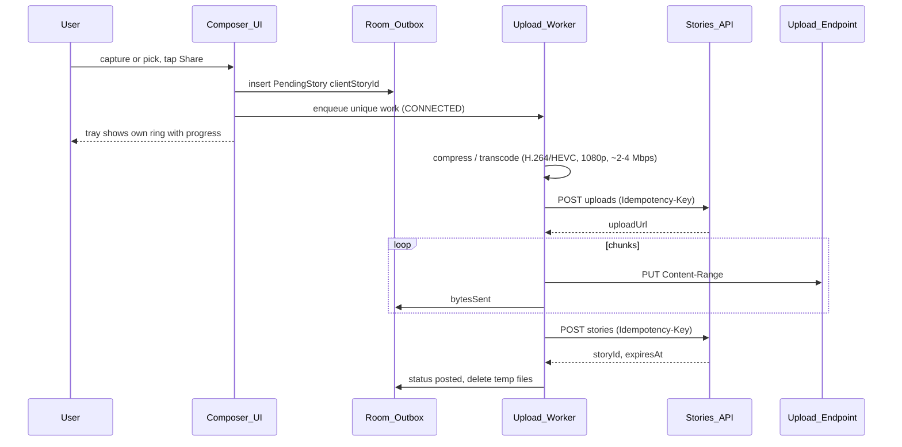

# 52 — Model Solution: Instagram-Style Stories

## Timed outline (45–60 min)

| Min | Focus |
|-----|--------|
| 0–6 | Requirements: post, tray, viewer, 24h expiry, views + viewer list, prefetch, delete |
| 6–15 | API contract + data model; server time as truth for expiry |
| 15–35 | Viewer: gestures, segmented progress, prefetch + media cache; upload pipeline |
| 35–45 | View receipts batching, live updates (add/delete/expire), privacy |
| 45–55 | Failures, metrics, stretch |

## Clarify and scope

**Prompt:** “Design Instagram-style Stories for the Android app.”

**Requirements first:**

| # | Requirement | Notes to confirm |
|---|-------------|------------------|
| R1 | Capture or pick a photo/video and post it as a story | Max video length (say 60 s, split into 15 s segments?) |
| R2 | Horizontal tray of followed users who have active stories | Order: unseen first, then recency / affinity |
| R3 | Open a user's stories; tap next/prev, hold to pause, swipe to next/prev user, swipe down to close | Auto-advance (photos 5 s, video = duration) |
| R4 | Stories disappear ~24 h after posting | Who decides “now”? (server) |
| R5 | Record that a viewer saw a story; author sees the viewer list | Viewer list visible only to author |
| R6 | Next stories load instantly | Prefetch + cache |
| R7 | Author can delete; tray/viewer update when stories are added, removed or expire | Near-real-time, not strict |

**MVP:** R1–R7 for photos + short video; close friends audience optional.

**Defer:** stickers/polls/music, AR filters, highlights (permanent), replies via DM (Ch 14), ads between stories, live.

**Assumptions:** media CDN with signed URLs; backend generates renditions; feed/follow graph exists (Ch 13).

## NFRs

- Viewer **first frame < 300 ms** for the next story (prefetched); < 1 s cold
- No expired story ever shown — even with a wrong device clock
- Uploads survive app kill + flaky network; no duplicate stories on retry
- View receipts eventually delivered (≥ 99%), batched — not one request per tap
- Bounded memory: at most ~3 players / a few decoded bitmaps alive
- Data-saver: prefetch less on metered / Data Saver on
- Privacy: viewer list only to author; blocked users never see or appear

## Architecture



## API contract

```text
GET  /v1/stories/tray?cursor=
  -> { serverTime, users: [ { userId, name, avatarUrl, hasUnseen,
        latestAt, storyCount } ], nextCursor }

GET  /v1/stories/users/{userId}
  -> { serverTime, stories: [ { storyId, type (photo|video), mediaUrl,
        posterUrl?, durationMs, width, height, createdAt, expiresAt,
        seen, viewCount? (author only) } ] }

POST /v1/stories/uploads                      (Idempotency-Key: clientStoryId)
  -> { uploadId, uploadUrl (resumable), expiresAt }
PUT  {uploadUrl}  Content-Range chunks         (resumable upload protocol)
POST /v1/stories                               (Idempotency-Key: clientStoryId)
  body { uploadId, type, durationMs, audience (followers|close_friends) }
  -> { storyId, createdAt, expiresAt }

DELETE /v1/stories/{storyId}                   -> 204 (idempotent)

POST /v1/stories/views:batch
  body { receipts: [ { storyId, viewedAt, receiptId } ] } -> 202
GET  /v1/stories/{storyId}/viewers?cursor=     (author only, else 403)

Realtime (optional): event stream / push topic
  story_added {userId}, story_deleted {storyId}, story_expired {storyId}
```

**Server is the source of truth for expiry:** `expiresAt` is server-assigned (createdAt + 24 h) and storage uses a **TTL** (e.g. DB TTL index / CDN object lifecycle) so media actually disappears. Client only *hides* early.

## Data model

```text
TrayEntry (Room):
  userId (PK), name, avatarUrl, hasUnseen, latestAt,
  rankScore, fetchedAt

StoryEntity (Room):
  storyId (PK), userId, type, mediaUrl, posterUrl?, durationMs,
  width, height, createdAt, expiresAt, seenLocally (bool),
  deleted (bool)
  Index (userId, createdAt)

PendingStory (Room, author outbox):
  clientStoryId (PK, UUID), localUri, compressedPath?, type,
  status (picked|compressing|uploading|publishing|posted|failed),
  uploadId?, uploadUrl?, bytesSent, storyId?, error?

ViewReceipt (Room, outbox):
  receiptId (PK, UUID), storyId, viewedAtServerEstimate, sent (bool)

ClockOffset (memory + DataStore):
  offsetMs = serverTime - SystemClock.elapsedRealtime-based local estimate
```

### Expiry with a trustworthy clock

- Each response carries `serverTime`. Store `offset = serverTime − elapsedRealtimeAtReceive` (monotonic `SystemClock.elapsedRealtime()`, immune to the user changing wall-clock).
- `serverNow() = elapsedRealtime() + offset`. Filter `expiresAt > serverNow()` in **every** query (tray counts + viewer list) — no stale story even if cache is old.
- Schedule a coroutine timer to the next `expiresAt` in the viewer; if the current story expires while watching, finish it, then skip.
- The offset is valid **only within one boot** (`elapsedRealtime` restarts at 0). Persist it with the boot it was taken in (`Settings.Global.BOOT_COUNT`, API 24+); a different boot count on read = offset invalid.
- Invalid offset + online → refetch tray/stories (new `serverTime`) before showing.
- Invalid offset + **offline** → fall back to the wall clock with a safety margin: show a story only if `expiresAt − margin (e.g. 1 h) > System.currentTimeMillis()`; anything inside the margin is hidden. If the wall clock is obviously off (earlier than the last known `serverTime`), hide all cached stories rather than risk showing expired ones.

## Viewer flow



| Gesture | Action |
|---------|--------|
| Tap right ~2/3 | Next story (or next user at end) |
| Tap left ~1/3 | Previous story (or previous user at start) |
| Long press | Pause timer + player; hide chrome |
| Horizontal swipe | Next/previous user (pager, cube transform optional) |
| Swipe down | Dismiss to tray position |

**Segmented progress:** one segment per story; segment `i` fill = elapsed / duration. Photos: a timer (5 s); video: `player.currentPosition / duration`, polled at frame-ish rate only while visible. Stall (buffering) pauses the timer — the bar must not advance while video is frozen.

**Mark seen** when the story was visible ≥ ~1 s (or first frame rendered), not on page bind (prefetch binds pages early).

## Upload pipeline



| Step | Android choice |
|------|----------------|
| Capture | CameraX (`Preview` + `ImageCapture` + `VideoCapture<Recorder>`), `PreviewView` |
| Pick | Photo Picker (`ActivityResultContracts.PickVisualMedia`) — no storage permission; backported via Play services to older versions |
| Compress | Photos: downscale to ~1080 wide, JPEG/WebP q≈80, strip EXIF location. Video: Media3 Transformer (hardware encoder) to target bitrate |
| Upload | WorkManager `CoroutineWorker`, `NetworkType.CONNECTED`, expedited when user just tapped Share, `setForeground` for long video; resumable chunks (query server offset on resume) |
| Idempotency | `clientStoryId` on both create calls → retry after kill never posts twice |
| Optimistic UI | Own ring shows “posting…”; viewers don't see it until server `storyId` |

Details shared with [Ch 20 Photo upload](20-photo-camera-upload.md).

## Tray

- Source: `GET tray` → Room; UI observes Room (`Flow`) — opens instantly from cache, refreshes on app foreground / pull.
- Order: **own story first**, then `hasUnseen` users, then seen; within group by server `rankScore` (affinity) or `latestAt`.
- `hasUnseen` merges server flag with local `seenLocally` (viewed but receipt not yet acked) so the ring greys immediately.
- Prefetch on tray idle: first story media (poster/first ~500 KB of video) for the first 3–5 unseen users.

## Prefetch + cache

| Item | Policy |
|------|--------|
| Within current user | Next 2 stories |
| Next user | First story (poster + first segment) |
| Video | Media3 `SimpleCache` (LRU, e.g. 200 MB) + `CacheDataSource`; prefetch with `CacheWriter` for the first N bytes; or `DefaultPreloadManager` on newer Media3 |
| Images | Coil/Glide disk + memory cache; `preload()` at target size |
| Players | Pool of ≤ 3 `ExoPlayer` instances (current, next, previous) owned by the ViewModel, keyed by pager page; release on close / `onStop` |
| Network aware | Metered / Data Saver (`ConnectivityManager.restrictBackgroundStatus`) → poster only, no video prefetch |
| Cleanup | Cache keys by storyId; evict expired stories' entries on open |
| Signed URLs | Cache key = storyId, not the URL (signatures rotate) via `setCustomCacheKey` |

## View receipts

- On “seen”: write `ViewReceipt` row + set `seenLocally` (UI updates immediately).
- Flush: batch when 20 receipts queued, every 10 s while viewer open, and on viewer close; WorkManager one-time job as the fallback so app kill doesn't lose them.
- Server dedupes by `(viewerId, storyId)`; `receiptId` makes retries idempotent.
- Author viewer list: paged `GET viewers`; count can be approximate/lagging.

## Delete + live updates

| Event | Client behavior |
|-------|-----------------|
| Author deletes | Optimistic hide in own tray; `DELETE` via outbox; restore on 4xx other than 404 |
| `story_deleted` received while watching | Skip to next story; remove from Room; evict cached media |
| `story_added` for a followed user | Upsert tray entry `hasUnseen=true`; reorder only when tray not being scrolled (avoid jumps) |
| Expiry | Client timer/filter hides; server sends `story_expired` optionally; never relies on push |
| Viewer opens a story deleted meanwhile | `GET` 404 / media 403-410 → skip with no error toast |

Transport: lightweight event stream when app is foreground (Ch 9); fall back to refetching tray on foreground + every few minutes. No silent push for this (battery, low value).

## Offline

- Tray + already-cached media viewable offline if not expired (by `serverNow()` estimate with margin).
- Uncached stories show poster or “can't load” and auto-skip.
- Posting offline → queued; own ring shows “will post when online”. Note the 24 h clock starts at server publish, not capture.
- Receipts queue offline, flush later.

## Failures

| Case | Behavior |
|------|----------|
| Upload killed mid-chunk | Worker resumes: ask server for committed offset, continue |
| Publish call timed out | Retry with same `clientStoryId` → server returns existing story |
| Transcode fails (codec) | Fall back to lower resolution / software path; else fail with “try again” |
| Media 403 (signed URL expired) | Refetch user's stories for fresh URLs, retry once |
| Video stall | Pause progress timer; spinner after 500 ms; skip after ~10 s |
| Device clock wrong | Ignore wall clock while the same-boot server offset is valid; after reboot + offline, wall clock with a 1 h margin, or hide everything if the clock is earlier than the last `serverTime` |
| Story expires while viewing | Let it finish, then exclude |
| Receipt batch fails | Keep in outbox, backoff; dedup server side |
| Low memory / `onTrimMemory` | Drop prefetched decoded bitmaps, keep only current player |
| Double tap Share | Same `PendingStory` (button disabled + idempotency key) |
| Blocked after posting | Server filters; client removes on next tray refresh |

## Security & privacy

- Viewer list: server enforces author-only (403 otherwise); never ship counts/lists for others' stories in the payload.
- Audience (followers / close friends) enforced server side at tray + fetch + media URL signing; signed URLs short-lived and per user.
- Blocked/muted users excluded both ways; private accounts only to approved followers.
- Strip EXIF GPS on upload unless user adds a location sticker.
- Screenshot: Android 14 `registerScreenCaptureCallback` can notify the app (detection, not prevention); do not promise prevention.
- Delete is real: server TTL + CDN purge on delete; local cache evicted.
- Analytics: story ids and timings, not media content.

## Android UI: Views (XML) and Compose

Basis: [Ch 4 — Android UI toolkits](../part-2-building-blocks/04-client-architecture.md#android-ui-toolkits-views-xml-and-compose). Same ViewModel (`StoriesViewModel` exposing `StateFlow<ViewerState>`) behind both.

| Concern | Views (XML) | Compose |
|---------|-------------|---------|
| Tray | Horizontal `RecyclerView` (`LinearLayoutManager(HORIZONTAL)`) + `ListAdapter`, stable ids; `setInitialPrefetchItemCount` only helps when this horizontal list is **nested inside a vertical RecyclerView** (feed) — it tells the outer prefetch how many inner items to bind | `LazyRow(items, key = { it.userId })` |
| User pager | `ViewPager2` with `FragmentStateAdapter` (one Fragment per user), `offscreenPageLimit = 1`, `PageTransformer` for cube effect | `HorizontalPager(state, beyondViewportPageCount = 1)`, `graphicsLayer { rotationY }` for cube (same TextureView requirement for the video surface) |
| Video surface | `PlayerView` in XML (`use_controller=false`); `SurfaceView` is cheaper, but the cube transition (`rotationY`) doesn't apply to it — use `surface_type=texture_view` if you keep the cube transform (Ch 16) | `AndroidView(factory = { PlayerView(it) })` (or Media3 `PlayerSurface` in newer `media3-ui-compose`) |
| Player lifecycle | Attach in `onResume` of the visible page Fragment, detach in `onPause` | `DisposableEffect(page == currentPage)` attaches/detaches; release on dispose |
| Tap / hold | `GestureDetector` / `OnTouchListener` on an overlay View | `Modifier.pointerInput { detectTapGestures(onTap, onPress = { pause(); tryAwaitRelease(); resume() }) }` |
| Segmented progress | Custom View `onDraw` with N rects, `invalidate()` on tick | `Canvas` / `Row` of `LinearProgressIndicator(progress = { … })` — lambda form avoids recomposing the row per frame |
| Swipe down dismiss | `MotionLayout` or custom drag on root | `Modifier.draggable(Vertical)` + `offset` |

```kotlin
/** Lives in StoriesViewModel (viewer-scoped): at most 3 players, keyed by pager page. */
class PlayerPool(private val create: () -> ExoPlayer, private val max: Int = 3) {
    private val byPage = LinkedHashMap<Int, ExoPlayer>()

    fun forPage(page: Int, current: Int): ExoPlayer {
        byPage[page]?.let { return it }
        val player = if (byPage.size >= max) {
            // Reuse the player of the page farthest from the current one
            val far = byPage.keys.maxBy { kotlin.math.abs(it - current) }
            byPage.remove(far)!!.also { it.stop(); it.clearMediaItems() }
        } else create()
        byPage[page] = player
        return player
    }

    fun releaseAll() { byPage.values.forEach { it.release() }; byPage.clear() }  // ViewModel.onCleared
}

// Compose viewer: HorizontalPager + Media3 PlayerView via AndroidView.
// Current page plus one on each side are composed, so ≤ 3 players are attached;
// the ViewModel plays the current page's player and pauses the others.
@Composable
fun StoryPager(
    users: List<String>,
    playerFor: (page: Int, current: Int) -> ExoPlayer,   // = viewModel.pool::forPage
    onPause: () -> Unit,
    onResume: () -> Unit,
) {
    val pager = rememberPagerState(pageCount = { users.size })
    HorizontalPager(state = pager, beyondViewportPageCount = 1) { page ->
        Box(
            Modifier.fillMaxSize().pointerInput(Unit) {
                detectTapGestures(onPress = { onPause(); tryAwaitRelease(); onResume() })
            }
        ) {
            AndroidView(
                factory = { ctx -> PlayerView(ctx).apply { useController = false } },
                update = { it.player = playerFor(page, pager.currentPage) },
                onRelease = { it.player = null },
                modifier = Modifier.fillMaxSize(),
            )
        }
    }
}

@Composable
fun SegmentedProgress(count: Int, current: Int, progress: () -> Float) {
    Row(Modifier.fillMaxWidth().padding(8.dp), horizontalArrangement = Arrangement.spacedBy(4.dp)) {
        repeat(count) { i ->
            LinearProgressIndicator(
                progress = { if (i < current) 1f else if (i == current) progress() else 0f },
                modifier = Modifier.weight(1f).height(2.dp),
            )
        }
    }
}

// Views tray: horizontal RecyclerView
data class TrayItem(val userId: String, val name: String, val hasUnseen: Boolean)

object TrayDiff : DiffUtil.ItemCallback<TrayItem>() {
    override fun areItemsTheSame(a: TrayItem, b: TrayItem) = a.userId == b.userId
    override fun areContentsTheSame(a: TrayItem, b: TrayItem) = a == b
}

fun setupTray(rv: RecyclerView, adapter: ListAdapter<TrayItem, *>) {
    rv.layoutManager = LinearLayoutManager(rv.context, RecyclerView.HORIZONTAL, false).apply {
        initialPrefetchItemCount = 6   // effective only when the tray is nested in a vertical RecyclerView
    }
    rv.adapter = adapter
}

// Media cache keyed by storyId (signed URLs rotate)
@androidx.annotation.OptIn(UnstableApi::class)
fun storyMediaItem(storyId: String, signedUrl: String): MediaItem =
    MediaItem.Builder().setUri(signedUrl).setCustomCacheKey("story:$storyId").build()
```

**Mixed codebase:** a View-based home screen can host the Compose tray via `ComposeView`; a Compose viewer can embed the existing `PlayerView` via `AndroidView` (as above). One player pool lives in the ViewModel/holder scoped to the viewer, never inside a composable or page Fragment.

**iOS parity:** `UICollectionView` horizontal tray / `UIPageViewController` (or SwiftUI `TabView(.page)`), `AVPlayer` with `AVPlayerLayer`, `AVAssetResourceLoader` or a URL cache for prefetch, `PHPickerViewController` for picking, `URLSession` background upload.

## Trade-offs

| Decision | Alternative | Why |
|----------|-------------|-----|
| Server TTL + client filter by server time | Client wall clock only | Correct with wrong device clocks; media truly deleted |
| Batched receipts outbox | Per-view request | Battery + server QPS; seen ring updates locally anyway |
| Prefetch next 2 + next user's first | Prefetch everything in tray | Data cost vs instant feel; data-saver aware |
| Player pool (≤ 3) | New player per page | Memory + codec instance limits; faster first frame |
| Client compress/transcode | Upload original | Upload time on mobile networks; costs CPU/battery |
| Resumable chunked upload | Single PUT | Large videos on flaky networks |
| Foreground event stream + refetch | Push for every story event | Low value per event; push reserved for social notifications |
| `FragmentStateAdapter` per user | Single big custom View | Lifecycle per page, but heavier; Compose pager lighter |

## Metrics

tray_load_ms, story_first_frame_ms (p50/p95), prefetch_hit_rate, rebuffer_ratio, stories_viewed_per_session, completion_rate, skip_rate, upload_success_rate, upload_p95_duration, duplicate_story_rate (should be 0), receipt_delivery_lag, expired_story_shown (should be 0), crash/ANR on viewer.

## Staff stretch

- Ranking tray by affinity model; experiment flags (Ch 49) for prefetch depth
- Adaptive bitrate (short HLS ladders) vs single MP4 per story
- Stories as server-driven layouts for stickers/polls (Ch 50)
- Close-friends lists and audience change after posting
- Ads insertion in the pager; frequency caps
- Highlights: copy expired stories to permanent collections server side

## Follow-ups

- How would you make the next story start in < 100 ms?
- What happens if the user posts 30 stories in a row (upload queue order, concurrency)?
- How do you prevent seen counts inflating from prefetch?

## See also

- [Ch 8 Media](../part-2-building-blocks/08-media-images-video.md) · [Ch 7 Offline & sync](../part-2-building-blocks/07-offline-and-sync.md) · [Ch 9 Realtime & push](../part-2-building-blocks/09-realtime-and-push.md) · [Ch 6 Caching](../part-2-building-blocks/06-caching-and-storage.md) · [Ch 13 Social feed](13-social-feed.md) · [Ch 16 Video player](16-video-player.md) · [Ch 20 Photo upload](20-photo-camera-upload.md) · [Ch 49 Feature flags](49-feature-flag-library.md) · [Ch 50 Server-driven UI](50-server-driven-ui.md) · [Ch 51 File downloader](51-file-downloader-library.md)
