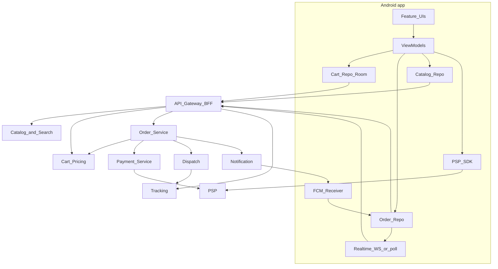
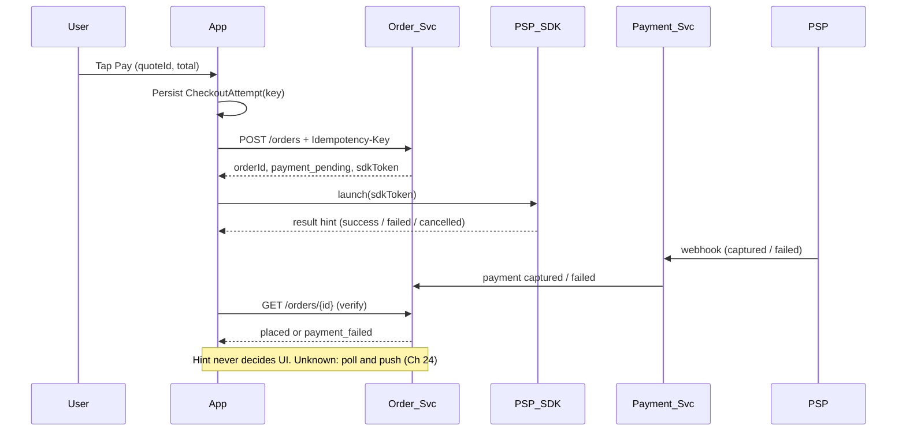
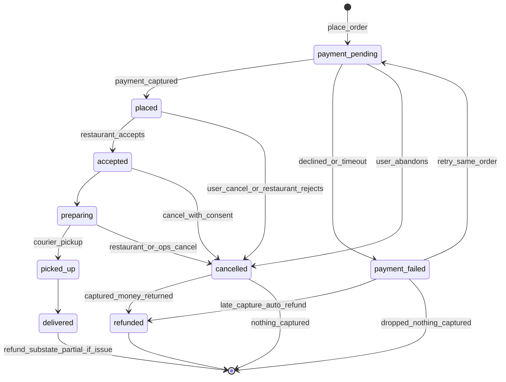

# 53 — Model Solution: Food Ordering App

A full consumer app, not a library: several features (discovery, menu, cart, checkout, live order, history) on top of a handful of backend services. The interview is won on **requirements first**, **money correctness**, the **order state machine**, and what happens when payment or the network goes sideways.

## Timed outline (45–60 min)

| Min | Focus |
|-----|--------|
| 0–6 | Scope: discover → menu → cart → pay → track → history; one restaurant per cart |
| 6–14 | NFRs, client architecture, backend services in brief |
| 14–24 | API contract + data model; money in minor units; server repricing (quote) |
| 24–36 | Place order: idempotency, PSP SDK, unknown payment outcome; order state machine |
| 36–46 | Live status (push + WS + poll), courier tracking, cancellation/refund by state |
| 46–55 | Offline, failures, security, Views vs Compose, trade-offs, metrics |

## Clarify and scope

**Prompt:** "Design a food delivery app like Swiggy / Zomato / DoorDash — the customer app."

| Question | Assumed answer |
|----------|----------------|
| Who? | Customer app only; restaurant and courier apps are separate clients of the same backend |
| Where is the user? | Everything keyed by **delivery address** (lat/lng), not current GPS |
| One cart, many restaurants? | **One restaurant per cart** (group orders deferred) |
| Payment | Cards / UPI / wallets via a PSP SDK; COD optional |
| Scale | Lunch/dinner spikes 10× baseline; menus change daily, availability changes by the minute |

**MVP:**

- Discovery: restaurant list for the chosen address; search (restaurants + dishes); filters (cuisine, veg, rating, delivery time, offers, price); sort.
- Restaurant page: info, sticky category menu, item customisations (size, add-ons, required/optional groups with min/max).
- Cart: add/remove/change qty; totals with item subtotal, packaging, delivery fee, taxes, discount/coupon, tip; **repriced by server**.
- Checkout: address, payment method, place order (idempotent), PSP SDK flow.
- Order confirmation + live status; live courier location after pickup.
- Order history + reorder; cancellation, refunds, failed payments handled per state.

**Defer:** group orders, scheduled orders, subscriptions/loyalty, ratings/reviews write path, in-app chat with courier, restaurant/courier apps, dispatch algorithm internals, ads ranking.

## NFRs

| NFR | Target / rule |
|-----|---------------|
| Money correctness | Integer **minor units** (`Long` paise/cents) + ISO currency; client never computes the charge — server quote is the price |
| No double orders | `Idempotency-Key` on place-order; double-tap and retry return the same order |
| No false success | "Order placed" only after server confirms payment state (Ch 21 golden rule) |
| Fresh status | Status change visible ≤ 5 s while app foregrounded; push when backgrounded |
| Discovery speed | Home list first paint < 1 s from cache; menu < 1.5 s on 4G |
| Resilience | Cart survives process death; active order restored on cold start |
| Battery | No location polling of the user; courier stream only while tracking screen visible |
| Privacy | Courier sees drop address only after acceptance; customer sees courier location only on active leg |

## Architecture

Client: single-activity, feature modules (`discovery`, `restaurant`, `cart`, `checkout`, `orders`, `tracking`) over shared `data` (Room + Retrofit/OkHttp) and `core` (money, auth, analytics). MVVM/MVI with `StateFlow`.



### Backend services (brief)

| Service | Owns | Notes |
|---------|------|-------|
| Catalog + search | Restaurants, menus, availability, serviceability polygons, search index | Geo query by address; menu versioned (`ETag`) |
| Cart / pricing | Quote: line prices, fees, tax, coupon validation | Stateless calc + short-lived `quoteId` (e.g. 10 min) |
| Order | Order record + state machine; idempotency store | Single writer of status; emits events with monotonic `seq` |
| Payment | PSP orders, webhooks, refunds, reconciliation | PSP webhook is the truth for "paid" |
| Dispatch | Courier assignment, ETA | Internals deferred |
| Tracking | Courier location ingest + fan-out | Throttled per-order channel |
| Notification | FCM/APNs, templates, collapse keys | Data messages carry `orderId`, `status`, `seq` |

## API contract

| Endpoint | Purpose |
|----------|---------|
| `GET /v1/feed?addressId=&lat=&lng=&filters=&sort=&cursor=` | Restaurant list for address (cursor paged) |
| `GET /v1/search?q=&lat=&lng=&cursor=` | Restaurants + dishes (debounced client side) |
| `GET /v1/restaurants/{id}/menu` | Menu + customisation groups; `ETag` / `If-None-Match` |
| `PUT /v1/cart` | Upsert cart → returns **quote** (server repricing) |
| `POST /v1/orders` | Place order from `quoteId`; header `Idempotency-Key` |
| `GET /v1/orders/{id}` | Snapshot (status, `seq`, payment, ETA, courier summary) |
| `WS /v1/orders/{id}/stream` | Status + courier location events while screen visible |
| `POST /v1/orders/{id}/cancel` | Cancel with reason → refund preview / result |
| `GET /v1/orders?cursor=` | History |

```text
PUT /v1/cart
{ "restaurantId": "r_42", "addressId": "a_7", "coupon": "LUNCH50", "tipMinor": 2000,
  "lines": [ { "lineId": "l1", "itemId": "i_9", "qty": 2, "optionIds": ["large", "extra_cheese"] } ] }
→ 200
{ "quoteId": "q_81f", "expiresAt": "2026-11-07T12:40:00Z", "currency": "INR",
  "lines": [ { "lineId": "l1", "unitMinor": 34900, "totalMinor": 69800 } ],
  "subtotalMinor": 69800, "packagingMinor": 2000, "deliveryFeeMinor": 3000,
  "discountMinor": 10000, "taxMinor": 3090, "tipMinor": 2000, "totalMinor": 69890,
  "warnings": [ { "code": "PRICE_CHANGED", "lineId": "l1" } ],
  "serviceable": true, "etaMinutes": 32 }

POST /v1/orders            Idempotency-Key: 7d0c…(UUID per checkout attempt)
{ "quoteId": "q_81f", "paymentMethod": { "type": "upi_intent" } }
→ 201 { "orderId": "o_555", "status": "payment_pending", "seq": 1,
        "payment": { "pspOrderId": "pay_abc", "sdkToken": "…" } }
→ 409 { "code": "QUOTE_EXPIRED" | "ITEM_UNAVAILABLE" | "RESTAURANT_CLOSED" }

Event (push data / WS):
{ "orderId": "o_555", "seq": 7, "status": "picked_up", "etaMinutes": 12,
  "courier": { "lat": 19.07, "lng": 72.87, "heading": 140, "at": "…" } }
```

## Data model

```text
Address:     addressId, label, lat, lng, line1, landmark, serviceableCache?
Restaurant:  id, name, cuisines[], rating, etaMinutes, costForTwoMinor,
             isOpen, isVeg, offerBadge?, distanceM
Menu:        restaurantId, version(ETag), categories[ {id, title, itemIds[]} ]
MenuItem:    id, name, priceMinor, isVeg, available, imageUrl,
             optionGroups[ {id, title, min, max, options[ {id, name, priceMinor} ]} ]
CartLine:    lineId, itemId, qty, optionIds[], unitMinorEstimate      (Room)
Cart:        restaurantId, addressId, coupon?, tipMinor, lines[],
             lastQuote? {quoteId, totals, expiresAt}, updatedAt          (Room, one row)
Order:       orderId, idempotencyKey, restaurantId, status, seq, totals,
             payment {method, state(pending|captured|failed|unknown)},
             refund {state(none|pending|partial|full), amountMinor, destination, eta}?,
             etaMinutes?, placedAt, updatedAt                            (Room)
             (status = lifecycle; refund = money sub-state. A partial refund on a
              delivered order leaves status = delivered, refund.state = partial)
CheckoutAttempt: attemptId(=Idempotency-Key), quoteId, orderId?, createdAt (Room — survives kill)
CourierPoint: orderId, lat, lng, heading, at                          (memory only)
Money: Long minor units + currency code — never Double
```

## Money: estimate locally, charge from the quote

The client shows an **instant estimate** while the user taps `+` (no spinner per tap), then debounces `PUT /v1/cart` (~400 ms) and replaces the estimate with the server quote. The pay button binds to `quoteId` + `totalMinor`; if the quote changed materially, show a "price updated" diff before paying.

```kotlin
data class Option(val id: String, val priceMinor: Long)

data class CartLine(val itemId: String, val baseMinor: Long, val options: List<Option>, val qty: Int) {
    val unitMinor: Long get() = baseMinor + options.sumOf { it.priceMinor }
    val totalMinor: Long get() = unitMinor * qty
}

data class Estimate(
    val subtotal: Long, val discount: Long, val packaging: Long, val deliveryFee: Long,
    val tax: Long, val tip: Long, val total: Long,
)

/**
 * Display-only estimate mirroring the quote's rules; the server quote is what gets charged.
 * Tax base (this sketch) = subtotal − discount + packaging. Delivery fee and tip are untaxed.
 */
fun estimate(
    lines: List<CartLine>, packagingMinor: Long, deliveryFeeMinor: Long,
    discountMinor: Long, tipMinor: Long, taxBps: Int,
): Estimate {
    val subtotal = lines.sumOf { it.totalMinor }
    val discount = minOf(discountMinor, subtotal)                 // never a negative tax base
    val taxBase = subtotal - discount + packagingMinor
    val tax = (taxBase * taxBps + 5_000) / 10_000                 // basis points, round half-up, integer math
    val total = taxBase + tax + deliveryFeeMinor + tipMinor
    return Estimate(subtotal, discount, packagingMinor, deliveryFeeMinor, tax, tipMinor, total)
}
```

With the quote example above (2 × 34,900; packaging 2,000; delivery 3,000; discount 10,000; tip 2,000; 5% = 500 bps): tax base 61,800 → tax 3,090 → total **69,890**, matching `totalMinor`. Real tax rules (per-item rates, taxed delivery fee) live only on the server; the estimate just has to be close enough not to surprise.

| Rule | Why |
|------|-----|
| `Long` minor units end to end | `0.1 + 0.2` problems; rounding owned by one place (server) |
| Server recomputes everything from `itemId` + `optionIds` | Client prices are tamperable and stale |
| Quote has TTL; order references `quoteId` | Price shown = price charged; expired → re-quote, never silent change |
| Format only at the edge (`NumberFormat` + currency) | Locale-correct display, no parsing back |

## Cart: one restaurant at a time

| Situation | Behaviour |
|-----------|-----------|
| Add item from restaurant B while cart has A | Dialog "Replace cart?" → clear + add, or keep A |
| Item needs customisation | Bottom sheet; enforce group `min/max` client-side, re-validated by server |
| Same item, different options | Separate lines (key = itemId + sorted optionIds) |
| Address changed | Re-quote: delivery fee/tax/serviceability may change; unserviceable → block checkout with reason |
| Item became unavailable | Quote warning → line greyed with "remove" |
| Process death / restart | Cart in Room (single row + lines); restored instantly, re-quoted on open |
| Multi-device | Optional server cart keyed by user; MVP: local cart, server quote stateless |

## Place order and payment



1. Disable Pay on first tap; generate `Idempotency-Key` **once per checkout attempt** and persist it before the request — a retry after timeout or process death reuses it, so the server returns the same order.
2. `409 QUOTE_EXPIRED / ITEM_UNAVAILABLE` → back to cart with the new quote and a diff.
3. Launch PSP SDK via `ActivityResultContract` ([Ch 21](21-checkout-payment-sdk.md)). Its callback is a **hint**.
4. Always verify `GET /orders/{id}`. `payment_pending` after SDK "success" = **unknown outcome**: show "Confirming payment…", poll with backoff, listen for push; never offer a second payment on a *new* order ([Ch 24](24-txn-history-pending-recovery.md)).
5. Server times out unpaid orders (e.g. 15 min) → `payment_failed`; late capture → auto-refund.
6. Retry payment on the **same** `orderId` while the quote is valid; otherwise re-quote.

## Order status state machine



`refunded` means *an unfulfilled order's captured money has been returned* — in full, or minus a cancellation fee disclosed before confirm (cancelled after capture, or a late capture on a failed order). Item-level refunds on a delivered order are **not** a status change: the order stays `delivered` and its `refund` sub-state moves `none → pending → partial` (see Data model).

Server is the single writer. Every event carries a monotonic `seq`; all three channels (push, WS, poll) funnel through one merge, so a late push can never move the UI backwards.

```kotlin
enum class OrderStatus { PAYMENT_PENDING, PAYMENT_FAILED, PLACED, ACCEPTED, PREPARING, PICKED_UP, DELIVERED, CANCELLED, REFUNDED }

data class OrderSnapshot(val orderId: String, val status: OrderStatus, val seq: Long)

/** Latest-wins by server sequence; duplicates and out-of-order events are dropped. */
fun OrderSnapshot.merge(incoming: OrderSnapshot): OrderSnapshot =
    if (incoming.orderId == orderId && incoming.seq > seq) incoming else this

enum class CancelPolicy { FREE, NEEDS_RESTAURANT_OK, NOT_ALLOWED }

/** UI hint for the cancel button; the server applies the real policy and fee. */
fun cancelPolicy(s: OrderStatus): CancelPolicy = when (s) {
    OrderStatus.PAYMENT_PENDING, OrderStatus.PLACED -> CancelPolicy.FREE
    OrderStatus.ACCEPTED, OrderStatus.PREPARING -> CancelPolicy.NEEDS_RESTAURANT_OK
    else -> CancelPolicy.NOT_ALLOWED
}
```

### Cancellation and refunds by state

| State | User can… | Money |
|-------|-----------|-------|
| `payment_pending` | Abandon / cancel → `cancelled` | Nothing captured; a late capture is auto-refunded (`cancelled → refunded`) |
| `payment_failed` | Retry on same order, change method, or drop | No charge; a late capture / bank debit is auto-refunded (`payment_failed → refunded`) |
| `placed` (not accepted) | Cancel freely | Full refund to source |
| `accepted` / `preparing` | Request cancel; may need restaurant OK or fee | Partial / full per policy shown **before** confirm |
| `picked_up` | No self-cancel; help/support | Case-by-case |
| `delivered` | Report issue (missing/wrong item, photo) | Item-level partial refund; order stays `delivered`, `refund.state = partial` |
| Restaurant rejects / ops cancels | Notified + reorder suggestion | Full refund, automatic |

Refund UX: show amount, destination (source vs wallet credit), and ETA (instant wallet vs 5–7 bank days); refund status is its own sub-state (`refund.state` on the order: `pending → partial | full`) polled from history, independent of the lifecycle status.

## Live status delivery

| Channel | When | Notes |
|---------|------|-------|
| WebSocket (or SSE) | Order screen visible | Subscribe in `repeatOnLifecycle(STARTED)`; reconnect with backoff; on reconnect, fetch snapshot then resume |
| FCM data push | App backgrounded / killed | `orderId`, `status`, `seq`; collapse key per order; update Room + ongoing notification ([Ch 9](../part-2-building-blocks/09-realtime-and-push.md)) |
| Polling `GET /orders/{id}` | WS blocked / push delayed | 10–30 s with jitter while visible; stop when terminal |
| Ongoing notification | Active order | Progress-style ongoing notification on Android; Live Activity on iOS |

Push is not guaranteed (Doze, OEM killers, `POST_NOTIFICATIONS` denied on Android 13+), so the app re-syncs active orders on every foreground and cold start.

## Live courier tracking

Reuses [Ch 15](15-ride-hailing.md) (driver marker) and [Ch 18](18-maps-location.md) (map hosting):

- Stream starts after courier assignment; before pickup, show restaurant + ETA only.
- Server throttles to one point every 3–5 s; client **interpolates** marker position and heading, never teleports.
- ETA comes from server (dispatch), not computed on device.
- Unsubscribe on screen stop and on `delivered`; nothing runs in the background — the customer's own location is never tracked.
- Stale point (> 60 s) → "Location updating…" chip; no map → status-only timeline.

## Discovery and search

| Concern | Approach |
|---------|----------|
| Geo key | Selected delivery address (default: last used; GPS only to *suggest* an address) |
| Listing | Cursor pagination (Paging 3) + Room cache keyed by `addressId + filters` |
| Filters / sort | Server-side; chips state in VM; changing filters resets cursor |
| Search | Debounce ~300 ms, cancel in-flight (`flatMapLatest`), recent searches local, typo-tolerant server index |
| Menu | Cached with `ETag`; availability refreshed on open (short TTL) |
| Ranking / banners | Server-driven sections ([Ch 50](50-server-driven-ui.md)); feature flags gate experiments ([Ch 49](49-feature-flag-library.md)) |
| Images | Coil/Glide with sized thumbnails from CDN |

## Offline

| Feature | Offline behaviour |
|---------|-------------------|
| Home / restaurant list | Cached page for the address with "Showing saved results" banner |
| Menu | Cached version viewable; "add" works locally; prices marked as estimate |
| Cart | Fully local; quote refreshed when online |
| Place order / pay | Blocked with clear message — never queued |
| Active order | Last known status + "updated 3 min ago"; resync on reconnect |
| History | Room cache, paged |

## Failures

| Case | Behaviour |
|------|-----------|
| Double tap Pay / retry after timeout | Same `Idempotency-Key` → same `orderId` |
| App killed after `POST /orders`, before SDK | On launch read `CheckoutAttempt`; fetch order; resume payment or show status |
| PSP SDK says success, server `payment_pending` | "Confirming payment" + poll/push; support ref after N minutes |
| PSP says failed but bank debited | Server reconciles; auto-reversal shown on order |
| Quote expired / price changed | Re-quote; show diff; require re-confirm |
| Item / restaurant unavailable at place | `409` → cart with flagged lines |
| Restaurant rejects after payment | `cancelled` → automatic full refund + notification |
| WS drops | Snapshot fetch + reconnect with backoff; fall back to polling |
| Push denied or delayed | Foreground resync; in-app banner for active order |
| Out-of-order events | `seq` merge drops stale |
| Address unserviceable | Block checkout; suggest another address |
| Access token expired mid-checkout | Refresh + retry once (place-order safe because idempotent) ([Ch 28](28-secure-auth-device-binding.md)) |
| Low storage | Room write failure → keep cart in memory, warn; images evict first |

## Security & privacy

- No PAN/CVV in app code — PSP SDK / tokenised methods only ([Ch 29](29-saved-cards-tokenization.md)).
- Server-side repricing and coupon validation; client totals are display-only.
- Auth: short-lived access token, refresh in Keystore-backed storage; certificate pinning on payment calls ([Ch 11](../part-2-building-blocks/11-security-and-privacy.md)).
- Address and phone are PII: encrypted at rest; masked in logs; courier gets a masked phone relay.
- Courier location visible only to the order's customer during the active leg; not stored on device beyond the screen.
- Analytics: funnel events (menu_view, add_to_cart, checkout_start, order_placed) without addresses or payment details.
- Abuse: rate-limit coupon tries and cancellations; refund claims need photo + server-side risk scoring.

## Android UI: Views (XML) and Compose

Full toolkit comparison: [Android UI toolkits](../part-2-building-blocks/04-client-architecture.md#android-ui-toolkits-views-xml-and-compose).

| Concern | Views (XML) | Compose |
|---------|-------------|---------|
| Menu with categories | `RecyclerView` + `ListAdapter` of sealed `Header`/`Item` rows; sticky category bar = `TabLayout` above the list synced both ways (or a custom `ItemDecoration` drawing the current header) | `LazyColumn` with `stickyHeader` per category; `LazyListState.firstVisibleItemIndex` drives the category tabs |
| Jump to category | `LinearLayoutManager.scrollToPositionWithOffset(headerPos, 0)` | `listState.animateScrollToItem(headerIndex)` in a coroutine |
| Customisation sheet | `BottomSheetDialogFragment` | Material 3 `ModalBottomSheet` |
| Cart badge | `BottomNavigationView.getOrCreateBadge(R.id.cart).number = n` | `BadgedBox { Badge { Text("$n") } }` |
| Sticky cart bar | `CoordinatorLayout` + bottom bar shown when cart non-empty | `Scaffold(bottomBar = …)` with `AnimatedVisibility` |
| Tracking map | `SupportMapFragment` + one `Marker`, position animated with `ValueAnimator` | maps-compose `GoogleMap` + `MarkerState` updated from the courier flow |
| Status timeline | Vertical `RecyclerView` or `LinearLayout` of steps | `Column` of steps from `when (status)` |
| Lists performance | `DiffUtil`, stable ids, image size hints | `key` + `contentType` on items; stable `@Immutable` UI models |

=== "Views (XML)"

    ```kotlin
    // layout: TabLayout @id/category_tabs above RecyclerView @id/menu_list
    sealed interface MenuRow { val key: String }
    data class HeaderRow(val categoryIndex: Int, val title: String) : MenuRow { override val key = "h$categoryIndex" }
    data class ItemRow(val categoryIndex: Int, val id: String, val name: String) : MenuRow { override val key = id }

    class MenuFragment : Fragment(R.layout.fragment_menu) {
        private var syncingFromTab = false

        fun bind(view: View, rows: List<MenuRow>, adapter: ListAdapter<MenuRow, *>) {
            val list = view.findViewById<RecyclerView>(R.id.menu_list)
            val tabs = view.findViewById<TabLayout>(R.id.category_tabs)
            val lm = list.layoutManager as LinearLayoutManager
            adapter.submitList(rows)

            // list -> tab: select the category of the first visible row
            list.addOnScrollListener(object : RecyclerView.OnScrollListener() {
                override fun onScrolled(rv: RecyclerView, dx: Int, dy: Int) {
                    if (syncingFromTab) return
                    val row = rows.getOrNull(lm.findFirstVisibleItemPosition()) ?: return
                    val cat = when (row) { is HeaderRow -> row.categoryIndex; is ItemRow -> row.categoryIndex }
                    if (tabs.selectedTabPosition != cat) tabs.selectTab(tabs.getTabAt(cat))
                }
                override fun onScrollStateChanged(rv: RecyclerView, state: Int) {
                    if (state == RecyclerView.SCROLL_STATE_IDLE) syncingFromTab = false
                }
            })
            // tab -> list: jump to that category's header
            tabs.addOnTabSelectedListener(object : TabLayout.OnTabSelectedListener {
                override fun onTabSelected(tab: TabLayout.Tab) {
                    if (list.scrollState != RecyclerView.SCROLL_STATE_IDLE && !syncingFromTab) return
                    val pos = rows.indexOfFirst { it is HeaderRow && it.categoryIndex == tab.position }
                    syncingFromTab = true
                    lm.scrollToPositionWithOffset(pos, 0)
                    list.post { syncingFromTab = false }
                }
                override fun onTabUnselected(tab: TabLayout.Tab) {}
                override fun onTabReselected(tab: TabLayout.Tab) {}
            })
        }
    }
    ```

=== "Compose"

    ```kotlin
    data class MenuSection(val id: String, val title: String, val items: List<MenuItemUi>)
    data class MenuItemUi(val id: String, val name: String, val price: String)

    @OptIn(ExperimentalFoundationApi::class)
    @Composable
    fun MenuList(sections: List<MenuSection>, onAdd: (MenuItemUi) -> Unit, listState: LazyListState = rememberLazyListState()) {
        LazyColumn(state = listState) {
            sections.forEach { section ->
                stickyHeader(key = "h-${section.id}", contentType = "header") {
                    Text(section.title, Modifier.fillMaxWidth()
                        .background(MaterialTheme.colorScheme.surface).padding(16.dp))
                }
                items(section.items, key = { it.id }, contentType = { "item" }) { item ->
                    ListItem(headlineContent = { Text(item.name) }, supportingContent = { Text(item.price) },
                        trailingContent = { TextButton(onClick = { onAdd(item) }) { Text("ADD") } })
                }
            }
        }
    }

    @Composable
    fun CartAction(count: Int, onClick: () -> Unit) {
        BadgedBox(badge = { if (count > 0) Badge { Text("$count") } }) {
            IconButton(onClick = onClick) { Icon(Icons.Filled.ShoppingCart, contentDescription = "Cart, $count items") }
        }
    }

    @Composable
    fun CourierMap(courier: LatLng?, drop: LatLng) {
        val camera = rememberCameraPositionState { position = CameraPosition.fromLatLngZoom(drop, 14f) }
        val courierMarker = rememberMarkerState(position = courier ?: drop)
        LaunchedEffect(courier) { courier?.let { courierMarker.position = it } } // interpolate in production
        GoogleMap(modifier = Modifier.fillMaxSize(), cameraPositionState = camera) {
            Marker(state = rememberMarkerState(position = drop), title = "Delivery")
            if (courier != null) Marker(state = courierMarker, title = "Courier")
        }
    }
    ```

**Mixed codebase:** one `MenuViewModel` / `OrderViewModel` exposing `StateFlow`; a legacy XML restaurant screen can host a Compose customisation sheet via `ComposeView`, and maps-compose and `SupportMapFragment` sit on the same Maps SDK, so the tracking screen can migrate independently ([Ch 18](18-maps-location.md)).

**iOS parity:** `UICollectionView` compositional layout with pinned section headers or SwiftUI `List` + `Section` headers (`pinnedViews: .sectionHeaders` in `LazyVStack`); tab bar badge; MapKit annotation for courier; Live Activity for order status.

## Trade-offs

| Decision | Alternative | Why |
|----------|-------------|-----|
| Server quote with TTL | Client-computed total | Single source of price; coupon/tax rules change server-side |
| Local estimate then debounced quote | Quote on every tap | Instant UI without request storm |
| One restaurant per cart | Multi-restaurant cart | Dispatch/fees simple; matches user mental model |
| Idempotency key per attempt, persisted | Disable button only | Survives timeouts, retries, process death |
| Push + WS + poll merged by `seq` | WS only | Push for background, WS for live, poll as safety net |
| WS only while tracking visible | Always-on socket | Battery and server fan-out |
| Local Room cart | Server cart | Offline + instant; server cart only if multi-device matters |
| Server-driven home sections | Hardcoded layout | Merchandising changes without release; costs schema discipline |

## Metrics

| Area | Metric |
|------|--------|
| Funnel | address_set → menu_view → add_to_cart → checkout_start → order_placed conversion |
| Money | Quote mismatch rate (estimate vs quote), `PRICE_CHANGED` at place, refund rate by reason |
| Payment | Payment success rate by method, unknown-outcome rate and time-to-resolve, duplicate-order rate (should be ~0) |
| Realtime | Status latency (server event → UI), push delivery rate, WS uptime on tracking screen, poll fallback share |
| Performance | Home/menu TTI, jank % on menu scroll, crash-free sessions during active order |
| Ops | Cancellation rate by state, restaurant reject rate |

## Staff stretch

- **Group orders:** shared cart with per-user lines, lock at checkout, split payment.
- **Scheduled orders:** quote validity vs future prices; reminder push.
- **Surge / peak protection:** server returns `etaMinutes` and soft-closes restaurants; client shows queue messaging instead of failing.
- **Kill switches:** disable a payment method or courier map via flags without release.
- **Multi-region money:** currency exponent per ISO code (JPY 0, INR/USD 2, KWD 3) — never assume ×100.
- **Accessibility:** veg/non-veg not by colour alone; price + customisation announced in one semantics node.

## Follow-ups

- How do you prevent a coupon being applied twice across devices? (Server redemption keyed by user + order, idempotent.)
- Courier takes long — how is ETA recomputed and shown? (Server ETA events; client shows range, not a fake countdown.)
- User changes address after placing? (Not allowed post-accept; before accept → cancel + reorder.)
- How do you test the state machine? (Table-driven unit tests over `merge` and `cancelPolicy`; fake push/WS/poll emitting out-of-order `seq`.)
- What changes for grocery (quick commerce)? (Inventory reservation at quote time, substitutions.)

## See also

- [Ch 21 Checkout / payment SDK](21-checkout-payment-sdk.md) · [Ch 24 Pending recovery](24-txn-history-pending-recovery.md) · [Ch 29 Saved cards](29-saved-cards-tokenization.md)
- [Ch 15 Ride hailing](15-ride-hailing.md) · [Ch 18 Maps & location](18-maps-location.md) · [Ch 13 Social feed](13-social-feed.md) (paged lists)
- [Ch 9 Realtime & push](../part-2-building-blocks/09-realtime-and-push.md) · [Ch 5 Networking & APIs](../part-2-building-blocks/05-networking-and-apis.md) · [Ch 28 Secure auth](28-secure-auth-device-binding.md)
- [Ch 49 Feature flags](49-feature-flag-library.md) · [Ch 50 Server-driven UI](50-server-driven-ui.md)
