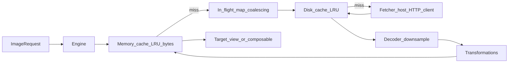

# 28 — Model Solution: Image Loading Library

## Timed outline (45–60 min)

| Min | Focus |
|-----|--------|
| 0–6 | Requirements: sources, transformations, caching, list performance, who integrates it |
| 6–14 | Public API: request builder, target binding, cancellation, config |
| 14–30 | Pipeline: memory cache → disk cache → network → decode → transform; request coalescing |
| 30–42 | Lists: cancellation on reuse, prefetch, downsampling, memory pressure |
| 42–55 | Failures, platform specifics, trade-offs, metrics |

## Clarify and scope

**Prompt:** "Design an image loading library (like Glide, Coil, Nuke or Kingfisher) that any team in the app can use."

| Question | Typical answer → design impact |
|----------|-------------------------------|
| Sources? | HTTP(S) URLs first; local files / content URIs / assets later |
| Formats? | JPEG, PNG, WebP, HEIF/AVIF where the OS decodes them; animated GIF/WebP as a stretch |
| Transformations? | Resize, crop, rounded corners, blur → part of the cache key |
| Where is it used? | Feeds and grids with fast scrolling → cancellation, prefetch and decode size matter most |
| Placeholders? | Placeholder, error image, blurhash / thumbhash previews |
| Custom networking? | Use the host's HTTP client (auth headers, proxies, pinning) |

**MVP:** load URL → bitmap into a view or composable; memory LRU + disk cache; downsample to target size; cancel on view reuse; coalesce duplicate requests; placeholder / error; prefetch API; memory-pressure trimming.

**Defer:** animated images, video frames, SVG, progressive JPEG, server-side image CDN negotiation (can be mentioned as a stretch).

## NFRs

- Main thread never blocked: decode and transform off the main thread
- Memory bounded in **bytes**, not item count; trims under pressure
- Scroll at 60/120 fps with images loading
- Disk cache bounded (e.g. 250 MB), survives restarts
- Library adds little size, no forced dependencies, never crashes the host

## Architecture



- **Engine:** owns queues, caches and the in-flight map; one per process (configurable).
- **Request:** data (URL + size + transformations + options) → **cache key**.
- **Target:** where the result goes; tracks its current request so reuse cancels the old one.

## Public API

```kotlin
// Android: builder + target extension, suspend for non-UI use
imageView.load(url) {
    size(ViewSizeResolver(imageView))    // decode to the view's pixel size
    transformations(RoundedCorners(12.dp))
    placeholder(R.drawable.ph); error(R.drawable.err)
}

val result: ImageResult = imageLoader.execute(ImageRequest(url, size = Size(256, 256)))

// Compose
AsyncImage(model = url, contentDescription = null, modifier = Modifier.size(96.dp))
```

```swift
// iOS: async/await core, view helpers on top
let image = try await pipeline.image(for: ImageRequest(url: url, processors: [.resize(width: 300)]))

imageView.loadImage(url, placeholder: .ph)            // UIKit: cancels previous request on reuse
LazyImage(url: url) { state in state.image?.resizable() }   // SwiftUI
```

Config: memory cache size (default ~15–25% of the app's memory class), disk size and location, HTTP client, decoder registry, logger.

## Data model

```text
ImageRequest: data(url|file|resource), targetSize, scale(fit|fill), transformations[], cachePolicy(memory/disk read/write), priority, headers?
CacheKey: hash(url + targetSize + transformations[].key)   // memory key
DiskKey: hash(url)   // original bytes; transformed results optionally cached separately
ImageResult: image, dataSource(memory|disk|network), request
```

**Two disk strategies:** cache the **original bytes** (one entry, decode per size; flexible) or also cache **transformed results** (fast for repeated thumbnails; more disk). Default: originals, plus transformed results for small thumbnails.

## Pipeline deep dive

1. **Memory check (main thread, O(1))**: hit → set immediately, no flicker, no placeholder.
2. **Coalescing:** if another request with the same key is in flight, attach to it instead of fetching again (in-flight map keyed by cache key; reference-counted so cancelling one waiter doesn't cancel the shared job until the last waiter leaves).
3. **Disk check (I/O queue).**
4. **Network fetch** with the host's client; honour `Cache-Control` / ETag for revalidation; write bytes to disk atomically (temp file + rename).
5. **Decode with downsampling:** read dimensions first, decode at the nearest power-of-two / exact target size. A 4000×3000 photo shown at 300×225 should never be decoded at full size (48 MB vs ~0.3 MB at 4 bytes/pixel).
6. **Transform** (crop, round, blur) on a CPU queue sized to cores.
7. **Store in memory cache and deliver** on the main thread, only if the target still wants this request.

## Lists and scrolling

- **Cancel on reuse:** each target holds its current request job; binding a new URL cancels the old one. Without this, fast scrolling shows the wrong image briefly and wastes bandwidth.
- **Prefetch** a few rows ahead (`RecyclerView` prefetcher / `UICollectionViewDataSourcePrefetching` / `onViewableItemsChanged`) at low priority; cancel when the user reverses.
- **Priorities:** visible > prefetch; the dispatcher reorders queued requests.
- **Stable sizes:** request size from the layout (or known aspect ratio from the API) so the cache key is stable and decode is right-sized.
- **Pause on fling** (optional): defer decode while the list flings fast, resume when it settles.

## Memory management

- Memory LRU sized in **bytes** (`bitmap.allocationByteCount`); evict least recently used.
- **Trim on pressure:** `onTrimMemory` / memory warning → clear or halve the memory cache.
- Bitmap pooling is mostly unnecessary on modern Android (hardware bitmaps, better GC) — say so if asked about Glide's pool.
- **Hardware bitmaps** (Android) keep pixels in GPU memory; can't be read back for transformations, so use software bitmaps when a transformation needs pixel access.

## Offline

- Disk cache serves offline; requests with `cachePolicy = cacheOnly` for offline mode.
- Pin user-requested downloads separately from the LRU cache (offline reading lists) so eviction doesn't remove them.

## Failures

| Failure | Handling |
|---------|----------|
| 404 / decode error | Error image; don't retry endlessly; cache negative result briefly |
| Timeout / no network | Retry once with backoff; serve stale disk copy if present |
| Corrupt disk entry | Delete entry, refetch |
| Disk full | Evict aggressively; continue memory-only |
| Huge image (OOM risk) | Downsample; cap max decode size; reject absurd dimensions |
| Target gone (view destroyed) | Cancel job via lifecycle; never hold the view strongly in the cache |

## Security & privacy

- Respect the host's TLS / pinning by using its HTTP client.
- Private images (DMs, documents): disable disk caching or encrypt; clear on logout.
- Strip EXIF location when re-encoding user uploads (upload path, not loading path).
- Don't log full signed URLs (they act as credentials).

## Platform implementation

| Concern | Android | iOS | Flutter | React Native |
|---------|---------|-----|---------|--------------|
| Existing libraries | Coil (Kotlin-first, coroutines), Glide | Nuke, Kingfisher, SDWebImage | `cached_network_image` + `flutter_cache_manager` | `expo-image` (SDWebImage / Glide underneath), FastImage |
| Decode with downsampling | `ImageDecoder` with `setTargetSize` / `BitmapFactory.Options.inSampleSize` | ImageIO `CGImageSourceCreateThumbnailAtIndex` with `kCGImageSourceThumbnailMaxPixelSize` | `ResizeImage` / `cacheWidth` | Native libraries decode to view size |
| Memory cache | `LruCache` sized in bytes | `NSCache` with `totalCostLimit` | `PaintingBinding.instance.imageCache` (`maximumSizeBytes`) | Native caches (not the JS heap) |
| Bind to view | View tag holds the job; cancel on reuse / detach | Associated object on `UIImageView` holds the task | Widget state disposes the stream | Native view prop change cancels the native request |
| Lifecycle | Cancel on `Lifecycle` destroy / view detach | Cancel when the cell is reused / view disappears | `dispose` | Component unmount |
| Memory pressure | `ComponentCallbacks2.onTrimMemory` | Memory warning notification | `didHaveMemoryPressure` | Native handlers clear caches |

**Flutter / React Native:** never decode images in Dart or JS. Let the engine (Flutter's image codecs) or native libraries (React Native) decode, and keep the caches out of the JS heap.

## Trade-offs

| Choice | Pros | Cons |
|--------|------|------|
| Cache originals on disk | One entry per URL, any size later | Decode cost on every miss in memory |
| Cache transformed results | Fast thumbnails | Disk usage, invalidation per variant |
| Hardware bitmaps | Less heap, faster draw | No pixel access for transformations |
| Coalescing | Fewer requests in grids with repeats | Ref-counting complexity |
| Use host HTTP client | Shared pool, auth, pinning | Library depends on host configuration |

## Metrics

- Memory / disk hit rate; time to first image per screen
- Bytes downloaded per session; duplicate fetches avoided by coalescing
- Decode time p95; images decoded larger than displayed (debug check)
- OOMs and scroll jank on image-heavy screens

## Staff stretch

- **Image CDN negotiation:** request `?w=300&fmt=avif` sized for the device; client sends size buckets to keep CDN cache hit rate high.
- **Blurhash / thumbhash** in API responses for instant placeholders.
- **Per-feature cache budgets** so one screen can't evict another's working set.
- Debug overlay showing data source (memory/disk/network) per image.

## Follow-ups

- How do you avoid showing the wrong image in a recycled cell?
- Why size the memory cache in bytes rather than entries?
- How would you support animated WebP without blowing memory?
- How does your cache key handle the same URL at different sizes?

## See also

- [Ch 09 — Media: images and video](../part-2-building-blocks/09-media-images-video.md)
- [Ch 07 — Caching and storage](../part-2-building-blocks/07-caching-and-storage.md)
- [Ch 14 — SDK and library design](../part-2-building-blocks/14-sdk-and-library-design.md)
- [Ch 18 — Social feed](../part-3-consumer-apps/18-social-feed.md)
