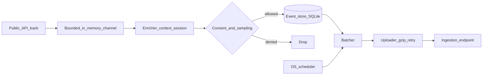

# 29 — Model Solution: Analytics SDK

## Timed outline (45–60 min)

| Min | Focus |
|-----|--------|
| 0–6 | Requirements: event types, volume, delivery guarantees, consent, who integrates |
| 6–14 | Public API: `track`, `identify`, `screen`, super-properties, consent |
| 14–30 | Pipeline: enrich → validate → persist → batch → upload with retries |
| 30–42 | Delivery semantics, dedupe, ordering, battery and data usage |
| 42–55 | Privacy, schema governance, platform specifics, metrics |

## Clarify and scope

**Prompt:** "Design an analytics library that every team in our app uses to log events."

| Question | Typical answer → design impact |
|----------|-------------------------------|
| Volume? | 100–2,000 events per active user per day → batching essential |
| Latency needed? | Minutes are fine for product analytics; seconds only for a few operational events |
| Delivery guarantee? | At-least-once with server-side dedupe by event id; small loss acceptable on uninstall |
| Consent? | Must respect GDPR/DPDP consent and opt-out before any upload |
| Schemas? | Typed events with a central registry; reject or flag unknown events in debug |
| Consumers? | Feature teams **and** shipped SDKs (namespaced events) |

**MVP:** typed `track(event)`, user identify/reset, automatic context (app version, OS, device, session), durable local queue, batched compressed upload with backoff, consent gating, sampling, debug view.

**Defer:** on-device aggregation, real-time streaming, A/B assignment (that's the flags SDK, Ch 34), session replay.

## NFRs

- `track()` is non-blocking and safe from any thread (< 0.1 ms on the caller)
- No event loss on process death once `track()` returns
- Battery and data: batch uploads (e.g. every 30–60 s in foreground, or 100 events, or on background), gzip
- Bounded disk (e.g. 10 MB / 10k events); oldest low-priority events dropped first
- Never crash or slow the host

## Architecture



## Public API

```kotlin
Analytics.initialize(context, AnalyticsConfig(writeKey = "...", flushInterval = 30.seconds))

Analytics.track(CheckoutStarted(cartValueMinor = 129900, currency = "INR", items = 3))
Analytics.screen("Cart")
Analytics.identify(userId = "u_123", traits = mapOf("plan" to "pro"))
Analytics.setConsent(Consent(analytics = true, marketing = false))
Analytics.reset()          // on logout: new anonymous id, clear user traits
Analytics.flush()          // e.g. before a known app exit point; still async
```

```swift
Analytics.configure(.init(writeKey: "...", flushInterval: .seconds(30)))
Analytics.track(CheckoutStarted(cartValueMinor: 129_900, currency: "INR", items: 3))
```

**Typed events** generated from a schema registry (one source of truth for name, properties, types, owner). Untyped `track(name, props)` exists for prototyping and is flagged in CI.

## Data model

```text
Event: eventId(UUIDv7), name, properties(JSON), timestamp(device ms), sessionId, sequence(per install),
       userId?, anonymousId, context{appVersion, os, osVersion, deviceModel, locale, networkType}, priority
Batch: batchId, events[], sentAt
Stored row: id, payload(blob), priority, attempts, createdAt
```

- **UUIDv7 event ids** sort by time and let the server dedupe retries.
- **Sequence number per install** lets the backend detect gaps (lost events) and order events with bad device clocks.
- **Clock skew:** send `sentAt` with the batch; the server computes `serverTime = receivedAt - (sentAt - timestamp)`.

## Pipeline deep dive

1. `track()` validates cheaply and pushes into a **bounded in-memory channel** (never blocks; drops with a counter if full — a sign of a bug).
2. A single background worker **enriches** (context, session, super-properties), applies **consent and sampling**, then **writes to SQLite** in small transactions.
3. **Batcher** triggers on: count ≥ N, age ≥ T, app going to background, or `flush()`.
4. **Uploader** reads a batch, gzips JSON (or protobuf), POSTs with the batch id; on **2xx** deletes rows; on **5xx / network** keeps rows and backs off with jitter; on **4xx** (bad payload) moves the batch to a dead-letter count and drops it, so one bad event can't block the queue forever.
5. **Server dedupes** by `eventId`, so a retry after a lost response doesn't double count.

## Sessions

- A session starts on first event after ≥ 30 min inactivity (configurable) or on cold start; `sessionId` attached to every event.
- Background time counts toward inactivity; foreground/background transitions emit lifecycle events.

## Battery and data

- Upload only on batch triggers; prefer unmetered networks for large backlogs.
- Background flush uses the OS scheduler (WorkManager with network constraint; on iOS a short `beginBackgroundTask` on backgrounding, then wait for next launch).
- Compress (gzip gives ~5–10× on JSON event batches).
- Cap retries per batch; respect `Retry-After` and server-side "slow down" signals (remote config can raise the flush interval).

## Offline

- Events persist; upload resumes when online.
- Disk cap: drop oldest **low-priority** events first; keep operational/critical ones; count drops and report them.

## Failures

| Failure | Handling |
|---------|----------|
| Process killed before flush | Events already in SQLite; next launch uploads them |
| Process killed before SQLite write | Small window (in-memory channel); accept or write synchronously for critical events |
| Duplicate upload (response lost) | Server dedupe by `eventId` |
| Malformed event | Rejected in debug builds; dropped and counted in release |
| Endpoint down for days | Disk cap + priority-based dropping |
| Bad SDK release floods events | Remote config: sampling rate, kill switch, flush interval |

## Security & privacy

- **Consent first:** no upload (and optionally no storage) until analytics consent; `setConsent` changes take effect immediately; opt-out deletes the queue.
- **No PII in properties:** schema registry marks fields; lint for emails/phone numbers; hash or drop.
- Anonymous id per install; `reset()` on logout; no advertising ids without ATT / declared purpose.
- Data residency: route to regional endpoints per config.
- Platform disclosures: Play data-safety form, iOS privacy manifest and nutrition labels must match what's collected.

## Platform implementation

| Concern | Android | iOS | Flutter | React Native |
|---------|---------|-----|---------|--------------|
| Durable queue | SQLite (Room) in SDK-private DB | SQLite (GRDB / raw) in Application Support | Native core's store, or `sqflite` if pure Dart | Native core's store, or op-sqlite |
| Background flush | WorkManager (network constraint, backoff) | `beginBackgroundTask` on resign active; flush on next launch | `workmanager` / native core | Native core |
| Lifecycle events | `ProcessLifecycleOwner` | `UIApplication` / `scenePhase` notifications | `AppLifecycleListener` | `AppState` |
| Screen tracking | Navigation `OnDestinationChangedListener` | View controller swizzling avoided — explicit `screen()` or SwiftUI modifier | `NavigatorObserver` / `go_router` observer | React Navigation `onStateChange` |
| Context | `Build`, `PackageInfo`, `ConnectivityManager` | `UIDevice`, `Bundle`, `NWPathMonitor` | `device_info_plus`, `package_info_plus` | `expo-device`, `expo-application` |
| Privacy declarations | Play data safety form | `PrivacyInfo.xcprivacy` (collected data, required-reason APIs like `UserDefaults`) | Both, via native layers | Both, via native layers |

**Cross-platform:** one native core per OS with a thin Dart / TS facade is safest (durable storage and background flush must be native). A pure-Dart / pure-JS implementation is acceptable if flushes only happen in the foreground and the queue is persisted on every write.

## Trade-offs

| Choice | Pros | Cons |
|--------|------|------|
| Persist every event | No loss on kill | Disk I/O per event (batch transactions help) |
| At-least-once + dedupe | Simple client, safe retries | Server dedupe store needed |
| Typed events from registry | Quality, discoverability | Codegen and governance overhead |
| Sampling on client | Saves battery/data | Must record sample rate for correct counts |
| JSON vs protobuf | JSON debuggable | Protobuf smaller, schema-enforced |

## Metrics

- Events tracked vs received (gap via sequence numbers); drop counts by reason
- Delivery latency p50/p95; queue depth on launch
- Upload bytes per user per day; battery attribution
- Schema violations per release

## Staff stretch

- **Schema registry + CI checks** for event changes; ownership per event.
- **On-device aggregation** for high-frequency signals (scroll depth, frame drops) to cut volume.
- **Remote control:** per-event sampling and kill switches from config.
- Differential privacy or k-anonymity for sensitive aggregates.

## Follow-ups

- How do you guarantee no double counting when a response is lost?
- What happens to events tracked before consent is given?
- How do you order events when the device clock is wrong?
- How would you keep the SDK from draining battery in a background-heavy app?

## See also

- [Ch 13 — Observability and quality](../part-2-building-blocks/13-observability-and-quality.md)
- [Ch 14 — SDK and library design](../part-2-building-blocks/14-sdk-and-library-design.md)
- [Ch 34 — Feature flags](34-feature-flag-library.md)
