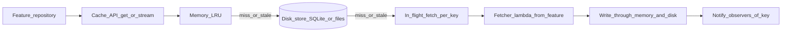

# 30 — Model Solution: App Caching Library

## Timed outline (45–60 min)

| Min | Focus |
|-----|--------|
| 0–6 | Requirements: what is cached, freshness rules, who uses it, offline |
| 6–14 | Public API: typed keys, `get` / `stream` with policies, invalidate |
| 14–30 | Layers: memory + disk, TTL, stale-while-revalidate, request coalescing |
| 30–42 | Eviction, size accounting, consistency, user scoping and logout |
| 42–55 | Failures, platform specifics, trade-offs, metrics |

## Clarify and scope

**Prompt:** "Design a caching library that feature teams use to cache API responses and computed data."

| Question | Typical answer → design impact |
|----------|-------------------------------|
| What's cached? | API responses (JSON → models), small computed results; not images (Ch 28) |
| Freshness? | Per-key TTL; stale-while-revalidate for lists; never stale for money (fetch-on-open) |
| Persistence? | Memory always; disk optional per namespace |
| Scope? | Per user — must clear on logout / account switch |
| Reactive? | Screens observe a key and update when it refreshes |
| Size? | Bounded per namespace; e.g. 20 MB disk total |

**MVP:** typed cache keys, memory + disk layers, per-entry TTL, fetch policies (cache-first, network-first, stale-while-revalidate, cache-only, network-only), coalesced fetches, observe a key, invalidate by key/prefix/tag, user scoping, size-bounded LRU.

**Defer:** normalized entity cache (GraphQL-style), cross-device sync, encryption per entry (mention for sensitive namespaces).

## NFRs

- Memory `get` O(1) on the caller's thread; disk work off the main thread
- Correct under concurrency: one fetch per key at a time
- Bounded memory and disk; survives restarts
- Zero data leak across users

## Architecture



## Public API

```kotlin
val userCache = cache.namespace("profile", Serializer.json<Profile>(),
    defaultTtl = 10.minutes, persistence = Persistence.Disk)

// One-shot with policy
val profile: Profile = userCache.get(
    key = CacheKey("user", userId),
    policy = FetchPolicy.StaleWhileRevalidate,
    fetch = { api.profile(userId) },
)

// Observe: emits cached value immediately, then fresh value when it arrives
userCache.stream(CacheKey("user", userId), FetchPolicy.StaleWhileRevalidate) { api.profile(userId) }
    .collect { state -> render(state) }   // CacheState(value, isStale, isRefreshing, error)

userCache.invalidate(CacheKey("user", userId))
cache.invalidateTag("feed")               // e.g. after posting
cache.clearUserScope()                    // on logout
```

```swift
let profiles = cache.namespace("profile", ttl: .seconds(600), persistence: .disk, as: Profile.self)
for await state in profiles.stream(.init("user", userID), policy: .staleWhileRevalidate, fetch: { try await api.profile(userID) }) {
    render(state)
}
```

## Data model

```text
Entry: namespace, key, userScope, value(blob), sizeBytes, createdAt, expiresAt, etag?, tags[], lastAccessAt
Index: (namespace, userScope, key) primary; expiresAt; lastAccessAt for LRU; tags table for tag invalidation
```

## Fetch policies

| Policy | Behaviour | Use for |
|--------|-----------|---------|
| Cache-first | Return fresh cached value; fetch only on miss/expired | Config, reference data |
| Network-first | Try network; fall back to cache on failure | Data that must be current but has an offline fallback |
| Stale-while-revalidate | Return cached (even if stale) immediately, refresh in background, emit the update | Feeds, profiles |
| Cache-only | Never touch network | Offline mode |
| Network-only (no store) | Bypass cache | Balances, payment status |

## Consistency details

- **Coalescing:** an in-flight map per key so ten screens asking for the same profile cause one request; late joiners get the same result.
- **ETag revalidation:** store `etag`; refresh with `If-None-Match`; a `304` only updates `expiresAt`.
- **Write-through after mutations:** after a successful `PATCH /profile`, write the response into the cache (and invalidate related tags) so other screens update.
- **Race:** a slow older response must not overwrite a newer one → store a version / fetch timestamp and keep the newest.

## Eviction and size

- Memory LRU in bytes per namespace; disk LRU by `lastAccessAt` with a global cap and per-namespace caps.
- Expired entries purged lazily on read and in a periodic background sweep (WorkManager / on launch).
- Memory pressure → drop the memory layer; disk stays.

## User scoping

- Every entry stores `userScope` (user id or "anonymous"). Reads filter by the current scope.
- **Logout:** `clearUserScope()` deletes the user's entries (memory + disk) before showing the logged-out UI.
- Account switching: keys never collide because scope is part of the primary key.

## Offline

- Policies decide: SWR and cache-first serve stale data with an `isStale` flag the UI can show ("Updated 2 h ago").
- Network-only namespaces show a clear offline error rather than stale data.

## Failures

| Failure | Handling |
|---------|----------|
| Fetch error with cached value | Keep cached, emit error state alongside value |
| Deserialization failure after app update | Treat as miss, delete entry; version the serializer per namespace |
| Disk full / DB corruption | Fall back to memory-only; recreate the store |
| Observer leak | Streams tied to lifecycle/task cancellation |

## Security & privacy

- Sensitive namespaces encrypted at rest (key in Keystore/Keychain) or memory-only.
- Never cache auth tokens here (they belong in secure storage, Ch 32).
- Clear on logout; exclude from backups on iOS.

## Platform implementation

| Concern | Android | iOS | Flutter | React Native |
|---------|---------|-----|---------|--------------|
| Disk store | SQLite / Room or files + index | SQLite (GRDB) or files in `Caches` / `Application Support` | drift / sqflite or `hive` | op-sqlite / MMKV for small entries |
| Memory layer | `LruCache` | `NSCache` (cost-based) | `Map` LRU in the main isolate | JS `Map` LRU (or rely on TanStack Query's cache) |
| Observe | `Flow<CacheState<T>>` | `AsyncStream<CacheState<T>>` | `Stream<CacheState<T>>` | Subscription / TanStack Query `useQuery` |
| Coalescing | `Mutex` + `Deferred` per key | `actor` holding `Task` per key | `Completer` per key | Shared `Promise` per key |
| Existing tools | OkHttp cache (HTTP level), Store (Dropbox) | `URLCache` (HTTP level) | `dio_cache_interceptor` | TanStack Query (memory + persisters) |

**React Native note:** TanStack Query already implements SWR, coalescing and invalidation in memory; pair it with a persister (MMKV / SQLite) rather than writing a cache from scratch — and say that in the interview.

## Trade-offs

| Choice | Pros | Cons |
|--------|------|------|
| HTTP-level cache only | Free, standards-based | No typed observe, weak offline control |
| App-level typed cache | Policies per feature, observe, user scope | More code to own |
| Normalized entity cache | One update fixes every screen | Complex; usually only with GraphQL |
| SWR by default | Instant UI | Shows stale data; needs UI affordance |

## Metrics

- Hit rate per namespace (memory/disk); stale serves; coalesced requests saved
- Time-to-content on cached screens
- Disk usage per namespace; evictions; deserialization failures after releases

## Staff stretch

- Per-namespace config served remotely (TTL changes without a release).
- Prefetch on Wi-Fi + charging for offline-heavy features.
- Cache warming at login for the first screen.

## Follow-ups

- How do you stop two screens from triggering the same request?
- What exactly happens on logout?
- Why not just use the HTTP cache?
- Which data must never be served stale?

## See also

- [Ch 07 — Caching and storage](../part-2-building-blocks/07-caching-and-storage.md)
- [Ch 31 — Data sync library](31-data-sync-library.md)
- [Ch 14 — SDK and library design](../part-2-building-blocks/14-sdk-and-library-design.md)
