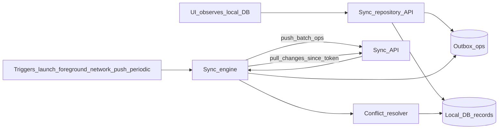

# 31 — Model Solution: Data Sync Library

## Timed outline (45–60 min)

| Min | Focus |
|-----|--------|
| 0–6 | Requirements: entities, offline writes, conflicts, multi-device, scale per user |
| 6–14 | Public API: local-first repository, observe, mutate, sync status |
| 14–30 | Outbox (push) + delta pull with change tokens; ordering and idempotency |
| 30–42 | Conflict resolution, schema migrations, triggers and scheduling |
| 42–55 | Failures, platform specifics, trade-offs, metrics |

## Clarify and scope

**Prompt:** "Design a library that keeps local data in sync with the server for apps that must work offline (notes, tasks, CRM records)."

| Question | Typical answer → design impact |
|----------|-------------------------------|
| Data shape? | Records (tasks, notes) with ids, owned by a user/workspace; attachments separate |
| Offline writes? | Yes: create, edit, delete offline → outbox |
| Multi-device? | Yes → changes from other devices must arrive; conflicts possible |
| Conflict policy? | Field-level last-writer-wins by default; custom resolver per entity; CRDT only for collaborative text (stretch) |
| Data size per user? | 10k–100k records → delta sync, not full download |
| Latency? | Seconds while foreground (push nudge or socket); minutes otherwise |

**MVP:** local DB as the source for UI; mutation API that writes locally + enqueues to an outbox; push loop with idempotent operations; pull loop with a server change token returning upserts + tombstones; conflict resolution hooks; sync status; triggers (launch, foreground, connectivity, push nudge, periodic).

**Defer:** CRDT text merging, peer-to-peer sync, end-to-end encryption, partial replication rules UI.

## NFRs

- UI never waits for network; reads are local
- No lost writes: once `mutate` returns, the change survives process death
- Idempotent replays; at-least-once delivery
- Bounded battery: batch pushes/pulls; respect OS background limits
- Correct after app upgrades (schema migrations)

## Architecture



## Public API

```kotlin
val tasks = sync.collection<Task>("tasks", TaskSchema)

tasks.observe(query = Query.where("listId", listId).orderBy("position"))   // Flow<List<Task>>
tasks.upsert(task.copy(title = "Buy milk"))     // local write + outbox op, returns immediately
tasks.delete(taskId)                            // tombstone locally + outbox op

sync.status: StateFlow<SyncStatus>              // Idle, Syncing, Offline, Error(code), pendingCount
sync.requestSync(reason = SyncReason.UserPull)  // pull-to-refresh
sync.registerResolver<Task>(TaskResolver())     // optional custom merge
```

```swift
let tasks = sync.collection("tasks", of: Task.self)
for await list in tasks.observe(.where(\.listID, equals: listID)) { render(list) }
try await tasks.upsert(task)
```

## Data model

```text
Record row: id(UUID, client-generated), fields..., version(server), updatedAt(server), dirtyFields[], deleted(bool)
OutboxOp: opId(UUID), entity, recordId, kind(create|update|delete), patch(JSON of changed fields), baseVersion, createdAt, attempts
SyncState: collection, changeToken, lastPullAt, lastPushAt
```

- **Client-generated UUIDs** so records can be created offline and referenced immediately.
- **Patches, not whole records:** field-level changes merge better and are smaller.
- **`baseVersion`** = the server version the client edited from → server can detect conflicts.

## Push loop (outbox)

1. Read up to N ops in creation order; **coalesce** consecutive updates to the same record (and drop create+delete pairs that never reached the server).
2. POST `/sync/push` with ops; each op carries `opId` (idempotency) and `baseVersion`.
3. Server applies each op atomically and returns per-op results: `applied(newVersion)`, `conflict(serverRecord)`, or `rejected(code)`.
4. Client marks applied ops done, clears `dirtyFields` that weren't changed again meanwhile, runs the resolver for conflicts, surfaces rejections (permission revoked, validation).
5. Retry with exponential backoff + jitter on network/5xx; replays are safe because the server dedupes `opId`.

## Pull loop (deltas)

1. `GET /sync/pull?collection=tasks&since=<token>&limit=500`
2. Response: `{ upserts: [...], tombstones: [ids], nextToken, hasMore }`.
3. Apply in one transaction: for each upsert, if the local record has **dirty fields**, merge (local dirty fields win until pushed, or run the resolver); otherwise overwrite. Apply tombstones (delete locally unless there's a pending local edit → conflict rule).
4. Save `nextToken` in the **same transaction** as the data, so a crash can't skip or double-apply a page.
5. Loop while `hasMore`.

**Order per sync:** push first, then pull — so the pull reflects our own changes and conflicts are resolved server-side first.

## Conflict resolution

| Strategy | When |
|----------|------|
| Field-level last-writer-wins (server timestamp) | Default for most records |
| Server wins | Permissions, server-computed fields, money |
| Client wins (while dirty) | User's in-progress edits |
| Custom merge (resolver) | Lists with positions, counters, sets (union) |
| CRDT / OT | Collaborative rich text (stretch) |
| Ask the user | Rare, high-value documents: keep both copies ("conflicted copy") |

Never use **device clocks** for ordering; use server versions / timestamps.

## Triggers and scheduling

- App launch and foreground; connectivity regained; after local mutations (debounced, e.g. 2 s); push nudge ("collection changed"); pull-to-refresh; periodic background.
- One engine run at a time (mutex); triggers during a run set a "run again" flag.

## Schema evolution

- Local migrations versioned with the app; unknown server fields preserved (store raw JSON) so older clients don't drop newer data when they write back.
- Server supports old clients' push formats for N versions; `minClientVersion` for breaking changes.

## Failures

| Failure | Handling |
|---------|----------|
| Kill mid-push | Ops remain; replay is idempotent |
| Kill mid-pull | Token saved with data in one transaction; resume from last token |
| Token expired (server compacted history) | Server returns `resetRequired` → full re-download while keeping dirty local records |
| Permanent rejection | Mark op failed, surface in UI, don't block the rest of the queue |
| Huge backlog after weeks offline | Paged push/pull, progress UI, Wi-Fi preference for attachments |

## Security & privacy

- Auth per request; workspace/tenant scoping enforced server-side.
- Local DB encrypted for sensitive apps (SQLCipher / Data Protection).
- Logout clears DB, outbox and tokens; warn if unsynced changes would be lost.

## Platform implementation

| Concern | Android | iOS | Flutter | React Native |
|---------|---------|-----|---------|--------------|
| Local DB + observe | Room + `Flow` | GRDB `ValueObservation` / SwiftData `@Query` | drift `watch()` | WatermelonDB observables / op-sqlite reactive queries |
| Background sync | WorkManager periodic + one-time with network constraint | Foreground-first; `BGAppRefreshTask` / `BGProcessingTask`; silent push nudge | `workmanager` + foreground triggers | `expo-background-task` + foreground triggers |
| Push nudge | FCM data message → enqueue expedited work | Silent push (best effort) | `firebase_messaging` background handler | RN Firebase background handler |
| Connectivity trigger | `ConnectivityManager.NetworkCallback` | `NWPathMonitor` | `connectivity_plus` | NetInfo |
| Existing options | Custom; Firebase/Realm-style SDKs | CloudKit (Apple users only), custom | PowerSync, Firestore offline | WatermelonDB sync protocol, PowerSync |

**Cross-platform:** the sync engine can live in shared code (Dart / TS / Kotlin Multiplatform) because it runs in the foreground; only the background trigger needs native APIs. KMP is a strong option to share one engine between native iOS and Android apps.

## Trade-offs

| Choice | Pros | Cons |
|--------|------|------|
| Outbox of patches | Small, mergeable, idempotent | Coalescing logic |
| Change tokens | Cheap deltas, resumable | Server keeps a change log; compaction → resets |
| Field-level LWW | Simple, usually right | Loses concurrent edits to the same field |
| CRDTs | Automatic merges | Metadata size, complexity |
| Vendor sync SDK | Fast to ship | Lock-in, less control over conflicts |

## Metrics

- Pending ops count and age p95; sync success rate; conflicts per 1k ops
- Time from local edit to server ack; time for other devices to see it
- Reset-required rate; data volume per sync

## Staff stretch

- Partial replication (sync only recent / pinned workspaces).
- Attachment sync as a separate transfer queue (Ch 36) referenced by record id.
- Realtime channel (Ch 10) to replace polling while foreground.

## Follow-ups

- Why push before pull?
- How do you make sure a crash mid-pull doesn't skip changes?
- What happens when the same field is edited on two devices offline?
- How do older app versions avoid deleting fields they don't know about?

## See also

- [Ch 08 — Offline and sync](../part-2-building-blocks/08-offline-and-sync.md)
- [Ch 22 — Offline notes](../part-3-consumer-apps/22-offline-notes.md)
- [Ch 30 — Caching library](30-caching-library.md)
- [Ch 17 — Backend for mobile](../part-2-building-blocks/17-backend-for-mobile.md)
