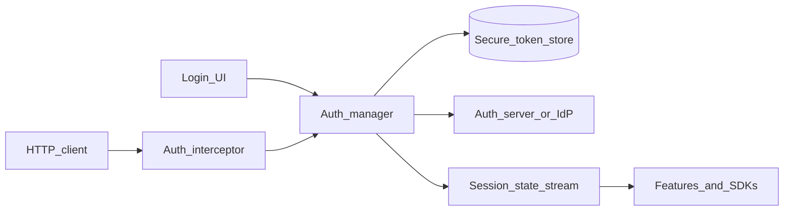
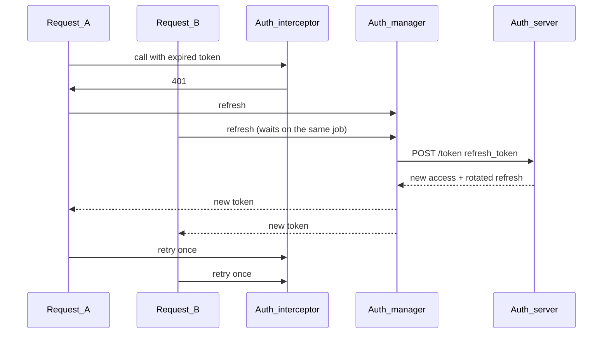

# 32 — Model Solution: Authentication Module

## Timed outline (45–60 min)

| Min | Focus |
|-----|--------|
| 0–6 | Requirements: login methods, session length, multi-account, who consumes the module |
| 6–14 | Public API: session state, login flows, token access for networking, logout |
| 14–30 | Token lifecycle: storage, single-flight refresh, expiry, revocation |
| 30–42 | OAuth / OIDC with PKCE, social login, passkeys, biometric unlock |
| 42–55 | Failures, security, platform specifics, metrics |

## Clarify and scope

**Prompt:** "Design an authentication module that the rest of the app (and our SDKs) use to log users in and make authenticated calls."

| Question | Typical answer → design impact |
|----------|-------------------------------|
| Login methods? | Email/password + OTP, Google / Apple sign-in, passkeys; enterprise SSO (OIDC) later |
| Token model? | Short-lived access token (5–15 min) + long-lived refresh token (rotating) |
| Session length? | 30–90 days for consumer; shorter for fintech + biometric unlock |
| Multi-account? | Nice to have → design storage keyed by account |
| Consumers? | Networking layer (attach tokens), features (who is logged in), SDKs (scoped tokens) |

**MVP:** observable session state; login with password/OTP and OAuth (PKCE) providers; secure token storage; automatic access-token attach + single-flight refresh; logout everywhere locally + server revoke; biometric app unlock option.

**Defer:** multi-account switching UI, enterprise SSO admin, step-up auth (Ch 47), device binding details (Ch 44).

## NFRs

- Tokens never in plain storage, logs or analytics
- Exactly one refresh in flight; no stampede of 401s
- Works after process death and app upgrade
- Logout is immediate and complete (memory, disk, caches, push token unlinked)

## Architecture



## Public API

```kotlin
interface Auth {
    val session: StateFlow<Session>          // SignedOut | SignedIn(user, scopes) | Expired | Locked
    suspend fun signInWithPassword(email: String, password: String): AuthResult
    suspend fun signInWithProvider(activity: Activity, provider: Provider): AuthResult   // Google, Apple, OIDC
    suspend fun signInWithPasskey(activity: Activity): AuthResult
    suspend fun accessToken(forceRefresh: Boolean = false): String?   // used by the networking layer
    suspend fun signOut(everywhere: Boolean = false)
}
```

```swift
public protocol Auth: Sendable {
    var session: AsyncStream<Session> { get }
    func signIn(provider: Provider, presentationAnchor: ASPresentationAnchor) async throws(AuthError) -> User
    func accessToken(forceRefresh: Bool) async throws(AuthError) -> String
    func signOut(everywhere: Bool) async
}
```

Features observe `session`; they never read tokens. Only the networking layer calls `accessToken()`.

## Token lifecycle



- **Proactive refresh** shortly before expiry (from `expires_in`), plus **reactive** on 401.
- **Single-flight:** a mutex / actor holds the in-flight refresh; waiters share the result.
- **Retry once** per request after refresh; a second 401 → session `Expired` → login UI.
- **Rotation:** each refresh returns a new refresh token; persist it **before** using the new access token. Reuse of an old refresh token signals theft → server revokes the family.
- **Revocation:** server can kill sessions (password change, fraud) → next refresh fails → client signs out cleanly.

## OAuth / OIDC on mobile

- **Authorization Code + PKCE**, opened in the **system browser session** (`ASWebAuthenticationSession`, Custom Tabs), never in an embedded WebView (credentials theft, blocked by Google).
- Redirect via claimed HTTPS links (Universal / App Links) preferred over custom schemes.
- Validate `state` and `nonce`; exchange the code on your backend or with PKCE on device.
- **Sign in with Apple** is required on iOS if you offer other third-party social logins (App Store guideline 4.8, with exceptions).
- **Passkeys** (Ch 58) through Credential Manager / AuthenticationServices: phishing-resistant, no shared secret.

## Biometric unlock

- Biometrics **unlock a local key**, they don't authenticate to the server. Store the refresh token encrypted with a key that requires user authentication (Keystore `setUserAuthenticationRequired`, Keychain `.biometryCurrentSet`).
- Re-enrolled biometrics invalidate the key → fall back to full login.
- Lock after N minutes in background (configurable per app risk).

## Logout

1. Mark session `SignedOut` immediately (UI reacts).
2. Revoke refresh token server-side (best effort, retried later if offline).
3. Delete tokens from secure storage; clear user-scoped caches (Ch 30), DBs, analytics user id, unlink push token.
4. Cancel in-flight user requests.

## Failures

| Failure | Handling |
|---------|----------|
| Refresh fails with network error | Keep session, retry with backoff; don't log out offline users |
| Refresh rejected (invalid_grant) | Sign out, explain "Session expired" |
| Clock skew makes token look expired | Use `expires_in` relative to receipt time, not device clock vs `exp` |
| Keychain item unavailable before first unlock (iOS) | Use `AfterFirstUnlock` accessibility for background refresh needs |
| Keystore key lost after OS update / restore | Treat as signed out; re-login |
| Browser login abandoned | Return `Cancelled` result; no state change |

## Security & privacy

- Tokens only in Keystore-/Keychain-protected storage; access token can live in memory only.
- Pin TLS for auth endpoints where operationally safe; no tokens in URLs or logs.
- Device binding / attestation for high-risk apps (Ch 44); rate limits and lockouts server-side.
- Logout on all devices available to the user; show active sessions.

## Platform implementation

| Concern | Android | iOS | Flutter | React Native |
|---------|---------|-----|---------|--------------|
| Token storage | Keystore-encrypted file / DataStore (Tink) | Keychain (`kSecClassGenericPassword`, `AfterFirstUnlockThisDeviceOnly`) | `flutter_secure_storage` | `react-native-keychain` / `expo-secure-store` |
| Interceptor + refresh | OkHttp `Authenticator` + `Interceptor`, `Mutex` | `actor TokenRefresher` around `URLSession` | `dio` `QueuedInterceptor` | axios interceptor with a shared refresh promise |
| Browser OAuth | Custom Tabs via AppAuth / Credential Manager for Google | `ASWebAuthenticationSession` | `flutter_appauth` | `react-native-app-auth` / `expo-auth-session` |
| Google / Apple sign-in | Credential Manager (Sign in with Google) | Sign in with Apple (`ASAuthorizationAppleIDProvider`), Google SDK | `google_sign_in`, `sign_in_with_apple` | `@react-native-google-signin`, `expo-apple-authentication` |
| Passkeys | Credential Manager | AuthenticationServices | Passkey plugins | `react-native-passkey` |
| Biometric-bound key | `BiometricPrompt` + `CryptoObject` | LocalAuthentication + access control flags | `local_auth` + native key | Native module |

## Trade-offs

| Choice | Pros | Cons |
|--------|------|------|
| Short access + rotating refresh | Limits stolen-token window, theft detection | More refresh traffic, rotation edge cases |
| Refresh token on device vs BFF session cookie | Simple API calls | Token handling on device |
| Biometric-locked refresh token | Strong local protection | Background refresh impossible while locked |
| Proactive refresh | Fewer 401s | Wasted refreshes when the app backgrounds |

## Metrics

- Login success rate by method; time to log in
- Refresh success rate; 401-after-refresh rate; forced logouts per day
- Refresh-token reuse detections (security signal)

## Staff stretch

- Multi-account with per-account token stores and scoped caches.
- Token exchange for SDKs (narrow scopes per SDK).
- Continuous session evaluation (risk signals → step-up).

## Follow-ups

- Five requests get 401 at once. What happens?
- Why not a WebView for Google login?
- How do biometrics fit with refresh tokens?
- What exactly is cleared on logout?

## See also

- [Ch 12 — Security and privacy](../part-2-building-blocks/12-security-and-privacy.md)
- [Ch 44 — Secure auth and device binding](../part-5-fintech/44-secure-auth-device-binding.md)
- [Ch 58 — Passkeys](../part-5-fintech/58-passkeys-webauthn.md)
- [Ch 06 — Networking and APIs](../part-2-building-blocks/06-networking-and-apis.md)
