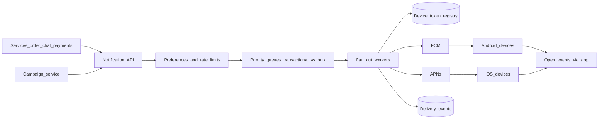

# 33 — Model Solution: Push Notification System

## Timed outline (45–60 min)

| Min | Focus |
|-----|--------|
| 0–6 | Requirements: notification types, volume, targeting, latency, opt-in |
| 6–15 | Client: permission, token lifecycle, receiving, display, tap routing |
| 15–30 | Server: token registry, send API, fan-out workers, FCM / APNs gateways |
| 30–42 | Reliability, dedupe, rate limits, quiet hours, rich content |
| 42–55 | Analytics, failures, platform specifics, trade-offs |

## Clarify and scope

**Prompt:** "Design a push notification system for our app: the client library and the backend that sends notifications."

| Question | Typical answer → design impact |
|----------|-------------------------------|
| Types? | Transactional (message, order update, payment) and marketing campaigns |
| Volume? | Transactional: millions/day, latency seconds; campaigns: tens of millions in a window |
| Targeting? | User id → all devices; segments for campaigns |
| Rich content? | Images, actions (reply, mark read), grouping |
| User control? | Per-category preferences, quiet hours, OS permission |
| Silent data pushes? | Yes for sync nudges — best effort |

**MVP:** permission flow, token registration and refresh, per-user device registry, send API with idempotency, fan-out workers to FCM / APNs, preference + quiet-hours filtering, notification categories/channels, deep-link routing on tap, delivery and open analytics, invalid token cleanup.

**Defer:** campaign builder UI, ML send-time optimization, in-app message inbox (mention as complement).

## NFRs

- Transactional p95 send latency < 5 s from event to provider
- At-least-once to the provider, de-duplicated on device by notification id
- No sends to opted-out users; quiet hours respected
- Scales to campaign bursts without hurting transactional traffic

## Architecture



## Client: permission and tokens

- **Ask in context**, not on first launch: after a user action that benefits ("Get notified when your order ships?"). Android 13+ and iOS both need explicit permission; iOS also supports **provisional** (quiet) authorization.
- **Token registration:** on every launch, get the current token and send `(userId, installationId, platform, token, appVersion, locale, timezone, permission state)` to the registry if changed. Tokens rotate (reinstall, restore, OS refresh) → handle `onNewToken` / `didRegisterForRemoteNotificationsWithDeviceToken`.
- **Logout:** unlink the installation from the user (don't delete the token; anonymous pushes may continue if allowed).

## Client: receiving and display

| Case | Android | iOS |
|------|---------|-----|
| App in foreground | `onMessageReceived` → show in-app banner or notification | `willPresent` → choose banner/sound or in-app UI |
| App in background, notification message | System shows it | System shows alert |
| Need to modify content (decrypt, image) | Data message → build notification yourself | Notification Service Extension (`mutable-content: 1`) |
| Silent data push | High-priority data message wakes the app (limited quota) | `content-available: 1` background push, throttled, ~30 s |
| Tap | `PendingIntent` with deep link → router | `didReceive response` → router |

- **Channels / categories:** Android notification channels per type (users can mute "Promotions" but keep "Orders"); iOS categories with actions and `interruptionLevel` (`timeSensitive` for deliveries, needs entitlement for critical).
- **Grouping / threads:** `setGroup` / `threadIdentifier` per conversation or order.
- **Dedupe on device:** stable notification id/tag (`orderId:status`) → a retry replaces rather than duplicates.

## Server: token registry

```text
Installation: installationId, userId?, platform(android|ios|web), token, appVersion, locale, timezone,
              permission(granted|denied|provisional), lastSeenAt, createdAt
Preference: userId, category, enabled, quietHours{start,end,tz}
```

- Index by `userId` for transactional fan-out; by segment attributes for campaigns.
- **Invalid tokens:** FCM `UNREGISTERED` / APNs `410 Unregistered` → mark inactive. Also expire installations not seen for ~60–90 days.

## Server: send path

1. Producer calls `POST /notifications` with `idempotencyKey`, `userId(s)` or segment, `category`, template id + params, priority, `collapseKey`, TTL.
2. API checks preferences, quiet hours (defer to window end), per-user rate limits (e.g. ≤ N marketing/day), dedupe by key.
3. Enqueue into **separate queues** for transactional vs bulk so campaigns can't delay a payment alert.
4. Workers resolve devices, render localized content per device locale, call providers (HTTP/2, persistent connections, batching where supported), record results.
5. Retries with backoff for provider 5xx / throttling; drop on permanent errors.

**Campaign bursts:** pace sends (e.g. over 10–30 min) to protect your own backend from the wave of app opens, and stagger by timezone.

## Rich content and actions

- Images via NSE (iOS) / `BigPictureStyle` (Android); keep payload small (4 KB limit on both), fetch media by URL.
- Actions: reply inline, mark read, track order. Action handling must work from a cold start (app may not be running).
- Live progress: Live Activities (iOS, ActivityKit push updates) and progress-style ongoing notifications (Android).

## Delivery semantics and analytics

- Providers are best effort; you can't confirm display server-side except via client signals.
- Track: sent, provider-accepted, delivered (client receipt where possible, e.g. NSE / `onMessageReceived` ping), opened (tap), dismissed (Android delete intent), conversions.
- Attribute opens by notification id in the deep link.

## Failures

| Failure | Handling |
|---------|----------|
| Provider outage / throttling | Backoff, queue grows; transactional queue prioritized; alert |
| Stale tokens | Cleanup on provider feedback + inactivity expiry |
| Duplicate sends (retry after timeout) | Idempotency key server-side; same notification tag on device |
| User force-quit iOS app | Silent pushes not delivered; alert pushes still shown |
| Payload too large | Validate at API; send ids, fetch details in app/NSE |
| Wrong user after logout | Unlink installation on logout before clearing session |

## Security & privacy

- Sensitive content (messages, amounts): send minimal text or encrypted payload decrypted in NSE / app; respect "hide previews".
- Signed deep links; app re-fetches state rather than trusting payload values (Ch 10 rule: push is a hint).
- Provider credentials (FCM service account, APNs auth key) in a secrets manager; rotate.
- Honour opt-outs and regional marketing consent rules.

## Platform implementation

| Concern | Android | iOS | Flutter | React Native |
|---------|---------|-----|---------|--------------|
| Provider SDK | Firebase Messaging | APNs via `UNUserNotificationCenter` (or Firebase wrapping APNs) | `firebase_messaging` | `@react-native-firebase/messaging`, `expo-notifications` |
| Permission | `POST_NOTIFICATIONS` (Android 13+) | `requestAuthorization(options:)`, provisional | `requestPermission()` | `requestPermission()` / `requestPermissionsAsync()` |
| Categories | `NotificationChannel` per category | `UNNotificationCategory` + actions, interruption levels | `flutter_local_notifications` channels/categories | `notifee` / `expo-notifications` channels/categories |
| Modify before display | Data message + local notification | Notification Service Extension target | Native NSE target + Dart for Android | Native NSE target (config plugin) + JS/native for Android |
| Tap routing | `PendingIntent` deep link → Navigation | `UNUserNotificationCenterDelegate.didReceive` → router | `onMessageOpenedApp`, `getInitialMessage` | `onNotificationOpenedApp`, `getInitialNotification` |
| Background handler | `FirebaseMessagingService` | `application(_:didReceiveRemoteNotification:fetchCompletionHandler:)` | Top-level background handler (headless isolate) | `setBackgroundMessageHandler` (headless JS) |

## Trade-offs

| Choice | Pros | Cons |
|--------|------|------|
| FCM for both platforms | One API | Extra hop/abstraction for iOS; still need APNs config |
| Direct APNs + FCM | Full control (priority, Live Activities) | Two integrations |
| Data-only messages on Android | Full control of display, dedupe, decrypt | Must handle display yourself; background limits |
| Separate transactional queue | Latency isolation | More infrastructure |

## Metrics

- Send latency p95; provider error rates; invalid-token rate
- Opt-in rate by prompt placement; opt-outs per category
- Open rate, time to open, conversion; notifications per user per day

## Staff stretch

- In-app inbox as the durable record (push may be missed).
- Send-time optimization and frequency capping per user.
- Web push and email fallback through the same pipeline.

## Follow-ups

- How do you avoid a campaign delaying OTP or payment notifications?
- What happens when the user reinstalls the app?
- How do you show an encrypted message preview on iOS?
- Why shouldn't the app trust the amount inside a push payload?

## See also

- [Ch 10 — Realtime and push](../part-2-building-blocks/10-realtime-and-push.md)
- [Ch 17 — Backend for mobile](../part-2-building-blocks/17-backend-for-mobile.md)
- [Ch 19 — Messaging / chat](../part-3-consumer-apps/19-messaging-chat.md)
